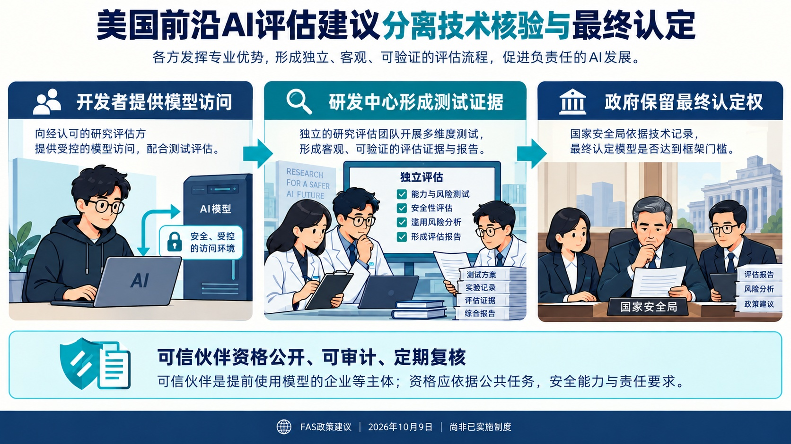
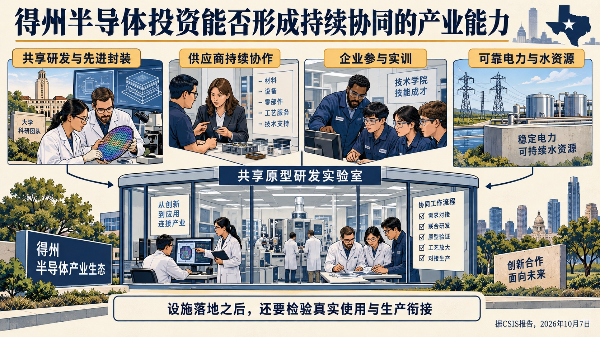
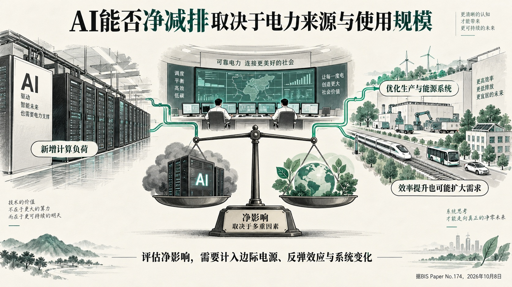
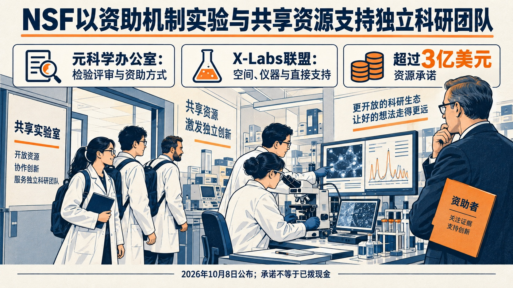
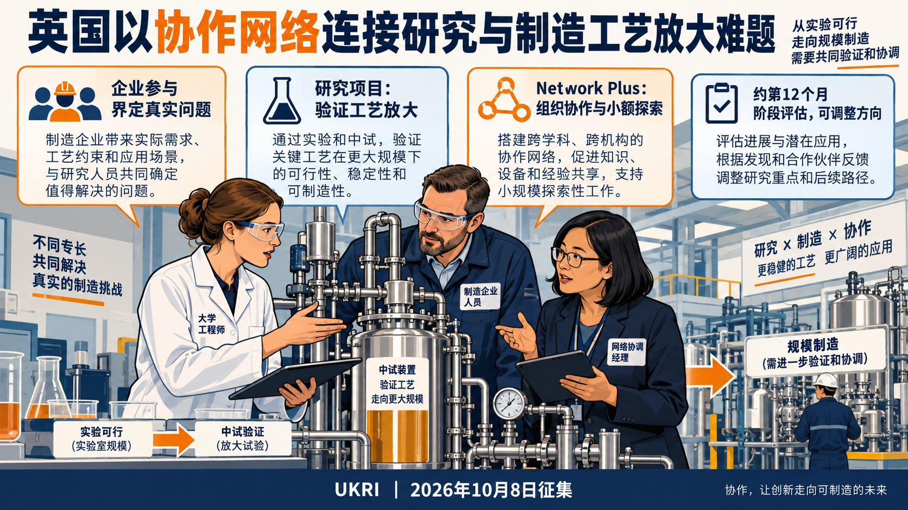
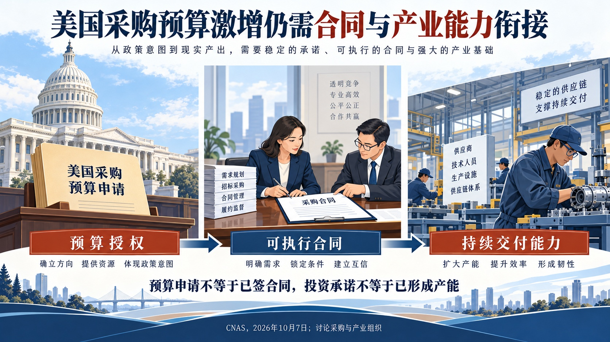
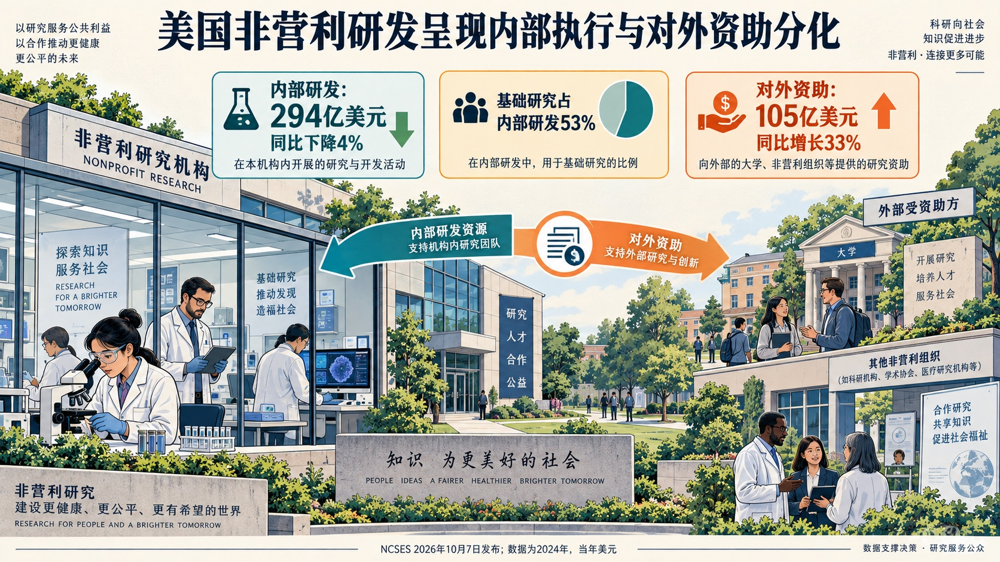

# 国际科技智库周报（2026-10-11）｜资料窗口：2026-10-05 至 2026-10-11

本期收录概况：收录 27 条｜重点 7 条｜本期收录机构 15 家。

<!-- weekly-editorial-sha256: 41f09013107c561c24f5b33e9d2c706b4b00d53dd56b1f9de0117fab0b1d5408 -->

## 科研怎样组织，技术怎样走向持续使用

本期从科研资助与制造协作读起，再看AI治理、研发统计、半导体生态及采购交付。各篇回应不同问题：既有正在设计的新机制，也有需要重新解释的数据和产业约束。

## 值得细读的发现

### 资助方式也成为研究对象

NSF拟设元科学办公室，检验评审与资助机制；X-Labs联盟承诺提供超过3亿美元资源。关键变化是研究组织方式，资源承诺尚不能当作现金到位。

原文：[NSF公告：Metascience、X-Labs](https://www.nsf.gov/news/nsf-lays-foundation-next-generation-technologies-support) · [阅读全文](#topic-04)

### 制造放大需要组织共同问题

英国配套资助研究项目与协作网络。Network Plus可向外部团队配置灵活资金，并以阶段评估调整安排，补上发现问题与组织合作之间的工作。

原文：[UKRI：Flexible funds、Stage gate funding](https://www.ukri.org/opportunity/manufacturing-scale-up-research-and-innovation-automotive-and-aerospace/) · [阅读全文](#topic-05)

### 内部研发与对外资助走向不同

美国非营利机构2024财年内部研发支出下降4%，对外研发资助增长33%。两项指标分别描述执行与资助角色，不能据此直接推断普遍外包。

原文：[NCSES NSF 26-329：图1、图2](https://ncses.nsf.gov/pubs/nsf26329) · [阅读全文](#topic-07)

[完整阅读导航（7 篇）](#reading-navigation)

## 主题展开

### 主题 01｜[P1] [FAS：让AI评估者与最终决策者分工](https://fas.org/publication/strengthening-eo-14409/)

- **来源**：美国科学家联合会（FAS）｜2026-10-09

#### 摘要导读

FAS建议让联邦资助研发中心承担技术核验，政府保留最终认定权，同时公开“可信伙伴”的功能性条件。这是针对评估可信度与资格分配的制度建议，尚非已实施措施。

#### 精华选编

美国科学家联合会（FAS）10月9日发布《迈向以证据为基础的前沿AI安全》，讨论前沿模型评估中的一个具体制度问题：参与制定保密测试标准的机构，同时决定哪些模型达到监管框架中的门槛，谁能独立检查这一判断？文章提出将技术核验交给联邦资助研发中心，并公开获得模型提前使用资格的功能性条件。它是一份政策建议，并非政府已实施的新制度。

### 评估可信度决定企业是否愿意参与

文章围绕第14409号行政令的自愿评估框架展开。有关机构制定保密的网络能力基准，国家安全局局长最终认定模型是否属于框架覆盖的前沿模型。参与开发者随后被要求在向“可信伙伴”首次发布之前，向政府提供最长30天的提前访问。作者担心，标准制定与适用判断集中在同一体系内，外部技术人员难以发现测试误差，企业也无法判断不同开发商是否被一致对待。

这会产生方向相反的两种风险：把能力未达门槛的模型纳入，可能增加发布延误与评估成本；漏掉真正具有重大风险的模型，则会削弱防护。由于参与是自愿的，评估不透明还可能削弱企业加入的意愿。作者因此把技术可信度视为机制能否运转的条件，而非事后的公关问题。

### 研发中心出具证据，政府保留决定权

建议中的联邦资助研发中心，是由政府长期支持、通常交由大学或非营利机构管理的专门研究组织。文中列举MITRE、国防分析研究所、麻省理工学院林肯实验室和卡内基梅隆大学软件工程研究所的相关中心，理由是它们已有保密设施、网络安全与机器学习人员，以及与主管机构合作的合同基础。

建议的工作流是：政府维持基准制定权；国防部门通过现有赞助协议分派任务；开发者在保密安排下提供模型访问；研发中心保存测试方法、版本、结果和局限，向主管机构提交技术报告；国家安全局局长依据记录作最终认定。研发中心不会取代政府授权，也不自行决定企业能否发布模型。文章借鉴联邦云服务安全授权中“第三方评估—政府授权”的分工，主张让评估记录在作决定的办公室之外形成。

这是一种相对独立，而非完全脱离政府。作者承认研发中心仍由相关部门赞助，也存在合同监督、成本和任务扩张问题。因此，方案的可信度仍取决于利益冲突管理、可追溯的评估记录和有效监督，不能由机构的非营利身份自动保证。

### 公开提前访问资格，减少关系型分配

第二项建议面向“可信伙伴”。提前获得先进模型既可能帮助关键基础设施防御，也可能给被选企业带来商业优势。作者建议由美国国家标准与技术研究院会同安全部门，在征求意见后公布资格：申请者能否说明具体公共任务，是否有保护模型的能力，商业优势与公共收益是否相称，以及是否接受使用记录和审计。

作者特别强调，与开发商已有商业关系不能单独构成入选依据，资格也应定期重评。这样，小型基础设施运营者可据公开条件准备申请，而无需猜测政府的合作名单。文章给出的经费只是建议性规划估算，尚需正式测算；其主要价值在于明确技术评估、最终认定和资格分配三项不同职能，避免把“可信”停留在机构声誉上。

### 主题 02｜[P1] [CSIS：得州半导体投资如何形成持续生产能力](https://www.csis.org/index%2Ephp/analysis/moving-texas-semiconductor-ecosystem-next-level)

- **来源**：美国战略与国际问题研究中心（CSIS）｜2026-10-07

#### 摘要导读

共享先进封装设施、供应商网络和企业参与实训，是得州将投资转为持续能力的关键连接。报告强调，地理集聚和投资承诺并不自动形成采购关系、设施利用和稳定生产。

#### 精华选编

美国战略与国际问题研究中心（CSIS）10月7日发布Hideki Tomoshige与Bailey Crane的报告《推动得州半导体生态系统迈上新台阶》。报告追问：晶圆厂、数据中心与公共补贴接连落地，是否就意味着形成了持久的产业优势？作者梳理得州的基础设施、公共研发、供应商、制造和人才体系，认为决定成效的是这些能力能否真正衔接，而非投资承诺的简单相加。

### 历史积累提供条件，组织连接仍需建设

报告回溯奥斯汀与达拉斯的不同路径。奥斯汀通过竞争性引入公共与企业联合研发项目、大学科研投入和人才集聚形成微电子基础；达拉斯则依托德州仪器、政府采购与商业客户扩张。两条路径都表明，企业投资与公共研究能力长期相互作用。早期机构本身是否完全实现目标，与其是否留下人才和合作网络，也不能混为一谈。

新一轮得州政策将资金与协调分开设置。得州半导体创新联盟汇集19所高等院校，承担战略规划、研究与资助建议，以及向州政府和立法预算机构报告等职责；配套创新基金支持研发、设计、制造和人才项目。联盟的意义在于为跨机构选择提供组织渠道，基金则落实具体支持。报告据此强调，州与联邦激励能否互补，比补贴名目多寡更重要。

### 共享先进封装设施补上单个机构难以承担的能力

得州电子研究所是报告最具体的制度案例之一。先进封装把不同来源、不同功能的芯片集成在同一封装中，对性能日益重要，但开发和验证需要高成本设施。研究所连接大学、芯片企业、设备材料企业与相关公共研究机构，建设开放研发和原型制造能力，使参与者可共同开发、测试并分担技术与资金风险。

作者认为，其价值在于技术能力、产业参与及运营灵活性相结合；作为州层面的实体，它在保持大学联系的同时采用不同于传统大学框架的治理安排。Texoma区域技术枢纽的分布式原型实验室网络，则试图把设计、封装和测试连接起来。这些仍有待证明：能否持续吸引企业使用，原型成果能否转入生产，以及多个地点能否按统一平台协同运行。

### 同处一地不保证形成产业链

报告专门提醒，数据中心与半导体制造地理接近，不代表采购关系会自动本地化。数据中心仍从全球供应链采购先进芯片，而得州相当一部分制造能力面向汽车、工业等应用。将下游算力需求转化为当地研发、设计和封装机会，需要真实的技术合作与供货关系。

同样，上游材料、设备、清洗和维护企业在当地设点，只是供应网络形成的起点。晶圆厂与供应商能否建立持续关系，决定新设施是否降低了停产风险、缩短了协作距离。与此同时，晶圆厂、数据中心和供应商同步扩张，会加大电力与水资源压力。新增建设项目与稳定运行的生产能力之间，仍隔着基础设施可靠性、设备投产、客户需求和供应商协同。

### 企业参与培训，把人才路径接到实际生产

奥斯汀社区学院的案例显示，人才合作可以具体到课程安排和费用承担。报告介绍的四周STARS培训按企业生产周期与运行条件设计课程，企业为在岗学员支付培训期间工资和学费；学分可继续衔接证书和学位。得州大学奥斯汀分校也将学生送往实际产线训练，并与学院推进联合培训与学分衔接。这些安排把企业的岗位需求、学院的实训能力和大学培养体系连接起来。

报告基于项目资料、机构数据与案例形成判断，并未提供补贴净效应的因果评估。其列举的投资、就业和设施中，既有既成事实，也有企业承诺和预测，不能统一视为完成成果。判断得州下一阶段表现，需要继续观察设施利用率、持续供货关系、共享平台使用和人才供给能否跟上扩张。

### 主题 03｜[P1] [BIS：单次计算更省电，为什么仍不能推出AI减少排放](https://www.bis.org/publications/paper-174-artificial-intelligence-and-climate-change-balancing-innovation-and-sustainability)

- **来源**：国际清算银行（BIS）｜2026-10-08

#### 摘要导读

AI的气候净影响取决于新增计算需求、边际电源与效率反弹。报告区分任务层面和经济整体的变化，并以不同技术情景讨论不确定性，没有给出必然净减排的结论。

#### 精华选编

人工智能既能优化电网、物流和工业流程，也需要越来越多的计算、电力和基础设施。国际清算银行10月8日发布的第174号研究报告，由Leonardo Gambacorta和Salvatore Polizzi梳理这两组效应。作者没有给出一个确定的全球净减排数字，而是追问：效率提升、需求增长和供电方式如何共同决定结果？

### 计算发生在何时何地，与计算量同样重要

可推迟的训练和微调任务，有机会移到电网压力较低、低碳电力较充裕的时间或地点；实时推理对延迟敏感，调度空间较小。但“电价低”不等于“边际排放低”：如果夜间新增电力仍来自高碳机组，仅按价格调度可能降低成本，却没有减少排放。

因此，平均电网排放强度只是参考。判断新增AI负荷的影响，更应问为满足这部分需求而增加的发电来自哪里。报告还区分了全年用电与局部峰值压力：大型数据中心聚集、不可延迟的任务同时运行，可能使特定地区的输配电和可靠性成为约束，即使全国年度占比尚不突出。

### 反弹效应有两层，不能只盯着模型效率

第一层来自同一种服务的扩大使用。例如物流优化降低每次运输的燃料消耗，但更便宜的运输也可能增加货运量；生成文本和图像的成本下降，会让更多任务调用模型。第二层发生在经济整体：生产率提高带来收入、利润和产出的增加，继而扩大其他商品与服务的需求。某个环节节省的资源，可能部分被别处新增的消耗抵消。

这类反弹并不意味着所有效率改进都无效，也不是证明总能耗必然上升的公式。它说明净效应需要同时观察单位任务能耗、任务数量、产出结构和能源组合。作者也指出，AI能够帮助清洁技术创新，同样能够提高化石能源开采等活动的效率；技术进步的方向受经济激励影响，不能自动视为绿色。

### 两种情景扩大的是不确定性

报告以辅助人类决策的AI和更广泛能力的通用人工智能作为两个示意端点，讨论同一组机制在不同技术进程下怎样变化。前一种情景的收益与成本可能渐进出现；后一种既可能加快能源与材料发现，也可能产生更大的计算和资源需求。它们是分析框架，不是给某年到来的技术下定论。

材料引用了不同年份、不同范围的研究和预测。任务层面的生产率提高不能直接外推为经济整体增速，更不能直接换算为减排量。报告最有用的地方，在于把这些中间环节拆开，提醒读者核对模型、观察事实与情景推演分别回答什么问题。

### 央行关注的是投资、供给和风险的时间差

AI投资和数据中心用电需求可能先出现，生产率收益却需要组织调整和配套投入后才显现。这种时间差使短期需求压力与长期供给能力变化更难区分。若预期收益落空，大规模基础设施融资还可能转化为信用和资产价格风险；若供电依赖长期高碳设施，又会增加未来转型的脆弱性。

作者因此强调改进能耗、排放和资源使用披露，支持更有效率的模型及新增低碳供电，并加强跨国可比性。这里谈的是作者的政策分析，并不代表BIS成员央行的统一立场。阅读时可以保留一个具体检验：一项AI应用宣称节能时，是否同时交代新增使用量、实际边际电源和配套基础设施，而非只展示每次任务的效率。

### 主题 04｜[P1] [NSF：把资助方式本身变成实验对象](https://www.nsf.gov/news/nsf-lays-foundation-next-generation-technologies-support)

- **来源**：美国国家科学基金会（NSF）｜2026-10-08

#### 摘要导读

NSF拟设元科学办公室，并以X-Labs资源联盟支持独立科研团队。值得观察的是评审实验、资源使用与里程碑资助如何衔接；超过3亿美元是资源承诺，尚不能等同于现金拨款或实施成效。

#### 精华选编

美国国家科学基金会（NSF）10月8日宣布一组科研组织与人才计划，其中值得关注的变化，是开始同时调整“如何选择研究”“谁能组织研究”和“研究工具怎样提供”。这些安排承接此前的政策部署，但本次新信息包括拟设元科学办公室、X-Labs资源联盟以及数字原生科研仪器资助计划。

### 评审机制也需要接受检验

元科学研究的是科学活动本身如何运转。NSF拟设的办公室将成为试验场，观察科研共同体对新评审和资助机制的反应，再把所得经验用于基金会项目。机构明确提出公开实验及发现，供学界、产业界和慈善机构使用；负责人职位尚待发布。这意味着公告给出了组织设计和实验意图，尚未公布具体实验组、衡量指标或优于现行评审的结果。

同日的NSF—英国研究与创新署联合声明将这项尝试延伸到跨国合作：双方拟开展有关科研生产率和影响的实验及分析，探索评审、资助和新工具，并支持元科学单位组成网络开展协调实验。正式安排仍计划在随后数月落实。其阅读价值在于把资助改革从单项制度倡议转向可比较的学习过程，而非已经证明某一种分配方式最优。

### 独立团队需要的不只有经费

NSF X-Labs Consortium的创始伙伴承诺提供超过3亿美元的资源，包括实验空间、仪器使用和直接支持。伙伴来自科研机构、先进计算中心、慈善和产业界。受支持对象是由研究人员、技术人员和创业者组成的独立团队，通过达到里程碑争取联邦资助，解决具体科学技术问题。

这里的3亿美元是多种资源的承诺值，不能等同于当期现金拨款。联盟的功能也因此更具体：让独立团队获得通常依附于大机构的场地、设备和专业知识，减少每个新团队重新搭建全部条件的成本。能否形成稳定的设备使用权、团队自主性和明确的里程碑评价，仍要由后续规则和实际运行检验。

### 挑战赛与仪器网络分别改变需求和供给

两项大挑战拟用竞赛组织跨学科、跨部门团队。Quantum+X围绕能源、生物技术和金融等行业问题寻找量子算法与应用；合成多细胞系统挑战则采用多阶段安排，推动计算与实验方法共同发展。它们借助明确问题吸引传统申请体系之外的参与者，但目前公告没有提供完整奖金额度与评审细则。

另一端，NSF拟在7月已宣布的可编程云实验室网络基础上，推出面向数字原生科研仪器的资助机会，预计五年投入最高7500万美元。其对象是从设计和架构上适应数据与智能系统的仪器，并非简单给现有实验流程增加聊天界面。与X-Labs放在一起看，这组计划既试图改变团队的组织形式，也试图改变团队可调用的实验条件。是否提高发现效率，应等待项目实施与元科学评估，不能由投入承诺直接推出。

### 主题 05｜[P1] [英国制造放大资助：研究项目之外，还要有人组织共同问题](https://www.ukri.org/opportunity/manufacturing-scale-up-research-and-innovation-automotive-and-aerospace/)

- **来源**：英国研究与创新署（UKRI）｜2026-10-08

#### 摘要导读

两项配套征集分别支持制造放大的技术研究和Network Plus协作网络。网络可用灵活资金吸纳外部团队，并接受阶段评估；企业参与问题界定和治理，学术机构负责牵头。

#### 精华选编

新工艺在实验室里可行，并不意味着能稳定进入生产。英国研究与创新署（UKRI）10月8日发布两项配套机会：一项支持汽车和航空航天制造放大的研究，另一项建立Manufacturing Scale-up Network Plus协作网络。两者分别处理具体技术障碍和跨机构协调，不能把网络看作附带的会议经费。

### 企业参与从提出问题开始

研究资助明确针对新技术、新工艺的制造放大，而不是重新发明产品。申请由符合UKRI条件的英国研究机构牵头，但工业伙伴应实质参与挑战界定、方案和成果应用，并提供支持函。项目还须能够接触工业尺度的环境，使研究结果面对真实制造条件。

该机会公布总资金1760万英镑，计划支持两项大型研究及最多十项小型研究。大型项目完整经济成本为450万至580万英镑、最长四年；小型项目最高60万英镑、最长两年，UKRI通常资助完整经济成本的80%。这两种口径不能混成每个项目直接收到的现金金额。

项目申请时预期非公共资源与UKRI资金之比约为1∶1，并须说明怎样继续吸引投入；文件提出的3∶1是项目组合层面的进一步撬动目标，不能改写为每个团队都已落实三倍现金配资。合作资源的来源、形式及承诺可信度会影响这一机制是否成立。

### 网络的职责包括分配小额探索资金

Network Plus面向汽车、航空航天及更广泛先进制造领域，要求在第一年形成证据和路线图，将研究能力与产业需求连接起来。企业不能作为牵头申请机构，但工业界、供应链和投资者应对优先问题和资金配置发挥有意义的作用。网络需要专门经理，其职能包括促成协作和推进活动，不是仅处理行政事务。

网络完整经济成本上限为563万英镑，UKRI实际资助上限为450万英镑，最长五年。最多50%的合格预算可用于灵活资金，向网络之外符合条件的研究机构配置小规模活动，包括早期研究、可行性工作和新合作。长期研究本身不由网络承担。这个设计把“识别共同问题”和“让外部团队试一试”连起来，同时要求分配程序公平透明、保留审批审计轨迹。

### 灵活性以明确的治理约束为前提

网络并非获得五年资金后自行运转。资助设有阶段安排，约第12个月检查由申请者提出、再与UKRI商定的指标和里程碑；评估可要求转向，进展不足时也可能终止。它还须建立独立咨询委员会，至少一半成员独立、主席独立，首次会议在启动四个月内举行，此后每年两次。管理结构须在三个月内建立并获UKRI认可。

这些要求把产业参与、学术牵头和公共资助监督放进同一个组织框架。具体研究项目解决某个工艺如何放大，网络持续检查哪些障碍值得共同投入，再通过灵活资金探索新方向。其实际效果仍取决于企业能否开放真实问题和验证场景，以及咨询和阶段评估是否影响资源分配；当前材料是征集设计，还不是放大成效评估。

### 主题 06｜[P1] [CNAS：采购预算激增，为什么仍难转成稳定交付](https://www.cnas.org/publications/reports/munitions-procurement-and-the-fiscal-year-2027-defense-budget)

- **来源**：新美国安全中心（CNAS）｜2026-10-07

#### 摘要导读

报告把预算、合同与交付计划分开比较：多年框架若缺少可执行的资金与采购承诺，未必足以推动供应商扩产。交付还受人员、设施和关键投入约束，不能从预算峰值推算产能已同步增加。

#### 精华选编

新美国安全中心（CNAS）10月7日发布的弹药采购研究，把美国2027财年预算申请、合同安排和产能计划放在一起比较。作者Carlton Haelig的判断是：更多采购预算只是第一步，稳定的多年需求、可执行合同和实际生产能力必须同时成立。该报告的分析对象是十个项目，不是整个国防工业。

### 一次性高峰不等于可持续订单

十个项目的2027财年采购申请合计495亿美元，按2027财年不变价比较，约为2016—2026财年年均58亿美元的8.5倍。但其中405亿美元、约82%，依赖预算协调立法部分。作者指出，这类资金的政治与立法不确定性，会削弱企业对长期需求的判断。

五年规划中的后续年度支出平均约267亿美元，较首年申请下降46%。这些数字是申请及规划，不能写成已获拨款。对企业而言，需要判断的不是某次发布会承诺多大，而是未来年度是否持续形成可执行订单。否则，已经投入的厂房成为沉没成本，尚未发生的扩建却可能随预期改变而停止。

### 框架协议与采购合同的承诺强度不同

七年框架协议表达政府与企业的合作意向，但仍须转化为获得授权、拨款支持的多年采购合同。后者包含取消责任等约束，能够增强需求可信度，却仍不是绝对不可逆的承诺。作者因此把“宣布多年合作”和“资金实际进入合同”分开观察。

这一区分也解释了为什么缩短签约时间未必等量缩短交付。订单进入生产队列后仍受既有积压、厂房、设备和人员约束。报告对已有2027财年合同计划的七个项目比较后，没有发现新采购能比此前订单更快交付；这反映的是当时计划文件，不应扩张为所有项目未来都不可能改善。

### 公共和私人投资正在承担不同环节

报告观察到政府投入从单个项目的产线支持，扩展到更通用的供应链、关键材料和合格供应商；企业则增加自身制造与总装能力。两端互补具有合理性，但公告中的企业资本开支承诺同样需要兑现，不能直接当作已经形成的年产量。

作者还区分平均采购成本与单件价格：扩大采购量能够摊薄固定开支，但只有订单数量实际增加时，这一效果才会出现。仅提高产能投入、而采购量没有同步扩大，会使每件产品分担的总项目开支上升。

这份研究最终主张把预算、合同、能力建设与可实现的交付进度一起审查。其主要贡献是揭示公共采购的时间一致性问题：财政承诺、企业投资和生产周期属于不同时间表，不能用一项总预算替代对三者是否匹配的判断。报告依据公开预算与计划，尚不能证明所有后续投资的实际效果。

### 主题 07｜[P1] [美国非营利研发：内部投入下降，对外资助却增加](https://ncses.nsf.gov/pubs/nsf26329)

- **来源**：美国国家科学与工程统计中心（NCSES）｜2026-10-07

#### 摘要导读

2024财年，调查范围内非营利机构内部研发约294亿美元，同比下降4%；对外研发资助约105亿美元，增长33%。两者描述不同角色，不能直接相加，也不能据汇总数据认定普遍外包。

#### 精华选编

美国国家科学与工程统计中心（NCSES）10月7日发布的统计简报呈现了一组容易混淆的变化：2024财年，非营利机构在内部执行的研发支出约294亿美元，较上一财年下降4%；向其他组织提供的研发资助与合同约105亿美元，反而增长33%。两个数字描述不同角色，不能相加后当作没有重复的全国研发总量，也不能据此直接断言机构普遍把研究“外包”了。

### 内部研发的资金来源在分化

内部执行研发最大的资金来源仍是联邦政府，约112亿美元，占38%；机构自有资金约86亿美元，占29%；企业提供约37亿美元，占13%。在列出的具体来源中，只有机构自有资金增长，增幅约3%。联邦来源下降10%，企业、基金会及其他非营利机构、个人捐赠等来源也有下降。

这说明“非营利”并不等于主要靠慈善捐款维持研究。联邦资金和机构自有资金在这一统计范围内承担更大份额。与之相应，讨论非营利研究组织的稳定性，需要区分其法律身份与收入结构。该简报报告的是2024财年的情况，不能拿来解释2026年新宣布计划已经产生的影响。

### 基础研究仍占多数，但领域结构并不均匀

内部研发中，基础研究约155亿美元，占53%；应用研究约93亿美元，占31%；试验发展约47亿美元，占16%。联邦与非联邦资金的用途也有区别：非联邦资助研发中试验发展占20%，联邦资助中为10%；应用研究则分别占27%和38%。这是支出结构差异，并不直接证明哪一来源更有效。

生物、生物医学和健康领域占内部研发支出的74%，约217亿美元，较上年下降7%。数学、统计、计算机与信息科学支出增长19%，达到9.07亿美元，但其规模远小于健康相关领域。增长率与总量必须同时看：一个小领域快速增长，未必足以改变整体下降方向。

### 谁在增加对外资助

对外研发资助增长主要来自不属于医疗或科技类别的其他非营利机构。它们提供约68亿美元，占外部资助的64%，较上年增加53%；医疗类机构约17亿美元，科技类机构约21亿美元。分类依据是机构多数工资支出对应的行业代码，因此不能把“其他”直接替换成“慈善基金会”，也不能仅凭汇总数据推断资金最终流向何种研究组织。

报告同时估计内部研发人员约16.4万人，折合约12.6万个全时当量，全时当量较上年下降13%。人员与资金的变化值得一起观察，但这一年度统计没有识别机构调整的因果机制。

这份简报使用2025年开展的调查，样本约8000家，代表约20500家符合条件的非营利机构，回应率78%。它排除了大学及由非营利机构管理的联邦资助研发中心；金额为当年价。因而其最可靠的贡献，是区分非营利部门作为“研究执行者”和“研究资助者”的变化，为继续追问资金流向、人员调整和组织分工提供依据。

## 本期简讯

### [塞尔维亚制造业绿色创新的能力差距需要配套支持](https://www.bruegel.org/analysis/how-climate-policies-can-speed-manufacturing-decarbonisation-western-balkans)

布鲁盖尔研究所（Bruegel）｜2026-10-05

Bruegel合并2020—2022与2022—2024企业创新调查，获得2,023条制造业观察值，分析减排及替代化石能源的创新。研究发现，大型、出口、外资及开展研发的企业更积极，小型本地企业相对落后；能源成本与预期规则是重要动因。作者建议将碳定价与有针对性的支持、成果监测结合。调查为企业自报、跨期截面观察，不能把相关变化全部归因于碳边境政策。

### [加拿大绿色创业的缺口在首批客户与商业规模示范](https://www.oecd.org/en/publications/driving-the-growth-of-green-start-ups-in-canada_46b171e3-en.html)

经济合作与发展组织（OECD）｜2026-10-05

OECD评估加拿大绿色创业支持体系，并比较澳大利亚、丹麦、葡萄牙和美国的政策经验。报告认为，加拿大早期资助与技术咨询较强，企业放大时却缺少国内首批客户和商业规模示范支持。作者建议把买家对接与试点费用支持结合，并让公共采购考虑生命周期成本；同时协调繁密的支持机构与项目转介。建议针对的是从研发走向市场的具体断点，其效果仍需在实施中评估。

### [技术扩散比较需要同时观察供给与使用](https://www.rand.org/pubs/research_reports/RRA4571-1.html)

兰德公司（RAND）｜2026-10-05

RAND区分技术生产能力的扩散与企业实际采用技术的扩散，用参与者、连接和制度条件构建比较框架。报告认为美国在多项结构指标上占优，中国在科研机构连接与政策协调方面有优势，但两国均存在非技术型中小企业采用不足的问题。结论来自代理指标和定性证据，不能等同于测得的生产率效果；数据滞后、非正式联系难计量，也影响跨国可比性。

### [AI失控桌面演练暴露识别与协调难题](https://www.rand.org/pubs/research_reports/RRA4767-3.html)

兰德公司（RAND）｜2026-10-05

RAND汇总26场、五类AI失控情景的桌面演练。参与者反复遇到的问题包括：怎样确认异常属于失控、谁掌握必要信息、怎样协调隔离与服务延续，以及事后由谁承担责任。研究采用专家参与的假设情景，价值在于暴露决策接口与准备缺口；它不能估计失控发生概率，也不能把情景中的行为认定为现实事件。

### [数字基础设施竞争也取决于融资与配套服务](https://www.rand.org/pubs/research_reports/RRA4569-1.html)

兰德公司（RAND）｜2026-10-05

RAND通过案例、领域分析和访谈，讨论第三国选择数字基础设施的因素。报告强调，设备、软件、融资、培训和长期本地服务的组合，往往比单项技术指标更能影响采用；但安全规则、政治关系和既有系统也会改变选择。作者把结论定位为定性判断，未测算各因素的独立效应；电信与海缆的锁定关系，也不能直接套用于较易替换的开放权重AI模型。

### [欧盟拟以6500万欧元维护生命科学关键数据](https://research-and-innovation.ec.europa.eu/news/all-research-and-innovation-news/commission-earmarks-eur65-million-safeguard-critical-data-life-sciences-and-biotechnology-2026-10-06_en)

欧盟委员会研究与创新总司（DG RTD）｜2026-10-06

欧盟委员会提出6500万欧元支持方案，其中GENCODE、UniProt和Europe PMC分别拟获1900万、3000万和800万欧元，另有800万欧元通过公开征集支持其他资源。资金对象是研究者持续依赖的数据维护、可用性与再利用条件，不只是新建数据库。相关资助协议仍待完成，不能将公布额度写成已到账投入。

### [神经数据治理需要沿处理过程厘清责任](https://www.oecd.org/en/publications/neurodata-governance_0ba61a20-en.html)

经济合作与发展组织（OECD）｜2026-10-06

OECD结合研讨会与16家神经技术企业的访谈、数据流映射，发现原始信号、衍生指标和推断信息的可识别性与敏感性不同。医疗器械、隐私和AI规则交叠，多方参与还使数据控制者、处理者及二次使用责任难以判断。报告建议按具体用途和数据流明确义务，协调监管路径；这些企业提供的是探索性证据，不能据此推算全行业合规比例。

### [DOE、NIH与Biohub拟连接实验数据、计算和生物模型](https://www.energy.gov/science/articles/doe-nih-and-biohub-partner-build-foundational-data-predictive-biological-super)

美国能源部（DOE）｜2026-10-07

合作备忘录提出将能源部的计算与实验设施、美国国立卫生研究院的健康研究数据和Biohub的模型及数据工作连接起来，以改进生物预测模型所需的基础数据。DOE计划未来五年投入超过5亿美元，Biohub另承诺五年5亿美元支持其虚拟生物学工作。两笔安排具有各自范围，不能合并为已经批准的单一共同基金；公开材料尚未给出模型有效性的实施结果。

### [日本SBIR第三阶段用阶段评审决定追加支持](https://www.mext.go.jp/b_menu/houdou/mext_01686.html)

日本文部科学省（MEXT）｜2026-10-07

文部科学省公布SBIR第三阶段基金的阶段评审结果，涉及Interstellar Technologies的ZERO项目。附件将各阶段原有支持上限与追加额分列，并附专家评审人员信息，说明后续支持依托阶段性审查，而非一次性承诺全部资金。第二、第三阶段分别列出14.4亿和39.3亿日元追加额。该通知证明的是评审与资助安排变化，不能据此宣称飞行验证成功。

### [锚定客户可以帮助清洁产业跨过早期需求风险](https://www.aspistrategist.org.au/australia-is-building-green-industries-defence-could-make-them-strategic/)

澳大利亚战略政策研究所（ASPI）｜2026-10-08

ASPI评论作者Simran Keshwani建议，公共采购方在产品达到明确性能和本地供应要求后，通过有限的多年包销或产能合同，为清洁燃料等早期生产提供可融资的需求信号；更大的市场仍由航空、矿业和民用客户形成。方案强调测试认证、实际用途和后续合同的衔接，不主张仅因产品低碳就采购。这是需求侧产业政策建议，尚非已实施的新采购承诺。

### [四个国家实验室项目分别补齐自主实验的不同环节](https://www.energy.gov/science/articles/doe-announces-four-national-laboratory-led-selections-advance-robotics-and)

美国能源部（DOE）｜2026-10-08

DOE公布四个实验室牵头项目：Argonne研究可自我改进的自主实验能力；Brookhaven利用对抗式数字对应系统识别失效情形；Oak Ridge建设可迁移接口、数据来源与可复现机制；SLAC连接实验光源与发现流程。它们的共同难题是自动操作能否产生可靠、可迁移的科学结果。计划总额3000万美元，其中200万美元来自2026财年，后续资金依赖拨款；入选仍须完成谈判，尚非全部授奖或能力建成。

### [DOE把量子计算应用组织为可比较的科学任务](https://www.energy.gov/science/articles/doe-announces-science-applications-quantum-computing)

美国能源部（DOE）｜2026-10-08

DOE提出八项优先科学应用，覆盖化学、材料、亚原子科学和应用数学，强调领域研究者与量子计算团队共同界定问题，并与经典超级计算能力比较。其意义在于把研究目标从设备指标连接到实际科学任务和可核查的应用价值。公告给出的是任务选择与研究组织方向，没有证明量子方法已在这些任务上获得优势。

### [Genesis新增项目把模型、设施与科学软件分工连接](https://www.energy.gov/articles/energy-department-announces-new-genesis-mission-awards-advance-super-intelligence-science)

美国能源部（DOE）｜2026-10-08

DOE公布12项新的第二阶段项目，拟支持1.59亿美元；加上此前两项，该阶段总计14项。新增方向包括共享加速器研究平台、科学软件的AI辅助验证，以及面向特定科学问题的数据与模型协作。公告还提及六项新的第一阶段项目，不能把阶段新增数与整个项目组合混为一谈。各项目的效率与能力提升属于研究目标，仍需实施验证，不能当作已经实现的成果。

### [Genesis博士培养拟同时嵌入实验室与产业经历](https://www.energy.gov/articles/energy-department-launches-genesis-mission-graduate-fellowship-advance-american-scientific)

美国能源部（DOE）｜2026-10-08

DOE宣布面向约100名博士生的四年培养计划，要求形成AI与另一科学或工程学科的双重能力，并安排国家实验室或用户设施、产业界两类研究经历。大学承担培养，外部研究场景补充设施与应用条件。计划拟投入最高1亿美元，含2027财年2000万美元，后续取决于拨款；四年和双重经历属于计划设计，不能据此认定已经缩短博士训练或提升产出。

### [初创企业扩张差距更多出现在商业化和后期融资](https://www.oecd.org/en/publications/what-it-takes-for-start-ups-to-scale-up_1f743fa7-en.html)

经济合作与发展组织（OECD）｜2026-10-08

OECD政策简报利用约19万家欧美创新初创企业资料发现：有专利的欧盟企业发明强度不弱，但首次申请专利后达到规模门槛通常更慢；融资差距主要在后期大轮次扩大。经验型创始人、专业管理和并购与更快扩张相关。报告采用融资额或估值界定规模，不能等同于销售增长，更不能把这些相关关系解释成单一管理措施的因果效果。

### [英国电池资助将研发评审与配套投资衔接](https://www.ukri.org/opportunity/battery-innovation-programme-investor-partnerships/)

英国研究与创新署（UKRI）｜2026-10-08

该机会以至少500万英镑公共资金支持电池相关研发，并要求获得指定投资伙伴支持及与项目匹配的私人投资。申请前需要投资者表达支持意向，研发项目独立接受创新质量评审，同时考虑公共支持的额外作用和投资进展；投资须满足成交条件。它将技术资助与股权融资过程连接，不能将投资者意向当作资金到账，也不保证通过研发评审即可获资助。

### [英国FOAK支持先帮助示范项目形成可融资方案](https://www.ukri.org/opportunity/first-of-a-kind-foak-builder-programme-entry/)

英国研究与创新署（UKRI）｜2026-10-08

FOAK Builder面向已有较高技术成熟度、准备建设首个同类设施的企业。入口阶段提供的是技术与项目开发咨询支持，单项价值最高31.5万英镑，不是直接建设拨款。方案关注工程采购建设、风险管理和包销等影响融资的条件；后续资助需再经过邀请与评估，并不因入选入口阶段而自动获得。它尝试补上从技术验证走向首套设施投资决定之间的项目开发能力。

### [AI异常行为的比较依赖一致的事件披露](https://www.aspistrategist.org.au/if-chinese-ai-goes-rogue-expect-opacity/)

澳大利亚战略政策研究所（ASPI）｜2026-10-09

ASPI评论比较不同开发者对模型异常行为的公开说明，认为模型论文中的测试结果、受控环境里的越界表现和真实外部事件需要分别记录。作者主张改进跨开发者的事件披露，以便外部研究者判断测试条件与风险是否可比。公开披露较少并不证明事件较少；文章提供的是透明度问题与政策建议，不能据此排序各国模型的真实失控概率。

### [技术管制评估要追踪适应成本及其持续时间](https://www.csis.org/analysis/russias-turn-china-under-sanctions)

美国战略与国际问题研究中心（CSIS）｜2026-10-09

CSIS研究作者Damien Spleeters指出，供应商国籍变化既不能单独证明管制成功，也不能证明完全失效：替代可能维持供给，同时增加成本、延迟和不确定性。报告建议持续观察这些摩擦是否消退，并把企业与供应关系变化纳入动态评估。研究综合贸易数据和个案解释政策效果衰减，没有给出可直接推广到所有产品的统一因果估计。

### [绿色技术价格竞争不能按单一行业模式解释](https://merics.org/en/report/survival-fiercest-how-involution-helps-china-dominate-green-tech-globally)

墨卡托中国研究中心（MERICS）｜2026-10-09

MERICS比较中国光伏、新能源汽车和风机行业，指出价格竞争的程度受技术复杂性、产品差异化、垂直整合、需求和地方支持共同影响。报告认为，国内低价压力可能强化出口竞争力，也损害企业财务与地方财政，因此欧洲面临降低转型成本与保持本地能力的双重问题。这是作者基于行业与企业资料的解释；“内卷程度”并非统一统计量，领先企业样本也不能代表所有企业。

## 阅读导航

- [主题 01｜FAS：让AI评估者与最终决策者分工](#topic-01) · 美国科学家联合会（FAS）
- [主题 02｜CSIS：得州半导体投资如何形成持续生产能力](#topic-02) · 美国战略与国际问题研究中心（CSIS）
- [主题 03｜BIS：单次计算更省电，为什么仍不能推出AI减少排放](#topic-03) · 国际清算银行（BIS）
- [主题 04｜NSF：把资助方式本身变成实验对象](#topic-04) · 美国国家科学基金会（NSF）
- [主题 05｜英国制造放大资助：研究项目之外，还要有人组织共同问题](#topic-05) · 英国研究与创新署（UKRI）
- [主题 06｜CNAS：采购预算激增，为什么仍难转成稳定交付](#topic-06) · 新美国安全中心（CNAS）
- [主题 07｜美国非营利研发：内部投入下降，对外资助却增加](#topic-07) · 美国国家科学与工程统计中心（NCSES）
