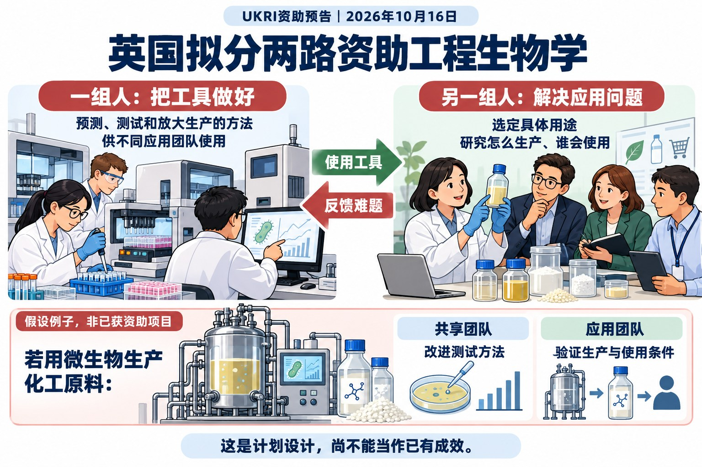
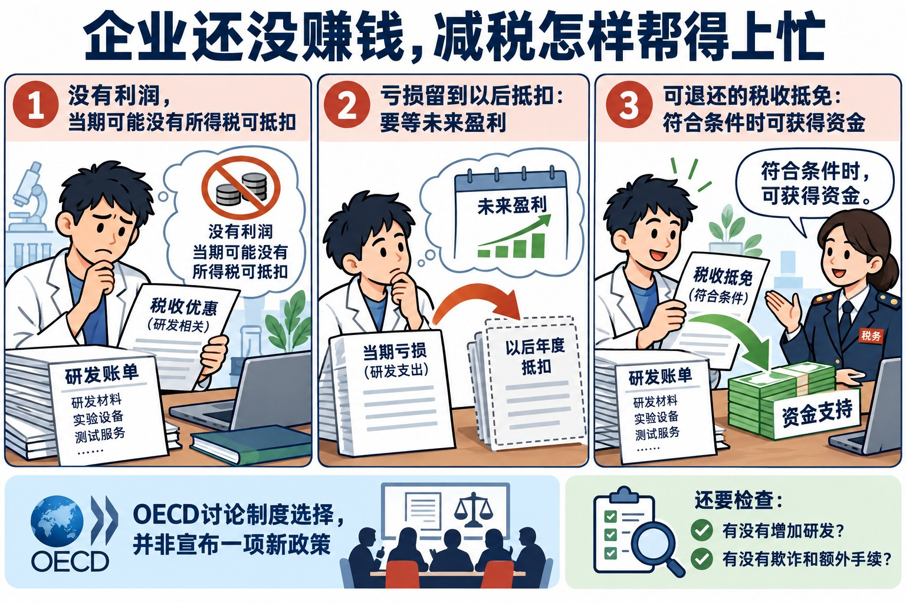
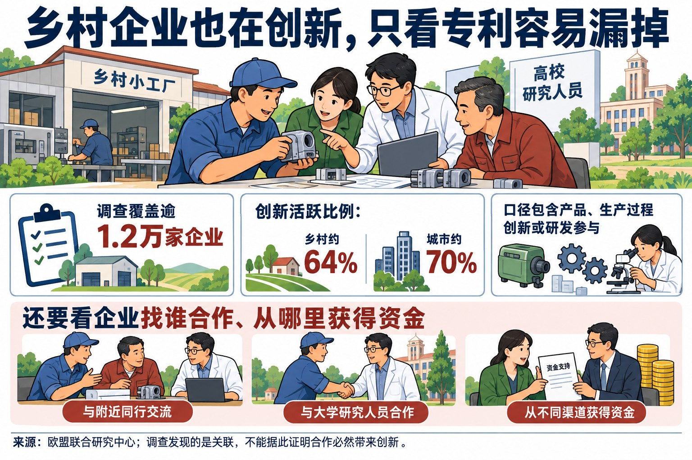
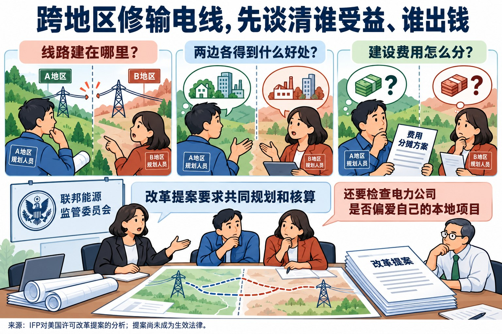
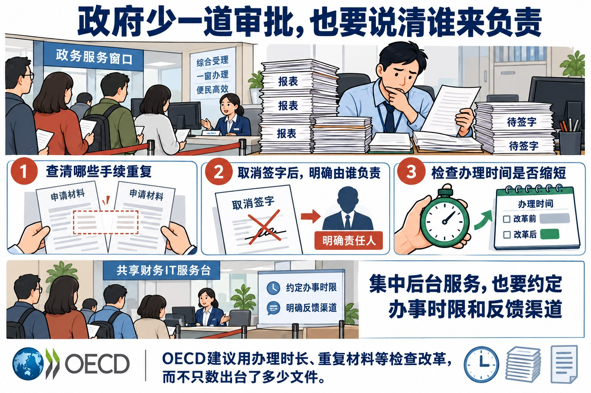
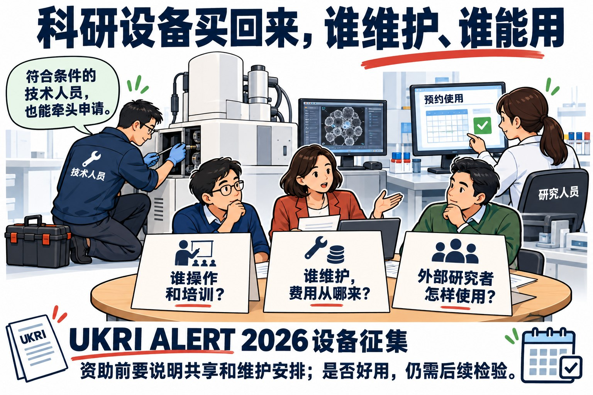

# 国际科技智库周报（2026-10-18 修订阅读版）｜资料窗口：2026-10-12 至 2026-10-18

本期收录概况：收录 29 条｜重点 6 条｜16个来源单元（15家机构）。

<!-- weekly-editorial-sha256: 991894a4a05637c1324cdc7329ef945125742fe8df8004b6ec07e218d7a9d09b -->

## 钱怎样用到研究上，规则怎样影响实际工作

这一期从具体问题读起：英国为何分别资助共用研究工具和具体应用？设备买回来，由谁维护、怎样让外部研究者使用？企业还没盈利，税收优惠能否帮它支付研发费用？另有乡村企业创新、跨区输电和政府审批三篇解读，以及23则简讯。

## 值得细读的发现

### 买到设备以后，谁让它持续可用

英国ALERT设备资助要求申请人说明谁操作、谁维护、外部用户怎样使用；符合条件的技术人员也能牵头申请。

原文：[Who can apply、Approach、Assessment process](https://www.ukri.org/opportunity/mid-range-equipment-for-biosciences-research-alert-2026/) · [阅读全文](#topic-06)

### 改进产品和生产方法，也算创新

欧盟联合研究中心调查发现，按产品、生产过程创新或研发参与计算，乡村与城市企业的创新活跃比例约为64%与70%。只看专利，会漏掉一部分活动。

原文：[执行摘要；印刷26、51—53、68—69页](https://publications.jrc.ec.europa.eu/repository/bitstream/JRC147353/JRC147353_01.pdf) · [阅读全文](#topic-03)

### 没有利润，税收优惠还能怎样帮企业

如果优惠只能抵扣当期所得税，亏损企业就可能暂时用不上。OECD讨论怎样让支持在企业需要钱时到达，以及怎样防止滥用。

原文：[执行摘要及页20—27](https://www.oecd.org/content/dam/oecd/en/publications/reports/2026/08/enhancing-corporate-tax-systems-to-support-business-dynamism_f3183286/7e843e1d-en.pdf) · [阅读全文](#topic-02)

[完整阅读导航（6 篇）](#reading-navigation)

## 主题展开

### 主题 01｜[P1] [英国拟分两路资助工程生物学：一边做共用工具，一边解决应用问题](https://www.ukri.org/opportunity/engineering-biology-programme-foundational-technology-hubs/)

- **来源**：英国研究与创新署（UKRI）｜2026-10-16

#### 摘要导读

英国拟分别资助两类团队：一类改进预测、测试等方法，让不同研究团队都能用；另一类围绕具体用途，研究怎样把技术做成可使用的产品或服务。经济和社会科学研究人员也要参与领导，尽早研究成本、需求和使用障碍。

#### 精华选编

英国研究与创新署（UKRI）10月16日预告：工程生物学将分别设立两类受资助的研究团队。一类改进许多项目都用得上的技术和工具，另一类围绕某个具体用途开展研究。原文把这类协作团队称为“枢纽”；这里不必理解成新建一栋楼，也不必理解成所有人集中在同一个实验室。

工程生物学是什么？可以先把它理解为：研究人员有目的地改造和组合生物系统，让它完成某种任务。比如，设法让微生物生产所需物质。研究不止要看一次实验能否成功，还要反复设计、测试，并考虑扩大生产后能否稳定工作。

### 用一个假设例子，看懂两类团队各做什么

假设一个团队想用微生物生产一种化工原料。以下只是帮助理解的例子，并非UKRI已经选定或资助的项目。

做这个应用，研究人员可能先要筛选许多微生物、比较不同设计，并测试哪种方法效果更好。这些测试和预测方法，也可能被生产其他物质的团队用到。“基础技术枢纽”就着重研究这一类共用难题：怎样预测得更准、怎样自动测试、怎样从小规模实验走向更大规模生产。这里的“基础技术”指许多应用都能用到的技术，不等于把这类团队简单归为基础研究。

“任务枢纽”则从一个具体用途出发。沿着上面的例子，它要研究这种化工原料怎样生产、潜在使用者有什么要求、技术走向使用还缺哪些条件。原计划允许组织市场验证、合作研发、人员交流和创业培育，并要求把研究人员、产业伙伴和帮助成果投入使用的人员组织起来。申请还需利用已有研究力量，避免重复建设已有同等规模投资支持的工作。

这样分工的意义是，共用方法有人专门研究，具体应用也有人持续推进。应用团队可以使用共用技术，同时把实践中的难题反馈给研究这些技术的人。不过，这不意味着两类团队互不往来，更不能理解为一类只研究技术、另一类只负责销售。

### 研究怎么做，不能等到最后才问谁会用

两类枢纽都要求经济和社会科学研究人员参与领导，并有经费支持实际研究。他们需要参与判断市场需求、采用障碍和社会影响，而不只是等技术完成后写一份推广报告。两类枢纽还须参加整个计划的协调网络，与其他团队交流和协调工作。

放到上述假设例子中，可以追问：潜在用户为什么愿意改用这种原料？现有生产方式有什么优势？新方法即使在实验室可行，使用者是否负担得起？这些例子用于解释相关研究能提出什么问题，不是声称原征集逐条列出了这些要求。尽早讨论，有助于研究团队选择值得继续投入的方向。

### 参与项目的人，与从外部提意见的人分开

产业伙伴可以参与研究和实施，合作关系要通过正式协议说明。另设的独立咨询委员会则不能由正式项目伙伴充任。也就是说，负责把项目做出来的人之外，还需要有人从外部检查方向、提出质疑。这是原计划中的角色区分；它能否真正影响项目决策，要看实施后的情况。

### 现在确定的是资助设计，还不是实施成绩

两类枢纽最长支持五年。基础技术枢纽的全经济成本上限为1200万英镑，任务枢纽为1500万英镑，UKRI通常承担其中80%。“全经济成本”是核算项目所需总成本的口径，上限不能直接当作UKRI支付的金额。预算和项目仍待相关批准与正式征集，不能写成这些团队已经建成，或分工已经产生效果。

来源：[基础技术枢纽](https://www.ukri.org/opportunity/engineering-biology-programme-foundational-technology-hubs/)、[任务枢纽](https://www.ukri.org/opportunity/engineering-biology-programme-mission-hubs/)，范围、社会科学、治理与资助章节。

本篇为改编整理，按[CC BY-NC-SA 4.0](https://creativecommons.org/licenses/by-nc-sa/4.0/)提供；原文权利与例外见[UKRI使用条款](https://www.ukri.org/who-we-are/terms-of-use/)。

### 主题 02｜[P1] [企业还没赚钱，减税怎样帮得上忙](https://www.oecd.org/en/publications/enhancing-corporate-tax-systems-to-support-business-dynamism_7e843e1d-en.html)

- **来源**：经合组织科学技术与创新｜2026-10-15

#### 摘要导读

企业还在亏损，没有足够的所得税可抵扣，名义上的研发优惠就可能暂时用不上。OECD讨论把亏损留到以后抵扣、允许退还部分抵免等办法，同时提醒：要查钱有没有增加研发投入，不能只看发了多少优惠。

#### 精华选编

OECD于10月15日发布《Enhancing corporate tax systems to support business dynamism》，重新审视企业所得税与企业进入、成长和退出的关系。报告关注的不是单一税率高低，而是同一套制度如何对不同年龄、规模和融资条件的企业产生不同作用。对尚未盈利的创新企业而言，一项名义优惠能否在需要资金时兑现，可能比优惠比例更关键。

### 有抵免资格，不等于当期有现金支持

新企业通常缺少抵押品和长期信用记录，更依赖内部资金；研发、软件和数据投入又往往难以收回。若税收优惠只能抵扣当期应纳所得税，亏损期企业就无法立即受益。成熟企业可以用其他盈利业务吸收抵扣，同样的制度因而可能给初创者带来更长的等待。

报告把亏损抵扣、结转和可退还抵免放到这个现金流问题中讨论。亏损结转以后年度，是把当期亏损留待未来盈利时抵扣；追溯抵扣以前年度利润，则可能产生退税。可退还抵免让没有足够应纳税额的企业也能获得支持。这些设计有助于政府承担部分投资下行风险，避免制度只分享利润、却不分担失败。

但支持并非越宽越好。较慷慨的亏损抵扣可能延迟低效率企业退出，退还机制也带来财政收入波动、欺诈及活动重新归类的风险。报告主张同时检验资金何时到达、支持是否诱发新增投入，以及管理成本，而不能仅比较名义优惠力度。

### 企业一长大就失去优惠，会不会因此不愿扩张

专门面向小企业的优惠可以补偿固定合规成本，也可能制造新的成长障碍。当营业规模超过门槛就失去优惠时，企业可能压低扩张速度，或者拆分组织以继续符合资格。政策原本希望扶持成长，却可能奖励停留在门槛以下。

税制复杂度会进一步改变受益分布。大企业更有能力理解规则和申领优惠，小企业未必知道可用安排，甚至需要先支付顾问费用。报告因此区分“降低税负”与“降低获得支持的成本”，并提醒定向措施的效率收益必须与额外复杂性比较。

### 优惠有没有让企业多做研发，不能只看领取金额

报告认为，以研发等支出为基础的优惠通常比对所得直接减税更贴近具体投资目标，因为前者直接降低新增活动成本；所得优惠则可能给原本就会发生的盈利带来额外收益。但研发激励的经验结果并不完全一致：部分研究发现小、年轻且融资受限企业反应较强，另有研究发现小企业效果较弱。

大型既有企业往往开展更多研发，也领取较多优惠。其研究可能产生外溢效益，同时也可能强化市场地位。不能把领取金额直接等同新增创新，更不能把研发总支出自动解释为基础研究投入。可退还性、额度上限、直接资助与税收支持的组合，须按对象和约束评估。

报告的最终判断是，税制可以减少对进入和扩张的扭曲，但很少是企业活力不足的唯一原因。融资、竞争、破产制度和技术扩散仍需配合。企业进入率下降也不必然意味着政策失败：若份额流向更高生产率企业，其含义与新进入者被制度障碍挡住并不相同。

来源：[OECD原报告](https://www.oecd.org/content/dam/oecd/en/publications/reports/2026/08/enhancing-corporate-tax-systems-to-support-business-dynamism_f3183286/7e843e1d-en.pdf)，页3—4、20—27。本文据CC BY 4.0许可改编整理；文中表述不代表OECD及其成员国的官方立场。

### 主题 03｜[P1] [乡村企业也在创新，只看专利容易漏掉](https://publications.jrc.ec.europa.eu/repository/handle/JRC147353)

- **来源**：欧盟委员会联合研究中心｜2026-10-12

#### 摘要导读

欧盟联合研究中心发现，不少乡村企业在改进产品和生产方法，只是未必申请专利。调查还比较它们与谁合作、从哪里获得资金，提醒政策制定者不要直接照搬城市的做法。

#### 精华选编

欧盟联合研究中心10月12日发布《欧盟乡村创新状况》，利用覆盖逾1.2万家企业的专门调查，检验一个容易被既有指标掩盖的问题：乡村地区的企业究竟缺少创新，还是其创新活动没有被专利、研发支出等指标充分捕捉？报告发现，按包含产品、过程创新或研发参与的口径，乡村企业的创新活跃比例约为64%，城市企业约为70%。差距存在，但不足以把乡村视为创新空白。

### 调查不包括小企业，就会漏掉它们的创新

乡村经济的行业和规模构成不同于城市。制造业占比更高、服务业占比更低，微型企业也略多。如果沿用排除小企业的调查范围，城乡创新差距会被明显压缩。另一种偏差来自指标：研发投入和专利能反映部分技术活动，却不能覆盖企业首次采用显著改进的产品和生产过程。

报告并未主张放弃技术指标，而是要求把它们放回恰当的比较范围。其国家层面的产品或过程创新平均值，与后文包含研发活动、采用加权汇总的“创新活跃”比例不同。因此，64%与70%不应和别处59%与65%的国家简单平均混用。对政策而言，先确定观察的是哪些企业、哪类变化，比急于给地区排位更重要。

### 同行合作与大学合作，解决的并非同一个问题

在专业供应商和外部服务较少的地方，企业可能需要先凑齐完成创新所需的知识和资源。报告发现，乡村企业与本地竞争者合作，与更高的产品创新概率相关。同行之间共享经验、联合解决问题和汇集有限投入，可能弥补当地创新网络的不足。这并不意味着竞争失去作用，而是企业在某些前期活动上存在共同需求。

大学联系的作用也须按创新结果区分。研究对“更高创新强度”的衡量，逐级区分单一产品或过程创新、两者兼有，以及进一步涉及专利的组合。在控制企业规模、年龄、人员教育和行业后，本地大学合作与乡村企业更高的创新强度具有较强关联；远距离大学合作没有呈现同样显著的结果。报告把45分钟车程作为本地与非本地联系的区分依据。

但不能把这一发现简化成“大学合作必然增加所有创新”。产品创新、过程创新和正式知识产权的结果并不一致。本地客户与供应商联系，也未必能顺利转化为专利等正式成果。政策若只考核签了多少合作协议，就可能忽略合作对象、实际问题和成果类型之间的匹配。

### 地方机构能帮助企业找资金，初创企业仍可能拿不到

调查中，乡村企业报告获得公共创新资金的比例为15%，城市为18%；获得欧盟资金的比例分别为5%和6.5%。地方与区域渠道则略有相反差异，乡村为9.1%，城市为8.2%。这些比例描述受访企业报告的资金来源，不能直接解释为各渠道项目的成功率。

作者建议加强地方咨询、创新券、简化资助和区域融资衔接，让国家及欧盟工具借助本地机构触达企业。乡村初创企业还面临特殊困难，不能把所有乡村企业的平均经验直接套给它们。研究使用横截面、自报调查，揭示关联而非确定因果；它最有价值的贡献，是把“复制城市创新集群”改成更具体的问题：当地企业缺什么伙伴，哪种合作产生什么结果，资金又在哪一环无法到达。

来源：[JRC原报告](https://publications.jrc.ec.europa.eu/repository/bitstream/JRC147353/JRC147353_01.pdf)，执行摘要、印刷页23—26、45—46、51—53、68—69。依据CC BY 4.0许可改编整理，不代表欧盟委员会立场。

### 主题 04｜[P1] [跨地区修输电线，先谈清谁受益、谁出钱](https://ifp.org/how-the-permitting-deal-works/)

- **来源**：进步研究所｜2026-10-12

#### 摘要导读

一条线路跨越两个地区，两边要先谈清建在哪里、各自得到什么好处、费用怎么分。IFP介绍美国改革提案怎样要求地区共同规划，以及怎样处理电力公司偏爱本地项目的问题。提案尚未成为生效法律。

#### 精华选编

美国进步研究所IFP于10月12日发表Aidan Mackenzie的许可改革报告，分析9月30日公布的两党法案。报告把输电瓶颈归于区域规划、企业激励、接网排队和技术采用之间的相互牵制；这些改革尚是提案。

### 共同受益的线路，未必有人愿意共同推进

相邻地区分别计算需求和收益，容易对线路选择及费用分担产生分歧。提案拟由联邦能源监管委员会制定规划标准，让地区共同研究并选择线路，同时扩展特定条件下的联邦选址权限。

### 增加投资不必然增加最需要的输电能力

公用事业可能偏好自己控制的本地项目。报告介绍，提案允许州向联邦能源监管委员会提请调查；若确认企业选择低效率本地项目或阻碍更合算的区域项目，处罚可包括降低其受监管回报率。提案同时把接网与输电规划衔接，并要求评估能提高现有线路能力的技术。

这套分析提醒，缩短审批只是一个环节，收益分担和投资回报安排同样影响建设选择。作者对提案持支持态度；实际效果仍取决于后续立法及执行，不能据其判断写成已解决电网拥堵。

来源：[IFP原报告](https://ifp.org/how-the-permitting-deal-works/)，Introduction及Transmission章节。

### 主题 05｜[P1] [政府少一道审批，也要说清谁来负责](https://www.oecd.org/en/publications/government-unstuck_464c0cff-en.html)

- **来源**：经合组织科学技术与创新｜2026-10-12

#### 摘要导读

政府不断增加审批和报表，却未必有人负责清理旧手续。OECD建议取消环节时同时说明由谁负责，并检查办理时间、重复提交材料等是否减少。把财务、采购等集中办理，也要说清服务时限和反馈办法。

#### 精华选编

OECD于10月12日发布《Government Unstuck》，讨论政府为何持续推出改革，办事体验和处理复杂问题的能力却未必同步改善。报告把数字基础、人员能力、运行制度与公众参与放在一起考察。其中一个具体问题是：过去为防风险而增加的审批、报表和协调机构，如何逐渐成为今天推进工作的障碍。

### 每道手续都有来由，累积成本却缺少负责人

报告使用“beige tape”描述政府施加给自身的行政程序负担。它与单纯无效的繁文缛节有所区别：不少程序原本服务于财务控制、问责、透明度或合法性。问题在于，新增要求通常有人推动，旧程序退出却缺少责任主体。一次危机增加一层审批，一项新任务增加一套报告，最终的耗时和跨部门摩擦没有被作为整体管理。

因此，简单要求“减少审批”容易失效。某个签字环节被取消以后，原先由它保护的决策应由谁负责，仍须说清楚。责任没有重新配置，工作人员就可能保留旧程序，或者在一段时间后增加新的保护性手续。报告建议建立持续负责内部简化的机制，并测量常见事项的审批时长、签字次数及人员用于内部合规的时间。

### 部门可以先一起办事，不必一开始就撤并

跨部门问题并不总能靠重划部门边界解决。机构重组也会打断工作关系、流失非正式知识，并占用管理层精力。报告提出先检验较轻的组织安排：让多个部门共同承担具体任务，为共同目标安排预算，并按任务需要组建和结束工作团队。

报告援引法国2030投资计划说明这种思路：由总理领导，通过跨领域加速战略协调多个部门的干预，并未为每项任务另建一个部委。这个案例的意义在于把共同目标、预算与协调责任联系起来，不能据此认定所有跨部门任务都应集中管理。

后台共享也需要明确服务责任。人员、财务、信息技术与采购功能集中以后，若服务标准和使用机构的反馈渠道没有同步建立，原来的重复建设可能变成新的排队瓶颈。报告因此强调约定服务标准，并明确由谁处理问题、向谁报告。其引用的斯洛文尼亚统一工作环境涵盖108个机构，展示的是多个机构共用一套信息系统的做法，不是对所有国家节约效果的统一估计。

### 出了多少文件之外，还要查办事究竟快了没有

报告最后提出“缺失的中间环节”：政府既能统计投入、制度和项目数量，也会追踪公众信任、经济增长等远期结果，却不一定知道改革具体改变了什么。许可办理是否更快，用户是否少交一次重复材料，意见征集之后是否发布回应，这些中间结果更能帮助管理者判断改革卡在哪里。

测量也不能只靠满意度。感知可能滞后于实际变化，行政系统可能只记录工作量，行为变化又可能受到外部环境影响。OECD主张把用户体验、行政记录、实际行为和财政等结构数据结合起来，并承认跨国口径、隐私和采集成本仍需解决。这是一项待完善的测量议程，尚不是已经验证的政府绩效排名。

来源：[OECD原报告](https://www.oecd.org/content/dam/oecd/en/publications/reports/2026/10/government-unstuck_dcbcbf9a/464c0cff-en.pdf)，印刷页31、76—79、126—128。本文据CC BY 4.0许可改编整理；文中表述不代表OECD及其成员国的官方立场。

### 主题 06｜[P1] [科研设备买回来，谁维护、谁能用](https://www.ukri.org/opportunity/mid-range-equipment-for-biosciences-research-alert-2026/)

- **来源**：英国研究与创新署（UKRI）｜2026-10-12

#### 摘要导读

申请英国ALERT设备资助，要讲清谁操作、谁维护、外部研究者怎样使用。符合条件的技术人员可以牵头申请。专家先判断申请质量，再按预算和规则分配资金；买到仪器只是开始，还要有人让它长期可用。

#### 精华选编

英国生物技术与生物科学研究理事会BBSRC于10月12日发布ALERT 2026中型科研设备征集，拟以1300万英镑预算支持生物科学基础设施。它资助设备购置，但评价对象并不限于仪器参数：设备能否被广泛使用、由谁管理、如何长期维护，以及是否真正增加共享能力，都进入申请和评审要求。

### 购置补助覆盖设备，持续运行仍需安排

每项申请为一台设备，或经确认构成完整实验流程、统一平台的多个部件；资助范围为20万至150万英镑全经济成本，支持比例100%，项目最长12个月。把多个互不相干的设备拼成申请并不符合范围，设备还须在申报时已经上市。

一次性安装和随制造商报价提供的维护合同可以纳入，维护合同最长三年且须在项目期内支付；日常人员、耗材和运行费用则不在该项资本资助范围内。因此，买得起设备并不代表长期用得起。申请机构需交代运营和维护经费、人员支持、与现有设施的整合，以及资助结束后的成本回收或后续资金安排。

### 技术人员可以承担项目领导

征集明确允许符合能力要求的科研技术专业人员担任负责人或共同负责人。评审同时考虑科学、管理、技术和用户角度，由多学科专家组作出判断。这个安排使设备采购、操作培训与持续服务的专业能力成为项目组织的一部分，而不只是科研计划之外的后勤条件。

共享也不止于写一句“对外开放”。申请需要说明产业和其他公共机构用户的需求、设备如何进入现有服务或设备池，以及公平使用安排。各机构最多提交三项申请，要求其在内部先讨论优先次序，避免把不同团队的购置愿望直接转化为项目数量。

### 先评质量，再决定怎样分配剩余资金

专家先独立评价，再形成共识分数。若采用分层方式，第一层优先资助，第二层在剩余预算内使用包括随机化和战略配置在内的评估工具，第三层不进入资助；若分层不可行，则按排序分配。不能把这项安排概括成“科研设备随机抽签”，因为质量分层和预算条件在前。

项目预算还属于更广的生物科学资源与设施配置，最终分配可能因组合质量和战略匹配调整。其值得观察之处，是把设备全生命周期责任和共享能力与购置决策相连；目前仍是征集规则，尚无本轮获资助设备使用率或开放成效。

来源：[ALERT 2026征集原文](https://www.ukri.org/opportunity/mid-range-equipment-for-biosciences-research-alert-2026/)，范围、资助、Approach、团队能力与Assessment。本文为改编整理，按[CC BY-NC-SA 4.0](https://creativecommons.org/licenses/by-nc-sa/4.0/)提供。

## 本期简讯

### [AI智能体治理需要说明授权，而不止描述模型](https://www.brookings.edu/articles/shaping-global-governance-of-ai-agents/)

布鲁金斯技术创新中心｜2026-10-12

Brookings于10月12日讨论AI智能体的全球治理。智能体能够调用工具并连续行动，单纯说明模型训练与能力已不足以交代责任。作者提出围绕行动权限、可调用资源和监督方式建立更清晰的授权描述，并把运行日志、持续监测与反馈纳入治理。国际合作也须考虑不同国家的评估和监管能力。文章讨论的是治理设计方向，尚不能据此判断某种统一制度已经形成。

### [美国拟收取OPT费用，会怎样影响留学和毕业后工作](https://ifp.org/100k-opt-fee/)

进步研究所｜2026-10-12

IFP于10月12日分析美国国土安全部的OPT收费提案。OPT是国际学生毕业前后在专业相关领域工作的通道；提案拟向学校收取首次推荐7万美元、后续推荐3万美元，包含STEM延长。作者认为，影响分析不能假定STEM参与对费用没有反应，还应考虑未来国际入学变化。其734名现任及往届学生调查显示，留下工作的意愿对费用及由谁付款的问法敏感。这是问卷情景与模型推演，尚非政策实施后的流动结果。

### [漏洞信息谁来填、谁来核：ITIF建议明确分工](https://itif.org/publications/2026/10/12/comments-to-nist-modernizing-nvd-age-of-ai/)

信息技术与创新基金会｜2026-10-12

ITIF于10月12日向NIST提交意见，建议国家漏洞数据库采用更清晰的协作分工：厂商、编号机构和合格数据发布者提供结构化资料，NIST承担汇聚、标准化和质量控制。产品标识不准会使企业难以判断哪些资产受影响，因此自动化首先需要可靠的数据入口。作者还建议公布积压、处理时长和记录完整度；AI给出的风险排序应保留证据来源及审计轨迹，供分析人员复核。

### [投资者判断可信AI缺少可比较的信息](https://oecd.ai/en/wonk/investors-matter-for-the-future-of-trustworthy-ai-are-they-ready)

经合组织人工智能政策观察站｜2026-10-12

OECD.AI于10月12日刊发作者评论，归纳6月专家讨论：投资者开始关注AI治理对客户需求、责任风险及经营质量的影响，但企业披露仍难比较。作者提出把测试、第三方管理和事故处置转为可用信息，辅以独立核验；政府采购要求也可形成需求信号。这些是投资治理的改进建议，不能据讨论共识推断可信AI已经带来可量化的投资回报。

### [判断AI怎样加快科研，要看整个研究过程](https://www.rand.org/pubs/perspectives/PEA5068-1.html)

兰德公司｜2026-10-12

RAND于10月12日区分三类AI研发活动：加快现有流程、发现新算法，以及自主设计并训练后继系统；第三类尚无公开系统证实。作者指出，模型能力测试看不到实验室内部的全部加速过程，建议观察自动化占比、算力分配等流程指标。内部研究智能体具有敏感系统访问权，也需分级权限和人工批准关口。研究速度是否会持续加快仍有争议，局部编程效率不能直接等同于整个研发系统的跃升。

### [英国资助跨机构合作，要求说明钱花完后怎样继续](https://www.ukri.org/opportunity/mrc-partnership-grant-applicant-led/)

英国研究与创新署（UKRI）｜2026-10-12

英国医学研究理事会10月12日发布申请者主导的伙伴关系资助安排，支持最长五年的合作。资助对象包括共享资源、数据与软件能力、培训及跨机构研究条件，通常承担全经济成本的80%。它不以一项完整研究课题为主体，也不支持只有交流活动、缺少明确工作内容的网络；少量启动研究应服务于展示新伙伴关系的能力。申请人还须解释资助结束后如何维持合作，避免把伙伴关系等同于一次联合署名。

### [Aurum原型把交易隐私写入系统设计](https://www.bis.org/publications/project-aurum-phase-2-exploring-privacy-enhancing-technologies-digital-cash)

国际清算银行研究｜2026-10-13

BIS创新中心10月13日公布Aurum第二阶段数字现金原型。银行仍负责客户身份核验，但身份信息不必随每次支付向系统各方披露；零知识证明等技术用于在隐藏敏感细节时验证支付，依法调查则通过限定机制进行。原型支持按风险和政策选择调整披露与控制。更强隐私也带来处理性能、复杂功能和钱包恢复的取舍；报告明确还不是可以直接正式运行的系统。

### [美国西部转型建议把资源收入与长期投资重新连接](https://fas.org/publication/a-vision-for-western-solidarity/)

美国科学家联合会｜2026-10-13

FAS于10月13日发表西部地区转型分析，讨论依赖资源开采的地方财政如何应对产业与气候变化。作者提出跨州绿色银行或基础设施银行共同投资，扩大长期资本来源，并让原住民部落参与资源和生态治理。这些建议试图让地方获得开采收入之外的长期资金，并让受影响的原住民部落参与决定资源怎样使用。相关银行、共管及生态服务收入安排属于建议，不能据此宣称已经完成财政转型。

### [弗吉尼亚能源计划的执行缺口在数据、模型和职责](https://fas.org/publication/virginia-has-an-energy-plan-now-it-needs-the-tools-to-deliver-it/)

美国科学家联合会｜2026-10-13

FAS于10月13日分析弗吉尼亚能源计划的执行条件。作者建议由Virginia Energy承担更主动的系统规划与采购协调，同时保留州公司委员会的监管审议职责；明确公用事业提交数据要细到什么程度、多久更新一次，建立共享建模能力，并增加主动调查和专业人员支持。文章把计划目标落到可执行的机构任务，所引降本数字来自模型情景，并非已经发生的账单下降。

### [美印区域创新指数揭示差距，也依赖指标选择](https://itif.org/publications/2026/10/13/2026-us-india-subnational-innovation-competitiveness-index/)

信息技术与创新基金会｜2026-10-13

ITIF于10月13日发布美印次国家创新竞争力指数，以12项指标比较51个美国地区与36个印度地区。知识经济和创新能力各占44.3%，全球化占11.3%；按该组合，美国各地区均高于印度各地区。印度领先者为昌迪加尔、马哈拉施特拉和德里。排名展示的是选定指标、权重和数据条件下的比较，不直接解释形成差距的因果机制，也不能替代对具体地区创新组织的分析。

### [EIC以跨机构联盟推进43项前沿技术原型](https://eic.ec.europa.eu/news/european-innovation-council-backs-43-projects-turn-breakthrough-research-prototypes-2026-10-14_en)

欧洲创新理事会（EIC）｜2026-10-14

欧洲创新理事会10月14日公布Pathfinder Open遴选结果：43个项目拟获支持，每项最高400万欧元，涉及30国218个组织，其中34个项目有中小企业参与。计划以跨学科联盟将高风险研究推进到技术概念与原型验证。官方列举的肺部微型机器人、生物启发量子技术等仍是拟探索方向，不能把入选视为技术已经实现。组织类别比例采用266次联盟参与为分母，与218个独立组织不同。

### [少数大额融资拉高总额，不等于初创企业都容易拿钱](https://kpmg.com/xx/en/media/press-releases/2026/10/ai-megadeals-dominate-venture-capital-as-investors-pour-billions-into-fewer-startups.html)

毕马威创投脉搏｜2026-10-14

KPMG于10月14日发布第三季度《Venture Pulse》。按报告所用PitchBook口径，全球当季创投金额1709亿美元、8341笔交易；35轮融资规模至少10亿美元，其中23轮发生在美国。大额AI交易拉高资金集中度，并不能代表一般初创企业融资普遍改善。报告第三季度金额低于前两季，应避免将“巨额交易突出”写成总投资持续加速。创投基金募资与对企业投资是两套统计，不能相加。

### [关键矿产技术怎样投入使用：先研究，再竞争下一笔资助](https://www.ukri.org/opportunity/advancing-solutions-for-critical-mineral-production-and-recycling/)

英国研究与创新署（UKRI）｜2026-10-14

UKRI于10月14日发布关键矿产生产与回收研究征集。第一阶段最多支持6项研究，每项全经济成本最高30.5万英镑、期限12个月；第二阶段竞争遴选最多3项，每项最高160万英镑、期限24个月。研究须同时识别技术、市场、行为、政策、规制及环境因素，和利益相关方共同设计解决路径。第二阶段并非自动续款，而要证明部署进展和潜力。本轮属于2000万英镑CMR2i计划中的一个部分，不代表全部预算。

### [供应链换源可以保产量，却未必保成本](https://www.bis.org/publications/bulletin-138-chokepoint-disruptions-and-their-macroeconomic-consequences)

国际清算银行研究｜2026-10-15

BIS于10月15日发表关键节点中断分析。作者结合供应网络位置、企业电话会议信息及贸易数据，指出冲击大小取决于节点的重要性、替代供应是否可用以及库存缓冲。改向其他供应商采购常能缓解数量损失，却可能伴随更高投入价格。因此，保持产出不等于冲击已经消失；判断风险还需观察企业的库存、替代成本和利润空间，而不能只看一项集中度指标。

### [监管机构缺少独立建模能力，FAS建议共享分析平台](https://fas.org/publication/leveling-analytical-playing-field/)

美国科学家联合会｜2026-10-15

美国科学家联合会10月15日提出MATTER Hub设想，针对州公共事业委员会难以独立检验电网投资和成本预测的问题，建议由能源部和国家实验室提供共享模型、可派驻专家与培训。州委员会保留议题和决策主导权，平台保持与受监管公用事业公司的独立性。作者建议国会提供五年、每年约3000万美元支持；这是一项政策提案，尚不能当作已经设立和拨款的平台。

### [AI挤占内存产能，调库存和建新厂解决不同问题](https://itif.org/publications/2026/10/15/calibrating-the-right-policy-response-to-the-ai-driven-memory-chip-shortage/)

信息技术与创新基金会｜2026-10-15

ITIF于10月15日分析AI需求推动的内存供应压力。高带宽内存占用制造资源，可能挤压传统产品供给；短期调配库存并不能增加总产能。作者认为，扩产周期、客户长期承诺、替代产品认证和制造良率需要一并考虑，政策不宜把周期性紧张简单归结为单一贸易因素。其建议着眼于提高产量调整能力和继续开展研发，不能把预期扩产当作眼前短缺已解除。

### [韩国研究安全指南细化分类责任和操作表单](https://www.kistep.re.kr/board.es?act=view&bid=0003&list_no=94890&mid=a10301000000&nPage=1&tag=)

韩国科学技术企划评价院（KISTEP）｜2026-10-15

KISTEP于10月15日介绍研究开发项目安全等级分类指南。公开说明强调区分安全与敏感项目，明确分类主体与程序，并提供表单、案例及问答，帮助机构开展自查和系统填报。机构可以据此判断由谁分类、按什么程序审批、填写哪些表单。

### [AI生物安全措施落地需要持续资金与责任主体](https://www.rand.org/pubs/conf_proceedings/CFA4954-2.html)

兰德公司｜2026-10-15

RAND于10月15日公布5月政策研讨会成果，15名专家围绕此前提出的防护措施讨论实施条件。报告把责任主体、资源、里程碑、指标和依赖条件放到同一框架，指出跨部门信息共享需要可信中介、持续资金以及隐私和知识产权安排。讨论进一步追问：由谁实施防护，谁支付费用，进度和效果怎样检查；研讨会形成的是方案与权衡，并非对实际防护效果的验证。

### [低碳混凝土企业先查清发展障碍，再申请后续支持](https://www.ukri.org/opportunity/growth-cohorts-next-gen-low-carbon-concrete-cohort-entry-round-2/)

英国研究与创新署（UKRI）｜2026-10-15

UKRI于10月15日公布低碳混凝土成长队列第二轮入口。第一阶段为期六个月，企业与项目经理共同梳理成长障碍、目标和实施计划，并对接行业及投资者；企业须安排有决策权的高级管理者参加。每家第一阶段支持价值5.44万英镑，其中5万为可申领资助、4400为实物服务，不能合称现金拨款。进入队列不保证获得第二阶段支持，后续仍有阶段评估。公布的1150万英镑覆盖两个阶段及多轮征集，不是本轮独享。

### [哪些研究需要重点保护，要看失去它会有什么后果](https://www.aspistrategist.org.au/australian-research-needs-to-be-protected-like-critical-infrastructure/)

澳大利亚战略政策研究所｜2026-10-16

ASPI于10月16日发表研究安全评论，主张借鉴关键基础设施治理，按某项研究能力丧失或被操纵的实际后果确定保护对象，避免将整个技术领域一概列为敏感。作者建议把网络、内部人员、技术转移、物理设施和数据风险放入统一框架，由机构高层承担责任。该思路的关键是保护具体能力，同时维持必要的开放合作；这是作者提出的治理方案，并非已经生效的新制度。

### [AI测试分数相近，实际使用风险也可能不同](https://www.brookings.edu/articles/how-are-countries-evaluating-ai-models/)

布鲁金斯技术创新中心｜2026-10-16

Brookings于10月16日梳理各国AI评估实践，强调模型在孤立测试中的能力与部署后的风险不同。工具权限、记忆、应用环境及使用人群都会改变结果。文章还关注评估机构能否获得必要访问权限，商业合同会否限制披露，以及评估能力不足地区的参与障碍。统一基准有助比较，却不能替代面向具体使用环境的检验；分数相近的模型，在不同系统中未必具有相同风险。

### [海上风电共享安全设施先要分清成本与责任](https://www.csis.org/analysis/capturing-national-security-benefits-offshore-wind)

战略与国际研究中心｜2026-10-16

CSIS于10月16日发表海上风电报告，讨论将商业设施与海域安全监测相结合的制度条件。欧洲案例显示，传感器、数据共享和事件报告可以形成协作，但不能把额外公共任务默认为开发商的免费义务。作者主张提前明确设备所有权、维护、数据使用、责任与保险安排，并讨论共同出资。建议针对美国情境提出，欧洲不同案例的安排与成熟程度并不相同。

### [日本氢基础设施路线图把加氢站经营困难反馈到研发](https://www.nedo.go.jp/library/battery_hydrogen.html)

日本新能源与产业技术综合开发机构（NEDO）｜2026-10-16

NEDO于10月16日发布氢基础设施技术路线图，将大规模供应链、需求地供应链、加氢站和各类设施都会用到的技术一起规划。说明书指出车辆普及较慢给加氢站经营带来压力，因此研发还须关注设备可靠性、能耗、运维及供应网络匹配。路线图按2030、2040、2050展开发展情景，不能理解为相应资金已经落实或商业目标已经实现。

## 阅读导航

- [主题 01｜英国拟分两路资助工程生物学：一边做共用工具，一边解决应用问题](#topic-01) · 英国研究与创新署（UKRI）
- [主题 02｜企业还没赚钱，减税怎样帮得上忙](#topic-02) · 经合组织科学技术与创新
- [主题 03｜乡村企业也在创新，只看专利容易漏掉](#topic-03) · 欧盟委员会联合研究中心
- [主题 04｜跨地区修输电线，先谈清谁受益、谁出钱](#topic-04) · 进步研究所
- [主题 05｜政府少一道审批，也要说清谁来负责](#topic-05) · 经合组织科学技术与创新
- [主题 06｜科研设备买回来，谁维护、谁能用](#topic-06) · 英国研究与创新署（UKRI）
