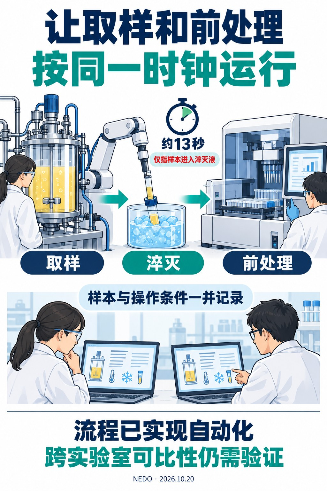
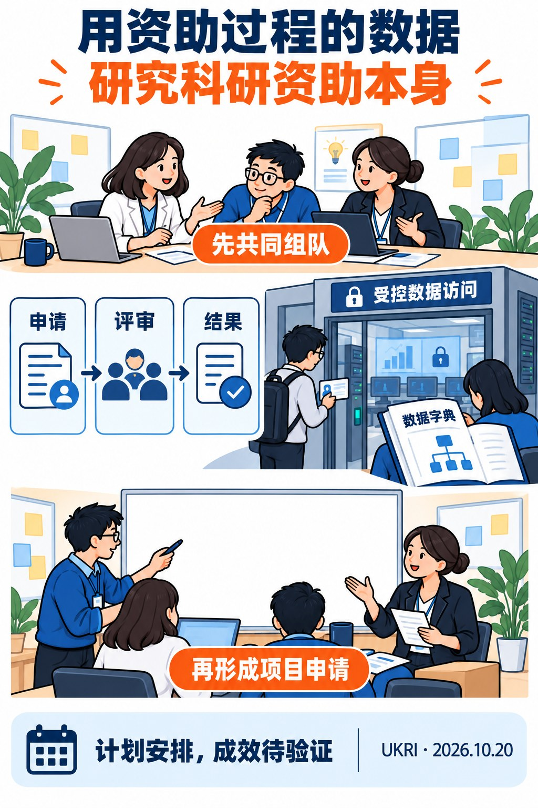
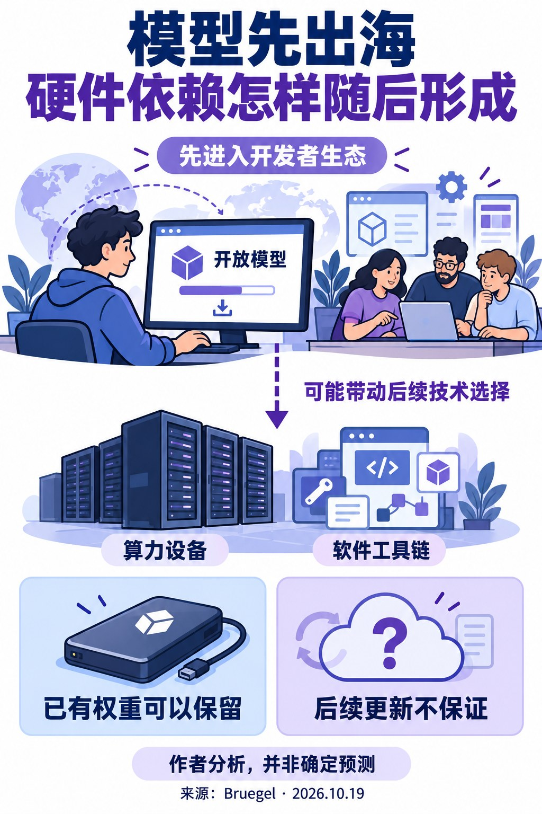
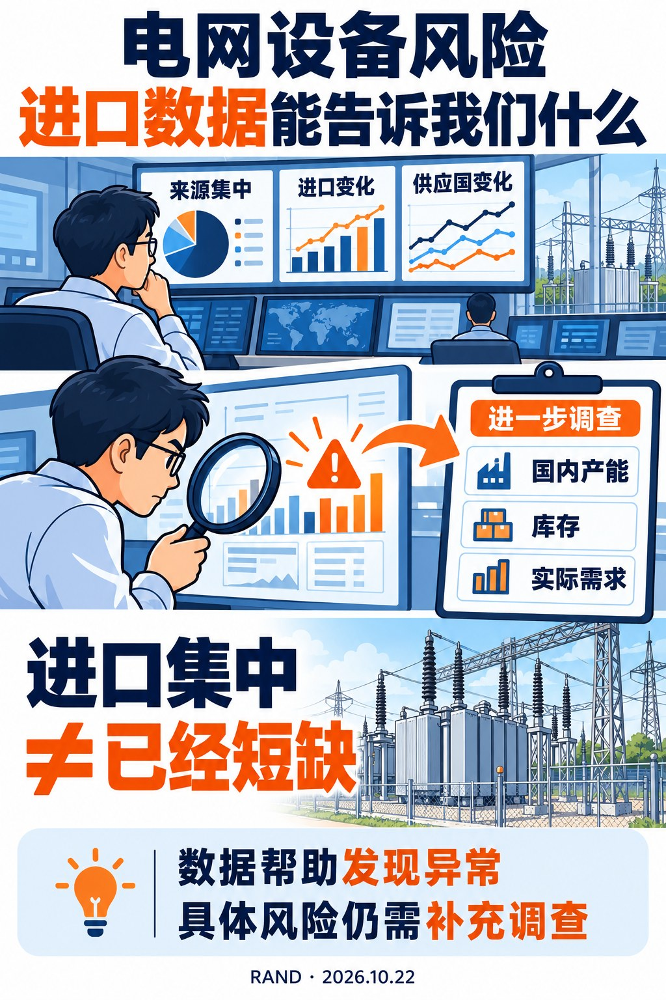
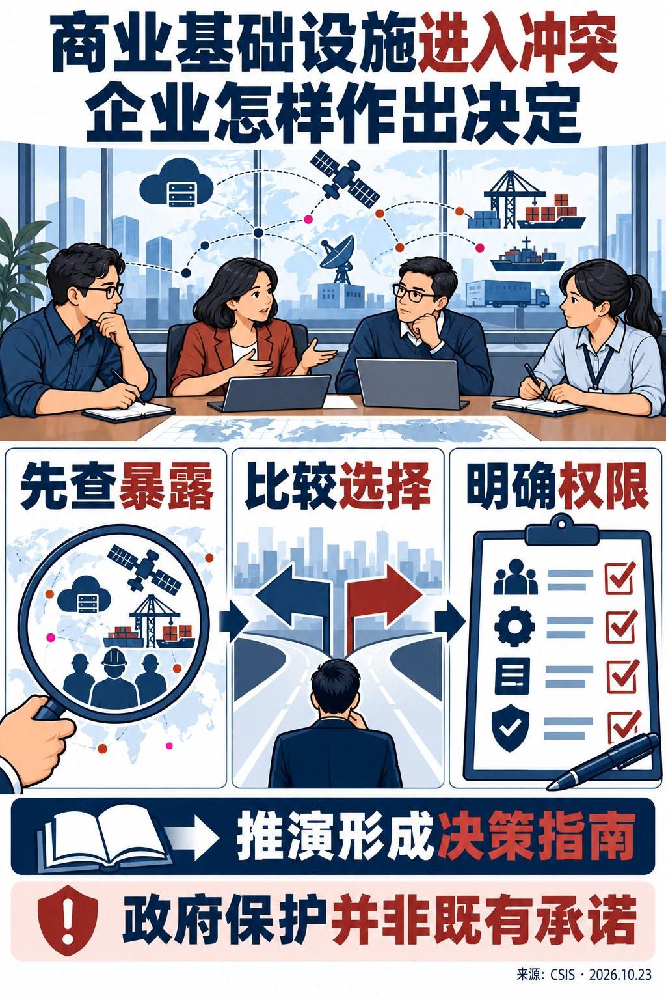
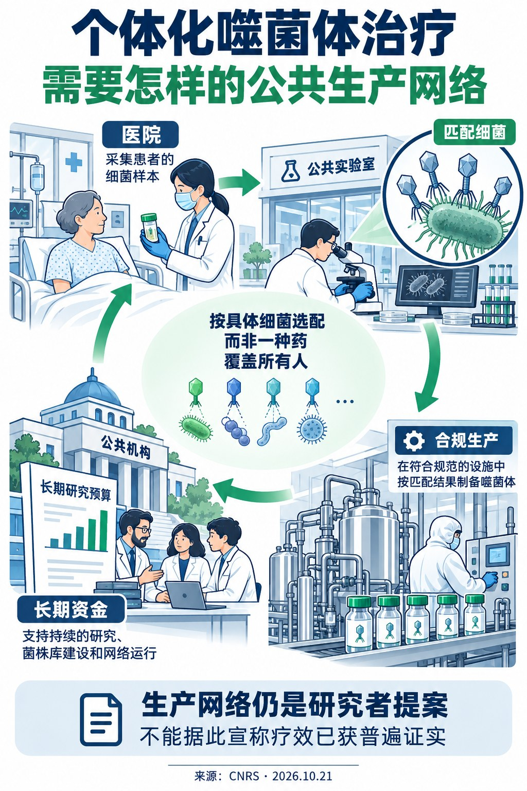

# 国际科技智库周报（2026-10-25）｜资料窗口：2026-10-19 至 2026-10-25

本期收录概况：收录 24 条｜重点 6 条｜本期收录机构 18 家。

<!-- weekly-editorial-sha256: 374101cccd9a4347a77f674a394cdceafb7a3b0d23084ba205b724241b4889fc -->

## 从实验流程到公共服务，读懂具体安排

本期并列观察科研资助、实验自动化、技术依赖与公共服务。先看谁在解决什么问题，再看流程、数据与责任怎样安排；已实现的变化与仍待检验的方案分别阅读。

## 值得细读的发现

### 取样时间统一了，可比性仍要验证

神户大学与岛津把取样、淬灭和前处理接成自动流程。约13秒只指样本进入淬灭液，不能解读为整套检测耗时。

原文：[日文概要、今回の成果、今後の予定，图1—3](https://www.nedo.go.jp/news/press/AA5_101976.html) · [阅读全文](#topic-01)

### 研究资助，也研究资助怎样作出决定

UKRI让团队围绕申请、评审和结果数据形成问题；数据字典支持先行设计，细粒度记录仍通过受控环境访问。

原文：[Sandpit process；UKRI administrative data；What we are looking for](https://www.ukri.org/opportunity/data-for-metascience-sandpit-2027/) · [阅读全文](#topic-02)

### 进口预警与实际短缺之间，还有调查

RAND结合集中度和进口变化筛查电网设备风险。国内产能、库存和需求并未被这些贸易指标完整覆盖。

原文：[印刷第1—13页，方法、表1—2及限制讨论](https://www.rand.org/content/dam/rand/pubs/perspectives/PEA5300/PEA5394-1/RAND_PEA5394-1.pdf) · [阅读全文](#topic-04)

[完整阅读导航（6 篇）](#reading-navigation)

## 主题展开

### 主题 01｜[P0] [让微生物取样和前处理按同一时钟运行](https://www.nedo.go.jp/news/press/AA5_101976.html)

- **来源**：日本新能源产业技术综合开发机构（NEDO）｜2026-10-20

#### 摘要导读

神户大学与岛津把微生物取样、淬灭和样品前处理接成自动流程，并记录样本和操作条件。约13秒只指样本进入淬灭液；跨实验室可比性仍是下一步工作。

#### 精华选编

### 难点出在测量以前

改变微生物的代谢途径，是工程生物学开发材料、化学品和其他产品的重要手段。研究者需要知道细胞在什么时刻产生了哪些代谢物，才能判断下一轮改造方向。可细胞离开培养环境后，代谢仍在变化；如果取样、降温和提取的节奏不同，测到的差异可能混入操作影响。

NEDO于10月20日介绍了神户大学与岛津制作所开发的自动代谢组分析平台。合作将培养过程中的取样、迅速停止代谢的淬灭、低温离心、代谢物提取及样品整理接起来，重点解决人工操作在时间与条件上的波动。项目源自2016—2021年的研发支持，并在此后继续开发，不能把整段研发历程写成本周刚启动。

### 自动化覆盖一串相互依赖的动作

平台将培养设备与样品处理装置连接。样本沿管路进入淬灭液，随后进行离心和提取，再整理到分析用样品板。公开说明给出的约13秒，是从取样到进入淬灭液的时间，不是完成整个代谢组检测所需的时间。

这种设计的价值不只在速度。细胞代谢变化很快，取样时间、等待时间和温度都可能改变最终读数。把连续步骤放在同一流程里，才能让“在培养到第几小时取样”真正对应可比较的实验条件。夜间和清晨的预定取样也可以自动执行，减少研究者必须守在设备旁的限制。

系统通过条码和传感器等记录样本身份与操作状态，并保留图像、时间和温度信息。自动化因此同时生成过程记录：出现异常读数时，可以回看样本经过了什么，而不是只剩一列最终浓度。对希望扩大实验规模的团队而言，可追溯性和设备吞吐量需要一起增长。

### 生长看起来相似，代谢未必相同

团队以四种大肠杆菌菌株开展验证，在最长约19小时的培养过程中持续观察。公开结果显示，即使生长曲线相近，不同菌株的代谢物变化仍存在差别。这提醒研究者，单看长得快不快，未必能识别代谢工程真正关心的路径变化。

这项演示支持的是平台可以按过程获取并区分代谢状态。它没有直接证明某种工业产品产量提高了多少，也不能仅凭自动取样推断研发周期已经大幅缩短。更进一步的判断，需要把这些测量与具体改造、产物和重复实验连接起来。

### 从一台装置走向可使用的研究能力

平台已布置在神户大学的智能细胞开发基地，可供企业利用。基地围绕设计、构建、测试和学习的循环组织研究，平台主要增强其中“测试”环节：让反馈更及时、条件更稳定，供下一轮设计使用。大学与仪器企业的合作，也把生物实验需求和设备实现放进了同一开发过程。

下一步计划包括扩大使用和提高不同实验室数据的可比较性。后者仍是需要推进的工作。设备已经自动运行，不代表跨机构的培养条件、样品处理和数据格式已经统一；若要把实验结果用于模型学习，这些差异仍需被明确记录和处理。

来源：[NEDO平台发布](https://www.nedo.go.jp/news/press/AA5_101976.html)，2026年10月20日。

### 主题 02｜[P0] [用资助过程的数据，研究科研资助本身](https://www.ukri.org/opportunity/data-for-metascience-sandpit-2027/)

- **来源**：英国研究与创新署（UKRI）｜2026-10-20

#### 摘要导读

UKRI以五天研讨组织团队，利用申请、评审和结果数据提出元科学项目；数据访问采用分层资格要求。

#### 精华选编

### 把申请和评审过程变成研究对象

科研政策常以论文、专利和项目结题结果衡量投入，但资源如何被分配、什么样的申请获得支持，同样影响知识生产。英国研究与创新署本次发布的元科学研讨式资助计划，把本机构的申请、同行评议、资助决定和结果数据作为研究资源，邀请团队研究科学体系怎样运行。它首先是一项组织研究的资助安排，成效要等项目实施后才能判断。

这里的元科学，是利用实证方法研究研究活动本身。行政记录的价值在于补足只看成功项目的视野：申请、评审与决定可以连在一起，帮助研究者提出有关选择机制的问题。不过，有记录不等于已经获得因果答案。数据覆盖哪些申请者、制度是否同时发生改变、未获资助者后来做了什么，都仍需要研究设计解决。

### 先围绕问题组队，再形成申请

计划安排五天集中工作：2027年3月1—3日现场交流，3月9—10日线上继续。参与者先讨论问题和可用数据，在引导与导师帮助下形成跨领域合作，最后向评审小组陈述项目。项目构想需要在研讨过程中产生；参加者不是带着已经完成的申请来争取一笔既定经费。

实时同行评议后，得到支持的团队再提交完整申请，仍需满足正式资助条件。这样安排把“找问题、找伙伴”和“审项目”连在同一个过程中。其吸引力在于让了解资助实践的人、熟悉数据的人和掌握研究方法的人较早对话；其实际价值取决于讨论能否形成可检验的问题，而不仅是跨学科团队名单。

导师和相关利益方参与设计讨论，但不能从本次资助中受益。企业、第三部门和政府人士可以参与，不过合计不超过参会人数的20%；他们可作为共同负责人或合作伙伴，不能牵头申请。项目由符合条件的英国研究组织牵头，也不支持国际合作。这些界限说明，开放参与与最终资金责任采用了不同规则。

### 数据开放有两道入口

敏感的个体层面行政记录通过UKRI DataLab在受控环境中使用。具有英国国家统计局安全研究服务或英国数据服务相应资质的研究者，可以申请访问；尚无资质的参与者先利用数据字典理解变量和结构。没有现成资质并不妨碍参加研讨，但不能因此直接接触个体记录。

这一区分值得注意：问题形成可以向更广的团队开放，细粒度数据访问仍需满足资格与安全要求。数据字典因此不只是技术附件，也是不同研究者能否共同设计项目的接口。实际研究还要面对变量解释、记录缺失、匹配和结果披露等工作，不能把安全环境等同于已经可直接使用的数据集。

### 项目资金与时间怎样衔接

计划公布总额200万英镑，按项目全经济成本的80%资助。完整申请截止2027年5月13日，项目预计7月1日开始，实施12—18个月，最迟2029年1月1日结束。投入不仅支持某个现成问题，也用于让团队围绕具体行政数据共同形成研究方案。

这项安排最值得继续观察的是两个结果：受控数据是否足以回答研究者提出的问题，以及实时组队和评审能否产生常规申请渠道不容易形成的合作。当前文件交代了机制与安排，尚未提供这些问题的答案。

来源：[UKRI征集说明](https://www.ukri.org/opportunity/data-for-metascience-sandpit-2027/)，2026年10月20日。

### 主题 03｜[P1] [模型先出海，硬件依赖怎样随后形成](https://www.bruegel.org/analysis/chinas-outbound-ai-strategy-starts-models-and-governance-and-ends-chips)

- **来源**：布鲁盖尔研究所（Bruegel）｜2026-10-19

#### 摘要导读

Bruegel认为，中国AI出海可能先扩散模型与治理合作，再逐步连接硬件和软件生态。已发布权重的使用自由，与持续获得下一代模型，是两种不同的依赖问题。

#### 精华选编

### 出海并非一次输出整套技术

Bruegel的分析把中国AI国际化拆成有先后次序的过程。作者认为，当前更容易向海外扩散的是模型和治理合作，芯片及其软件生态仍需先满足国内需求、补足能力；未来硬件条件变化后，已经形成的应用和开发者网络可能影响海外选择。这是一项关于发展路径的分析判断，并非宣布中国所有技术层已经具备同样的国际竞争力。

这个视角把注意力从某个模型的榜单名次，转向模型、开发工具、算力和服务之间的联系。外国开发者使用某一套工具，会增加配套投入的回报，也形成新的应用场景；随着用户和开发者增多，原本各自独立的技术环节可能逐步互相支持。

### 开放权重降低门槛，也留下新的依赖

公开模型权重使使用者可以保留、修改并在自己的基础设施上部署已经发布的版本。这降低了进入门槛，但不保证今后每一代前沿模型都继续开放。报告提示，后续版本的获得仍受开发者决策、盈利方式和技术出口规则影响。

这里需要分清两种权利：使用手里已有的模型，与持续获得未来改进。二者不同，才能准确理解开放的价值与边界。报告提到10月16日公布的相关技术出口规则草案，讨论其可能影响；草案不能表述为所有新限制已经正式执行，更不能推断已公开的权重会自动失效。

### 软件生态连接模型与芯片

作者以英伟达CUDA与华为CANN说明，硬件竞争还包含开发工具、兼容性和使用习惯。即使替代软件平台尚未广泛进入国际市场，模型如果越来越适配特定硬件，也可能减少未来迁移的部分成本，使今天的模型使用转化为明天的硬件需求。

这并不等于使用某个模型就必然被锁定在某种芯片上。报告讨论的是条件变化下可能形成的路径：开发者积累了哪些经验、应用依赖哪些库、下一代模型对硬件有何要求。价格、性能和兼容性都可能改变这一路径，不能只用国别解释每一次采购。

### 治理合作与商业扩散相互影响

报告同时讨论全球AI合作倡议、标准以及能力建设安排。作者认为，这些平台可以让技术使用方式和治理模板随合作扩散，但也明确指出相关组织的运行方式尚未充分检验。加入一个合作框架不等于所有成员已经采用同一套技术或规则。

作者还提出一个张力：下游开放模型和包容性合作可以吸引使用者，上游原材料或技术限制却可能促使同一批使用者寻求替代。商业吸引力与经济安全工具之间的关系，因而不是单向加强的。

### 欧洲面临的选择

文章建议欧洲参与相关治理讨论，同时不预先认可某一整套模板；在具有合理安全要求的范围内，让质量和价格发挥作用，并鼓励企业保留切换模型的能力。作者还主张通过合作补足算力和治理能力。这些是面向欧洲的政策建议，而非欧盟已采纳的路线。

这份分析最有用的区分，是把“现在可以使用什么”与“以后会依赖什么”分开观察。其判断依靠产业和政策案例综合而来，没有估计某种依赖必然发生的概率。后续应看软件迁移成本、硬件供给与真实部署如何变化，而不是把技术输出的先后顺序视为已经确定的终局。

来源：[Bruegel分析](https://www.bruegel.org/analysis/chinas-outbound-ai-strategy-starts-models-and-governance-and-ends-chips)，2026年10月19日。

### 主题 04｜[P1] [电网设备风险：进口数据能告诉我们什么](https://www.rand.org/pubs/perspectives/PEA5394-1.html)

- **来源**：兰德公司（RAND）｜2026-10-22

#### 摘要导读

RAND用2016—2025年美国进口记录，把来源集中、价格波动和数量下降组合成电网部件风险信号。指标用于决定进一步查什么，不能单独证明短缺或衡量全部国内需求的对外依赖。

#### 精华选编

### 先找值得追查的部件

美国能源部就大电网系统安全征求信息后，RAND研究团队提出用公开贸易数据筛查设备供应风险。报告覆盖2016—2025年的美国进口记录，试图在昂贵而复杂的全面供应链调查之前，先识别哪些部件出现了异常，值得进一步查清。

这项研究处理的是进口端的可见变化。一个设备类别来自少数国家、价格突然上涨或进口量持续下降，都可以成为追查线索；但进口减少也可能来自本国产量增加或技术替代。报告因而没有把风险分数直接解释为缺货概率，更没有用它判断美国全部需求对海外的依赖程度。

### 五个指标怎样放在一起

结构指标包括供应国集中度和供应国数量，分别描述来源是否集中、替代来源是否稀少。动态指标包括数量低于历史平均的波动、价格高于历史平均的波动，以及连续三年同比进口量下降的累计幅度。

作者先把关键部件与海关商品编码对应，再利用贸易数据构造指标。映射并非简单按名称查找：团队结合能源贸易分类、广泛的商品编码和海关裁定，补充并校正对应关系。编码如果把不同用途的产品混在一起，后面的精细计算仍会受到影响。

各指标标准化后组合为一个分数。其中两项结构指标各占八分之一，三项动态指标各占四分之一；供应国越多，风险贡献的方向相反。动态指标比较同一部件不同时期，结构指标则与同侧电表设备的同类群体比较。因此，这是一种混合历史异常和相对集中度的筛查方法，数值本身不是直观的损失金额。

### 集中度数字的分母非常重要

下表列出原报告表2的三个例子。分母均是2025年美国在相应商品类别中的进口，而非美国使用量，也不是全球市场份额。

| 设备类别 | 最大来源国 | 占该类美国进口比例 |
| --- | --- | --- |
| 核反应堆 | 加拿大 | 100.0% |
| 生产井设备 | 韩国 | 99.5% |
| 水力涡轮机 | 捷克 | 96.9% |

来源：RAND报告表2，印刷第11页。生产井类别使用接近完整钻探和生产平台的编码，地热设备实际可能按部件进口；类别名称不能脱离编码限制解释。

报告据综合分数还识别出汽轮机、部分发电设备、导线及大型变压器等关注对象。不同部件可能由不同指标推高分数，不能根据一个总排名给出同一种处置。来自盟国的集中供应与来自战略竞争对手的集中供应，也涉及不同的风险情境。

### 政策工具需要第二轮诊断

作者提出的选项包括细化贸易统计编码、适当披露生产和供应链信息、推动设备标准化和模块化、加强电力公司与大型新增负荷之间的需求预测，以及研究关键设备储备。细化编码解决“看不清”，需求协调解决“各自采购”，储备则处理冲击时的缓冲，它们针对的环节不同。

报告明确没有为每个部件匹配最优政策，也没有完成成本收益排序。国内产量、库存、实际需求和全球替代来源仍需补齐。最稳妥的用途，是把公开数据变成追问清单，再由工程和市场调查解释异常，而不是让一个风险分数替代采购或产业判断。

来源：[RAND政策回应](https://www.rand.org/pubs/perspectives/PEA5394-1.html)，2026年10月22日。

### 主题 05｜[P1] [商业基础设施进入冲突，企业怎样作出决定](https://www.csis.org/analysis/no-front-lines-decision-guide-companies-caught-conflict)

- **来源**：美国战略与国际问题研究中心（CSIS）｜2026-10-23

#### 摘要导读

CSIS以六次情境推演和企业案例整理决策指南：先查清人员、资产和服务依赖，再比较维持、收缩或退出方案，并明确紧急行动权限。政府保护安排仍是报告建议。

#### 精华选编

### 云服务和通信企业也会被卷入战争

CSIS这份报告讨论一个企业经营问题：提供云、通信、网络安全和物流等服务的公司，可能同时支撑民用生活与军事行动，即使从未把自己定义为防务企业，也会承受冲突风险。继续服务、缩减业务和退出市场，都可能伤及员工、客户或其他依赖基础设施的人。

作者把六次企业与政府人士参与的情境推演、访谈和案例整理为决策指南。推演中的虚构科技公司在交战双方都有业务；参与者先根据公司与冲突情况作出选择，再应对首席执行官突然公开支持一方的变化。这种设计考察的是决策张力，不能把参与者选择当成现实企业总体的行为比例。

### 在算损失以前，先补信息缺口

指南要求同时形成两份判断：冲突可能怎样发展，公司究竟暴露在哪里。前者关心各方目标、持续时间、外部支持和关键不确定性；后者要盘点人员、设施、数据和知识产权，以及收入和客户依赖。只看当地营收会遗漏一个重要问题：公司停止服务后，医院、居民或其他企业会受到怎样的影响。

财务承受力也不是固定常数。一次短暂中断与数年收缩需要不同预案；可以迁移的数据与无法迅速搬走的数据中心，面临的风险不同。报告因此先要求把事实和假设写清，再讨论公司价值、员工立场、股东要求与董事会容忍度。

### 六种选择，都是待检验的初步方案

指南列出的路径包括维持双方业务、局部收缩、分离防务相关业务、退出其中一方，以及退出双方。局部收缩可以保留最小服务，但必须回答最小团队能维持多久；分离子公司或业务线，也要核实外界是否真的会因此区别对待，而不能假定组织图改变就自动降低风险。

报告用物理、财务、法律合规和声誉四类风险组织讨论，网络与软件供应链风险会跨越这些类别。它提供的二十项问答表用于迫使决策者明确分歧，不是经过验证的灾难预测模型。最终选择还要回到具体员工、资产和服务，检查最坏情况下是否仍可执行。

### 真正的压力测试，是明确谁能行动

缓释措施不能停留在“加强管理”。报告强调常设危机委员会、固定更新节奏、备用通信与撤离路径、紧急支出的流动性，以及在董事会无法及时开会时谁有权停运或撤离。预案还要写出触发条件，让人员在压力下知道何时从常规方案转入备用方案。

微软在乌克兰的案例说明，退出可以分阶段发生：停止新增销售、缩减经营、调整续约和服务，并不必然在同一天完成。报告依据公开声明、访谈和财报重建过程，没有进入公司内部决策现场。这个案例的阅读价值是呈现选择怎样随时间变化，而不是证明某一步决策已经消除了全部风险。

### 企业与政府之间存在责任缺口

推演参与者对政府能提供何种保护缺少稳定预期。作者因而另写一份面向总统的建议备忘录，讨论资源限制、企业之间的差异，以及保护企业可能带来的升级风险。备忘录主张在特定冲突情境中给出更明确的威慑和沟通安排；它是作者的政策提议，并非已经生效的美国保护承诺。

报告也提供AI辅助整理信息的提示词，但决策责任仍在管理层与董事会。对这份指南最有价值的使用方式，是检验信息、权限和服务依赖是否被真正讨论，而不是把情境推演中的评分机械套到另一场冲突。

来源：[CSIS《No Front Lines》](https://www.csis.org/analysis/no-front-lines-decision-guide-companies-caught-conflict)，2026年10月23日。

### 主题 06｜[P1] [个体化噬菌体治疗，需要怎样的公共生产网络](https://www.cnrs.fr/en/update/phage-therapy-microscopic-predators-countering-antibiotic-resistance)

- **来源**：法国国家科学研究中心（CNRS）｜2026-10-21

#### 摘要导读

法国已有按药品标准生产和临床使用噬菌体的实践，研究者主张连接医院与实验室的现有能力，并以长期资金维持生产。全国公共网络仍是提案，疗效证据也需继续积累。

#### 精华选编

### 治疗产品要随病原体而变

噬菌体是感染特定细菌的病毒。它们的选择性为处理耐药感染提供了研究方向，也带来了组织难题：必须先识别患者的致病菌，再找出能够作用于它的噬菌体。产品并非完全固定，检测、菌种收藏、筛选、生产与临床使用需要持续衔接。

法国国家科学研究中心的本周专题把重点放在这种治疗怎样获得可持续的供给。报道中的研究者将噬菌体视为抗生素的补充，并强调两者可能协同作用。细菌和噬菌体还会共同演化，耐药性也可能出现，因此不能把它写成已经解决抗生素耐药问题的替代品。

### 已有临床使用，仍缺充分疗效证据

法国从2022年起通过同情使用机制，让部分患者在正式上市许可之前接受特定噬菌体治疗。里昂公立医院已获药品监管机构许可，按药品质量要求生产治疗用噬菌体；PHAGEinLYON Clinic项目也已为100多名复杂感染患者提供个体化治疗。

这里有两类不同证据。生产许可意味着相关制造流程满足规定要求，患者获得治疗则说明临床路径已经运行；两者都不能代替针对具体感染的可靠疗效评价。监管人士在报道中明确指出，临床有效性数据仍有限。临床试验需要足够稳定、合规的产品供应，而供应体系又常要等待治疗证据和市场前景，这形成相互依赖。

### 为什么提出公共生产网络

参与法国国家研究署Phag-One项目的社会科学研究者认为，仅靠传统工业药品模式，很难完整承接这种从患者细菌出发的定制过程。他们调查发现，公共机构已经分散拥有所需能力：医院能够识别患者和开展临床工作，实验室保存细菌与噬菌体，部分平台具备药品和医院制剂生产条件。

因此，提案不是从零设想一个包办所有工作的单一机构，而是把已有能力连接起来。不同单位承担检测、筛选、质量控制、生产和临床应用，在协作中维持供给。报道把可及性与可持续性列为这类公共体系的两个目标：既要让患者获得适用产品，也要避免无序使用再次耗损治疗资源。

### 科研经费与持续生产之间的缺口

研究者指出，当前不少噬菌体活动仍依靠科研项目经费，而医院持续生产需要专门人员、长期资金和稳定的法律安排。项目可以资助一次探索，却未必能维持样本收藏、质量体系和日常制备。如果基础能力随项目结束而中断，临床团队就难以形成可靠预期。

法国国民议会已有推动公共噬菌体治疗发展的法案提案，试图稳定法律与资金条件。其状态仍是提案，不能视为全国公共生产网络已经建立。报道真正提出的制度问题，是研究资助如何与医院服务的长期责任接续。

### 农业应用让协作范围进一步扩大

噬菌体研究也进入植物病害等领域。人、动物与环境中的耐药问题相互关联，不同场景又有各自的安全和环境约束。法国已有研究网络围绕噬菌体和治疗组织交流，但跨场景应用仍需分别验证。把这些活动放在同一讨论框架中，有助于共同研究演化和耐药机制，并不意味着一种临床做法可以直接移用于农业。

来源：[CNRS专题](https://www.cnrs.fr/en/update/phage-therapy-microscopic-predators-countering-antibiotic-resistance)，2026年10月21日。

## 本期简讯

### [自给能力越接近技术前沿，资源取舍越难回避](https://ecipe.org/insights/china-economics-of-self-sufficiency/)

欧洲国际政治经济中心（ECIPE）｜2026-10-19

ECIPE的Erik van der Marel从机会成本讨论中国技术自给：闲置资源转向新产业时，短期代价可能较低；接近资源约束后，投入某项技术的科学家、工程师和资本，就不能同时用于另一项。 文章特别指出，前沿知识常积累在少数专业团队和企业中，不能仅靠增加资金迅速复制。它提供的是一个解释取舍的经济学框架，没有测算各技术的最优自给程度，也不能据此认定某项战略投入必然不值得。

### [研究人才短期进企业，补上研发项目的人员缺口](https://eic.ec.europa.eu/news/bring-new-talent-and-expertise-your-company-innonext-2026-10-19_en)

欧洲创新理事会（EIC）｜2026-10-19

欧洲创新理事会介绍，InnoNext为符合条件的受支持企业提供3—6个月、经费全额覆盖的研究人才实践安排。企业先提出技能和项目需要，再通过平台匹配来自欧洲研究理事会、玛丽·居里行动等研究计划的人才。 截至本次通报，415组匹配已获确认，112项实践已经启动，另有226个机会开放。匹配、启动和空缺是不同状态，不能相加当作已完成项目。企业案例反映了维持研发进度和补充市场知识的用途，但尚不足以证明该安排对企业创新绩效的平均影响。

### [把AI领先换算成月份，模型假设决定政策结论](https://ifp.org/how-to-increase-americas-ai-lead-over-china/)

美国进步研究所（IFP）｜2026-10-19

IFP用综合能力基准估计中美前沿模型的时间差，并把训练算力和模型蒸馏纳入简化模型，以比较不同政策组合。报告估计当前差距约6.5个月，认为限制算力获取与抑制蒸馏若同时奏效，可能扩大差距；这是作者的情景结果，不是可直接观测的未来事实。 模型假设两国算法效率大体相同，并把训练算力比的对数映射为领先月份。作者承认强化学习、算法进步和算力分配等简化会影响结果。其研究价值在于公开政策推演怎样依赖假设，阅读时应把芯片数量估计、能力测量和干预效果分别审视。

### [共同使用定价软件，何时变成限制竞争](https://itif.org/publications/2026/10/19/pricing-algorithms-are-not-inherently-anticompetitive/)

美国信息技术与创新基金会（ITIF）｜2026-10-19

ITIF评论主张，监管应区分利用市场信息辅助独立定价，与通过非公开敏感信息和软件规则协调价格。文章讨论纽约相关禁令被部分阻止执行的案件，并引用司法部对RealPage的具体指控，说明问题不能只由“使用同一种软件”来判断。 原文也提到一项工作论文的双重结果：算法可能提高对市场变化的响应，同时使用者价格又更接近共同利润最大化的情形。因此，文章对技术的支持立场不能掩盖其自身引用的竞争疑虑；应继续追问数据共享和限制降价等具体机制。

### [用了AI的财政项目，哪些才算研发](https://www.stepi.re.kr/site/stepien/ex/bbs/publicationView.do?pageIndex=1&cbIdx=1303&reIdx=141&cateCont=A0508)

韩国科学技术政策研究院（STEPI）｜2026-10-19

把现成模型用于系统建设，是否就能计入研发预算？韩国STEPI用120个信息通信领域AI财政项目检验分类标准，并比较生成式AI判断与专家判断。加入OECD软件研发补充指引后，两个模型共同判为研发的项目由49个减到44个，变化集中在基础设施、示范和人才类活动。 对另一个46项目的专家调查中，10位专家意见完全一致的只有10项。报告据此主张按具体活动和阶段识别研发、分摊成本，并让统计、预算和税收支持采用共同标准；AI可辅助初筛，最终仍需专家和部门说明。研究范围限于特定部门和小规模专家样本，不能据此估计韩国全部研发预算的错分比例。

### [与欧盟AI规则接轨，先补执行机构和审核能力](https://www.ceps.eu/ceps-publications/artificial-intelligence-conformity-assessment-in-ukraine/)

欧洲政策研究中心（CEPS）｜2026-10-20

CEPS为联合国工业发展组织编写的乌克兰AI合格评定报告认为，法律对齐还需要标准、监管、认证认可、技术测试和人员能力配套。报告指出，乌克兰可以利用既有技术监管基础，但数据保护、AI监督架构和审核人才仍存在执行缺口。 作者建议跟踪并转化相关技术标准、建立AI审核课程，并为统一数字监管机构可能延迟到位准备替代安排。它是一份关于制度准备的政策研究，资料截至2026年8月；实施进度仍取决于法律、机构和专业能力的同步建设。

### [数据中心协议不透明，地方政府怎样积累谈判经验](https://fas.org/publication/data-center-task-force/)

美国科学家联合会（FAS）｜2026-10-20

美国科学家联合会发现，数据中心与地方政府的社区利益协议常在保密条件下谈判，其他城市难以比较条款和学习经验。本周宣布组建工作组，由地方政府人员、随需参与的专家和公众分阶段参与，形成可供各地调整的协议模板。 讨论范围包括公用事业成本、水资源、噪声、退出处置，以及执行和信息披露。计划到2027年4月持续开展会议，2027年3月公开草稿征求意见。当前发布的是共同开发工具的安排，尚无模板实施后给社区带来多少净收益的证据。

### [研发团队的AI试点，卡在数据与工程工具衔接](https://www.mckinsey.com/capabilities/operations/our-insights/operations-blog/rewiring-r-and-d-for-the-agentic-age)

McKinsey & Company（Operations）｜2026-10-20

麦肯锡在研发负责人论坛前开展的48人调查显示，受访者对AI改变研发抱有较高预期，但七类研发用例中，报告已超出概念验证并实现规模化的比例只有13%。数据可用性与质量、嵌入工程流程和工具，是最常被提及的障碍。 文章提出让平台团队与工程师共同工作，并与产品生命周期管理、验证工具连接。对安全关键产品，虚拟验证仍须遵守允许的标准并建立验证证据。这项小样本论坛调查不能代表全部企业，文中宏观收益估计也不是已经实现的成果。

### [海底设施安全，维修和监测能力也是关键](https://www.rand.org/pubs/research_reports/RRA4027-1.html)

兰德公司（RAND）｜2026-10-20

RAND关于海底电缆、管线等基础设施的报告指出，社会对这些设施的依赖增长，比检查、维修和归因能力建设更快。设施受到损伤后，发现、确认原因和恢复服务都可能花费时间，进而压缩政策选择空间。 报告将韧性、监测、跨部门合作和审慎回应放在一起讨论：既要降低破坏带来的收益，也要避免在证据尚不充分时过度升级。这些方案着眼于降低脆弱性，威慑效果仍取决于具体对手、设施和应对能力。

### [建筑业缺人，先看同类企业之间的效率差距](https://www.diw.de/de/diw_01.c.1022864.de/publikationen/wochenberichte/2026_43_1/produktivitaet_in_der_bauwirtschaft__trendwende_erforderlich.html)

德国经济研究所（DIW Berlin）｜2026-10-21

德国建设需求增加，用工却趋紧。DIW基于贝塔斯曼基金会委托研究发布本周报告：匿名企业统计显示，同一细分行业、相同规模的建筑企业，劳动生产率仍差异很大。以2022年数据测算，若低于本组中位数的企业都达到中位数、其他企业不变，人员不增，总增加值可高约12%。这是模型估算，尚未实现。 作者建议加快模块化预制、数字化规划审批等已有做法的扩散，并由公共采购试点探索施工机器人。工地分散，技术使用也涉及责任与许可；报告没有证明某项采购办法就能兑现上述12%。

### [供应链重排，怎样被海关重新解释](https://ecipe.org/insights/customs-policy-and-trade-defence/)

欧洲国际政治经济中心（ECIPE）｜2026-10-21

ECIPE刊登的关税分析讨论，企业转移生产地或分批进口部件，可能遇到更严格的原产地与商品归类解释。文章回顾摩托车转产案例，并讨论10月7日有关分批进口电动自行车部件的欧盟普通法院判决：判断是否构成完整产品，可以考察多批货物之间的商业联系，而不只看是否同日入境。 作者提醒企业把生产安排的经济理由、发票和交易关系放在一起审视。文中对新判决注明尚非最终结论；对未来海关数据平台和规则收紧的讨论也包含预判。企业需要持续核查适用规则，而不能把已有供应安排视为分类结果不变的保证。

### [英国呼吸道感染中心增加了接诊能力，但减压效果仍待验证](https://www.rand.org/pubs/research_reports/RRA5157-1.html)

兰德欧洲研究所（RAND Europe）｜2026-10-21

RAND Europe参与的过程评估考察英格兰急性呼吸道感染中心怎样组织服务。研究在2025年5月至2026年6月开展，覆盖42个综合照护委员会中的35个，并结合23次访谈、三场公众小组讨论和研讨会。 中心为基层接诊提供了额外能力，使用者反馈总体积极，但不同地区的模式差异很大，尚缺乏证明它们减轻急诊压力的稳健证据。报告将改进重点放在提前确定资金、清晰的转诊和预约、信息系统衔接及按需求扩缩服务。这是实施过程评估，不能把服务已开展等同于总体医疗效果已经证实。

### [数字资产托管，关键还在交易权限与系统衔接](https://www.bcg.com/press/22october2026-digital-asset-custody-safekeeping-into-core-financial-infrastructure)

波士顿咨询公司（BCG）｜2026-10-22

银行开展代币化资产和区块链支付业务，需要同时决定谁保管私钥、谁批准交易以及谁承担责任。BCG受Ripple委托发布的报告，将企业自托管、钱包服务、托管服务和非托管钱包区分为四种模式，建议按投资、资金管理和支付等用途组合选择，而非把托管当成一次独立的技术采购。 报告考察的三起安全事件提示：即使加密系统未被攻破，交易批准与独立核验的漏洞仍可能造成损失。银行采用多家服务商时，还需统一权限、政策和报告，并接入原有银行系统。这里呈现的是咨询报告的制度建议；其收益测算属于示例情景，不能当成已经实现的利润。

### [海洋钻探资助把陆地到海洋的研究接起来](https://www.dfg.de/en/news/news-topics/announcements-proposals/2026/ifr-26-80)

德国研究联合会（DFG）｜2026-10-22

德国DFG发布海洋钻探重点计划（SPP 527）新一轮征集，支持最长三年、2027年开始的海洋科学钻探相关研究。该计划在2024年已获延续至2025—2030年，本次是年度项目征集，不是新设六年计划。 研究可利用过去和正在开展的航次数据、岩芯，也可准备未来航次、开发钻探工具和软件，但必须与具体钻探项目相连。一个新增方向是与大陆科学钻探计划合作开展“陆地到海洋”项目，用连续观测研究海岸淡咸水、冰盖与海平面等相互联系的问题。欧日共同牵头的国际框架提供任务方向，年度联合学术会议则用于连接项目网络。

### [毕业后留用人才的费用，可能先落到大学头上](https://itif.org/publications/2026/10/22/america-trains-worlds-best-stem-talent-why-make-them-leave/)

美国信息技术与创新基金会（ITIF）｜2026-10-22

ITIF评论关注美国国土安全部提出的毕业后实践训练（OPT）费用方案：大学首次推荐F-1学生参加毕业后实践训练，要支付7万美元，后续推荐另需3万美元。对继续申请理工科（STEM）延长期的毕业生，两项可能合计10万美元。这仍是提案，不能按已经执行的收费描述。 作者认为，费用可能让大学更少推荐学生，并主张以核查可疑雇主、验证真实工作和匹配税务工资记录处理滥用问题。文中所引2024年数据为临时签证持有人取得美国计算机与信息科学博士的58%、工程博士的51%；这些比例说明人才渠道的重要性，并不直接预测提案实施后的流失人数。

### [数据中心和芯片投资热，不能代表整个制造业复苏](https://itif.org/publications/2026/10/22/semiconductor-data-center-boom-does-not-make-manufacturing-rebound/)

美国信息技术与创新基金会（ITIF）｜2026-10-22

ITIF的Robert Atkinson提醒，少数行业的大额建设投资可能掩盖制造业其他部分的停滞。他引用Jefferies分析称，自2025年以来被追踪的制造业投资公告中，半导体和先进技术约占70%，生物制药约占18%，其他行业合计约12%。这是投资公告结构，不是实际产出结构。 文章主张同时看多数细分行业的实际增加值、产能利用和贸易表现，而不能只用工厂建设或就业变化判断复苏。其数据来自对投资银行报告的引用，观点也带有明确的产业政策主张；因此，投资公告还需与实际建设、生产和经营数据相互对照。

### [小卫星任务先把科学目标与用户需求一起论证](https://www.ukri.org/opportunity/small-satellite-missions-sandpit/)

英国研究与创新署（UKRI）｜2026-10-22

英国小卫星任务资助准备先让科学家、工程团队和潜在用户共同设计任务，再支持5—6项早期可行性研究。讨论不仅涉及卫星载荷，还要说明轨道、平台、数据处理，以及最终用户怎样使用观测结果。 本轮安排约30人参加研讨，计划支持从2027年5月开始、为期11个月的研究。187万英镑是全经济成本口径，UKRI按80%资助；2028—2030年后续约2000万英镑仍取决于阶段评审等条件。企业可参与合作，但不是本轮直接牵头申请者；这是一项任务形成与筛选安排，尚非卫星建成或发射成果。

### [东南亚的AI选择，可能藏在通信与云合同里](https://www.aspistrategist.org.au/chinas-infrastructure-advantage-could-shape-southeast-asias-ai-choices/)

澳大利亚战略政策研究所（ASPI）｜2026-10-23

ASPI分析认为，东南亚的AI供应商选择常随通信网络升级、云合同和软件服务逐步形成，而非一次单独购买模型。文章以老挝电力应用和区域电信合作说明，本地化应用可以与境外算力、维护和更新相连接。 作者将关键问题放在谁能审计、维护、修改和替换技术。低成本与快速交付确有吸引力，风险则在于依赖积累后切换变难。文章是对案例的综合判断，不能据此认定所有使用中国模型的国家都已形成不可逆依赖。

## 阅读导航

- [主题 01｜让微生物取样和前处理按同一时钟运行](#topic-01) · 日本新能源产业技术综合开发机构（NEDO）
- [主题 02｜用资助过程的数据，研究科研资助本身](#topic-02) · 英国研究与创新署（UKRI）
- [主题 03｜模型先出海，硬件依赖怎样随后形成](#topic-03) · 布鲁盖尔研究所（Bruegel）
- [主题 04｜电网设备风险：进口数据能告诉我们什么](#topic-04) · 兰德公司（RAND）
- [主题 05｜商业基础设施进入冲突，企业怎样作出决定](#topic-05) · 美国战略与国际问题研究中心（CSIS）
- [主题 06｜个体化噬菌体治疗，需要怎样的公共生产网络](#topic-06) · 法国国家科学研究中心（CNRS）
