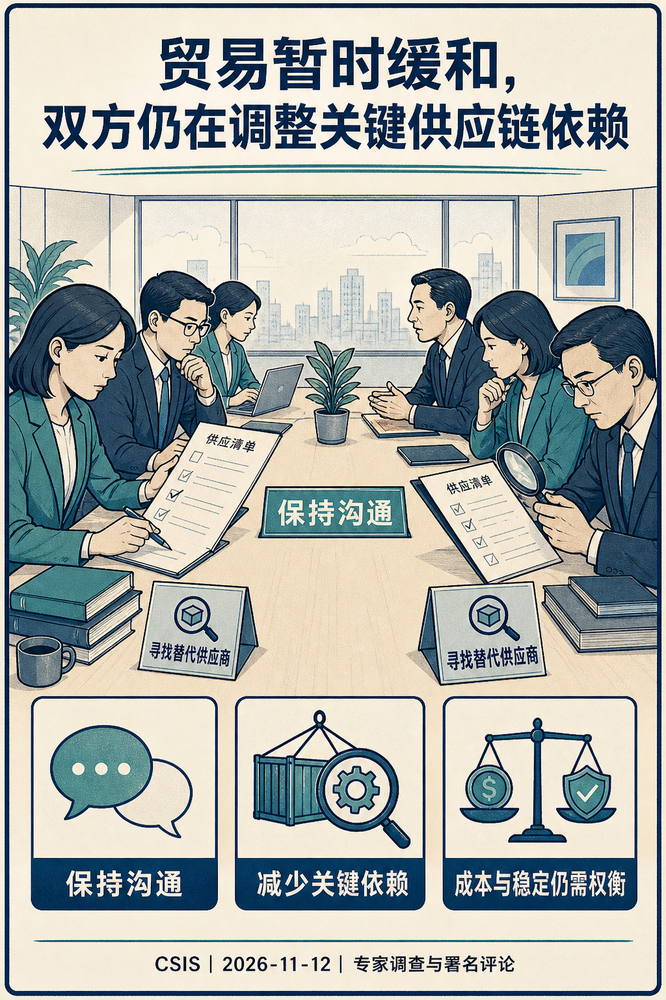
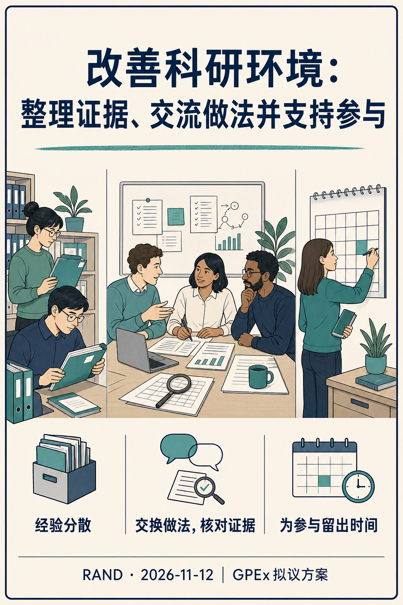
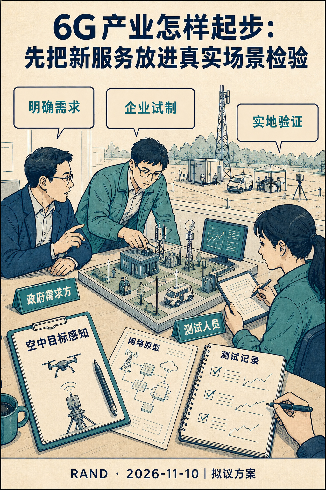
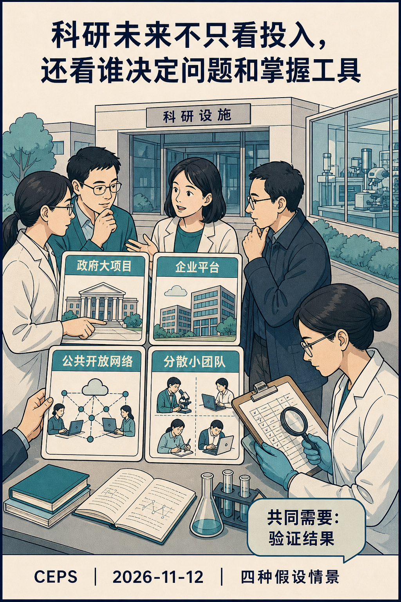
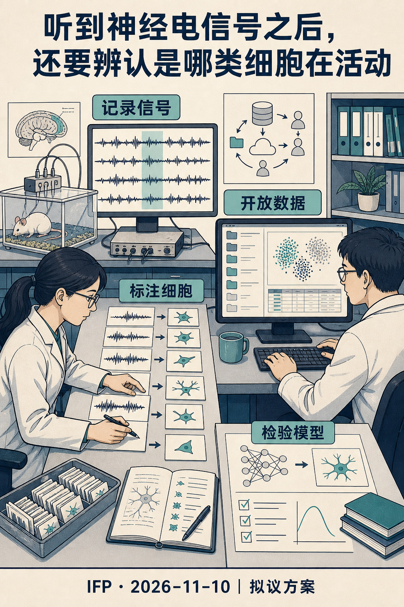
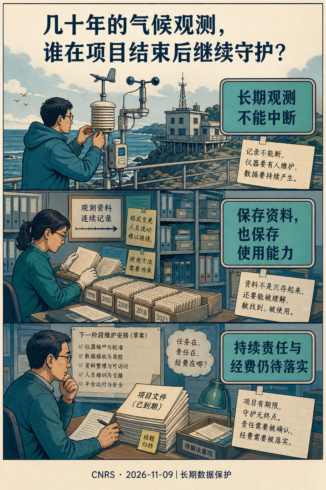

# 国际科技智库周报（2026-11-15）｜资料窗口：2026-11-09 至 2026-11-15

本期收录概况：收录 31 条｜重点 6 条｜本期收录机构 20 家。

<!-- weekly-editorial-sha256: d81aafbfeed23e79cf26b9411b312e4673cf00d2b254366adaffdfd0a7d0ae64 -->

## 经验怎样共享，长期资源由谁维护

本期并列观察科研组织、技术试点和经济关系：谁维护长期资源，谁把经验变成可用做法，谁承担调整成本。

## 值得细读的发现

### 让经验交流有可投入的时间

GPEx把证据整理、同行交流与参与工时支持放进同一拟议安排。

[来源原文](https://www.rand.org/pubs/research_reports/RRA4061-1.html) · [阅读全文](#topic-02)

### 长期数据不能只靠短期项目

气候观测需要连续记录，保存数据还需要维护和使用服务。

[来源原文](https://www.cnrs.fr/fr/actualite/la-france-future-terre-dasile-des-donnees-scientifiques-sur-le-climat) · [阅读全文](#topic-06)

[完整阅读导航（6 篇）](#reading-navigation)

## 主题展开

### 主题 01｜[P1] [贸易休战为何仍需防范供应链重新分组](https://www.csis.org/analysis/resilience-and-reform-us-china-relations-and-global-economic-order)

- **来源**：Center for Strategic and International Studies｜2026-11-12

#### 摘要导读

CSIS呈现专家对贸易调整责任和规则改革的分歧；阶段性缓和与关键供应链去依赖可能同时发生。

#### 精华选编

CSIS于11月12日发布《韧性与改革》，汇集三轮中美非官方专家对话调查及署名评论，讨论贸易仍在运行、关键依赖却持续调整的经济秩序。

### 同意需要改革，仍可能选择不同路线

2026年7月调查中，中国组84.6%的回答认为缓解贸易失衡应优先由美欧扩大对中国投资者的开放；国际组58.8%则选择中国调整国内经济。两组对WTO改革也有分歧：前者更重视约束经济安全工具和改善争端解决，后者更倾向部分成员先行达成协议、增加制度灵活性。

### 缓和与减少依赖同时发生

Mary E. Lovely认为，相互反制维持了阶段性稳定，但两边仍在寻找替代供应、减少关键依赖。这个过程可能降低冲突暴露，也会增加重复建设成本；一方调整更快，还可能打破旧平衡。徐奇渊则强调，贸易和金融承受住冲击，不意味着原有秩序原样延续，联系可能越来越按安全考量分领域保留。

调查每组通常不足20人，国际组多数来自美国，且三轮人员和问法有所变化。它呈现的是参与者分歧，不能代表两国民意，也不能用比例变化直接证明同一批人转变立场。

### 主题 02｜[P1] [改善科研环境，怎样把分散尝试变成可用经验](https://www.rand.org/pubs/research_reports/RRA4061-1.html)

- **来源**：RAND｜2026-11-12

#### 摘要导读

GPEx拟把证据整理、同行交流和参与工时支持结合起来，使改善科研环境的经验更容易被其他机构使用。

#### 精华选编

### 先整理证据，再安排交流

英国不断出现改善科研环境的项目，各机构却难以知道哪些做法值得借鉴。RAND与合作伙伴提出建设良好实践交流平台GPEx，把实践经验、评价工具和同行学习连接起来。

方案要求专人维护有明确出处的证据，并提供评价模板。交流可以采用跟岗、短期借调和围绕具体问题组织的工作坊；每轮结束后整理经验，调整下一轮活动。资料库由此需要持续维护，参与者也需要能实际投入时间。

### 谁负责工作，谁决定经费

拟议联合体由独立机构牵头，向UKRI承担履约责任；合作方组织本地区、本领域的活动。项目委员会审批计划与预算，执行团队维护资料和监测，主题团队提供实际经验。独立评估者跟踪活动如何产生变化。

报告比较五年50万、250万和500万英镑三档预算，认为所设想功能至少需要250万英镑。其中应专门补助参与者的部分工时，避免小机构只能靠无偿贡献。以上均是设计和测算；共创过程的企业参与仍有限，方案尚须在实施中检验。

### 主题 03｜[P1] [6G产业政策，先检验谁愿意为新服务付费](https://www.rand.org/pubs/research_reports/RRA4368-1.html)

- **来源**：RAND｜2026-11-10

#### 摘要导读

RAND建议以可验证的服务需求组织6G合作，通过逐级竞争试点决定扩展，并兼顾必要的在岸生产与盟友互通。

#### 精华选编

### 从设备竞争走向服务试点

美国本土移动网络设备商规模有限，而软件、云计算和平台企业具有优势。RAND比较五条政策路径后，建议把政府与企业合作，同必要的研发和生产在岸安排结合起来。

企业负责网络设计、商业服务和投资；政府明确优先需求，提供频谱、贷款与研发支持。作者建议首先试验让通信网络兼具探测、跟踪空中目标的能力，以具体服务带动设备需求，而非先假定扩大设备产量就能带来市场。

### 用竞争逐步验证，而非直接承诺全国铺开

方案要求确定牵头机构和评价指标，组织企业团队依次开展虚拟原型、实验室验证及实地试点，再按性能、互通与扩展能力选择系统。政府实验室承担测试，各企业可在满足公共需求的同时寻找商业收入。

这一分工仍面对张力：安全要求可能推动研发生产在岸化，跨国网络互通却需要盟友尽早参与。报告提出的2030年初步能力是目标，不是已经实现的结果；服务盈利和合作能否带动产业发展，都有待试点检验。

### 主题 04｜[P1] [科研由谁出钱、谁掌握工具，会改变哪些问题得到研究](https://www.ceps.eu/ceps-publications/science-in-2050-alternative-futures-and-lessons-for-today/)

- **来源**：欧洲政策研究中心（CEPS）｜2026-11-12

#### 摘要导读

CEPS比较四种科研组织情景，提出保护自主探索、持续验证研究结果，并明确合作中的预算与决策责任。

#### 精华选编

CEPS于11月12日发布《2050年的科学》，由33名专家参与研讨，按谁资助和控制研究、研究集中还是分散，构建四种未来，检验欧洲今天的科研选择。

### 同样增加投入，也可能留下不同缺口

政府大项目能集中资源处理长期任务，却可能挤压没有明确应用目标的探索。企业平台能加快发现，但算力、数据和发表渠道集中，会增加大学对平台的依赖。公共开放网络扩大大学、社区实验室等参与者的空间，却需要更多工作整合结果、统一标准；分散小团队反应灵活，证据规则各异又让可靠性判断更难。

### 验证结果与支持探索，需要稳定安排

作者建议为自主提出问题的基础研究保留经费，并持续支持研究方法、质量标准和人工智能生成结论的验证。公私合作不能只要求参与者联合申报，还要明确科研框架计划与欧洲竞争力基金的分工；地区承担任务，也应获得相应预算和决策权。

这些是政策情景及建议，并非已验证的未来。报告提出公共研究与创新投入达到GDP的3%，口径也不同于现行公私合计3%的目标。判断制度选择时，应同时看经费规模、研究者自主空间以及谁负责检查结果。

### 主题 05｜[P1] [为神经电信号补上细胞身份，需要怎样的团队](https://ifp.org/brain-cell-types/)

- **来源**：进步研究所（IFP）｜2026-11-10

#### 摘要导读

用专门团队持续生产带细胞身份标签的神经活动数据，再检验分类器能否跨物种使用，是这项拟议公共资源的核心。

#### 精华选编

### 听到信号，还要认出是哪类细胞

电极可以记录神经元放电，却常难辨认信号来自哪类细胞。Siegle提出建设开放标注数据集：先把已知细胞类型与活动对应，再训练分类器解释新的记录。

方案主要依靠动物数据。用光遗传方法标记指定细胞后，可将其身份与电信号配对；小鼠提供主要样本，猕猴用于检查特征能否跨物种保留。推广到人类之前，还需要手术组织等资料验证，不能假定动物模型天然适用。

### 经费需要支持持续生产公共数据

作者估计五年约需2000万美元：约1500万美元支持13人小鼠数据及模型团队，两家猕猴合作实验室各约每年50万美元。采集协议、质量标准和数据持续开放，使外部团队能够补充样本、比较模型。

这种工作需要工程与实验人员长期按同一标准生产、检查和发布数据。作者认为，通常围绕单个发现或特定疾病设定的资助难以充分支持它，因而提出专门联合体或聚焦研究组织等安排。其价值仍取决于标注质量、分类能力和跨物种验证；这是一项建设建议，并非已经取得的治疗成果。

### 主题 06｜[P1] [项目结束以后，谁来守住几十年的气候观测数据？](https://www.cnrs.fr/fr/actualite/la-france-future-terre-dasile-des-donnees-scientifiques-sur-le-climat)

- **来源**：法国国家科学研究中心（CNRS）｜2026-11-09

#### 摘要导读

CNRS提出，长期观测与数据保存需要持续责任和经费，不能只依赖三五年的项目。法国相关法案仍在审议，扩大Data Terra容量也只是成本估算。

#### 精华选编

法国国家科学研究中心11月9日的分析，把气候数据保护落到一个具体矛盾：观测要持续几十年，资助却常按三至五年的项目安排。测量中断后，扩充硬盘也补不回缺失的记录；数据保存因此关系到海岸、冰川和城市风险的长期判断。

### 让长期责任有明确承担者

文中讨论的法国法案于2月提出、仍在议会审议，拟把地球、气候和环境数据的收集、传播与保存纳入公共科研使命。受访研究者期待相应经费保障；文章没有证明法案已通过，也没有把机构当前自愿承担的维护工作写成稳定保障。

### 存得下，还要找得到、用得起来

Data Terra提供了可依托的基础。CNRS此前的背景介绍说明，它连接地球系统的五类数据资源，通过共同目录、数据描述和处理服务，使不同实验室的数据能够相互关联。34家机构与大学共同参与，逾200名全职人员从事相关工作。这解释了为何数据保护不能简化为购买存储设备：还需要持续的整理、质量检查和面向研究者的服务。[背景来源：CNRS，2025年4月25日](https://www.cnrs.fr/fr/actualite/federation-eosc-top-depart-pour-le-cloud-europeen-de-la-science-ouverte)。

本期文章援引CNRS地球与宇宙研究部门的估算：将Data Terra可用容量从100扩至600拍字节，约需1700万欧元，可为受威胁的外国气候数据提供接纳空间。这是扩容设想及估算，不是已经获批的投资。

### 保护数据，也必须作出取舍

保存能力和环境成本都有边界。文章主张由科学委员会选择有长期价值的数据，并保持其可查找、可访问、可互操作和可复用。面向三十年后的使用者，需要同时保证观测不中断、资料不丢失、数据还能被理解。

## 本期简讯

### [英国深科技融资增长，后期融资仍更依赖海外资本](https://dealroom.co/reports/the-state-of-uk-deep-tech-2026/)

Dealroom / Royal Academy of Engineering｜2026-11-09

Dealroom与英国皇家工程院的公开报告图表显示，截至2026年9月底，英国深科技融资达到127亿美元，高于2021年全年的96亿美元。但融资增长伴随资本结构差异：金额低于1500万美元的融资轮中，英国投资者提供58%的资金；在至少1亿美元的轮次中，这一资金占比降至18%，美国投资者提供59%的资金。这些数据提示，本国早期创新活跃与本国资本能否支持企业扩张，是两个不同问题。数字采用Dealroom的统计范围，不能等同于全部企业融资普查。

### [欧洲科技成长资本计划，引入长期机构投资者](https://www.eib.org/en/press/all/2026-415-major-institutional-investors-join-eib-group-and-eu-member-states-to-channel-over-eur10-billion-into-european-scale-ups)

European Investment Bank Group｜2026-11-09

欧洲投资银行集团公布科技冠军联盟，希望通过机构投资者和公共资金扩大欧洲科技成长企业融资。公告区分了两类资金：Tibi网络及私人投资者表达超过80亿欧元的投资意向；科技冠军母基金首轮获得约20亿欧元承诺，拟通过子基金支持企业扩张。联盟还提供投资平台衔接与政策对话安排。投资意向、基金承诺和未来动员目标处于不同阶段，不能加总后直接称企业已经获得相同金额的融资。

### [把代际公平拆成可比较的政策指标](https://joint-research-centre.ec.europa.eu/jrc-news-and-updates/new-jrc-tool-tracks-european-policies-well-being-future-generations-2026-11-09_en)

European Commission Joint Research Centre｜2026-11-09

欧盟联合研究中心推出代际公平指数，将年轻人与老年人的社会、经济状况，以及环境条件和社会韧性，整理为六个综合指标。工具覆盖教育、住房、温室气体排放、公共债务等27个政策领域，可比较各国情况及2010年以来的变化。它的价值是让“对下一代是否公平”从笼统判断变成可核对的问题；指标变化仍需要结合制度和背景解释，不能直接当作某项政策产生因果效果的证明。

### [家庭上网调查应分清线路慢、Wi-Fi差与不会用](https://itif.org/publications/2026/11/09/comments-to-ntia-regarding-2027-internet-use-survey-information-collection/)

Information Technology and Innovation Foundation｜2026-11-09

ITIF向美国国家电信和信息管理局提交意见，建议2027年互联网使用调查继续追问家庭不上网的首要原因，并增加数字技能不足的选项。资金应针对真实障碍配置，而不能只统计网络覆盖。 对于觉得网速不够的家庭，作者建议进一步问清哪些应用受影响、是否愿为提速付费，以及慢速是否只发生在个别房间。这有助于区分入户线路能力与家庭路由器设置问题。上述内容仍是调查设计建议，未被表述为已经采用的问卷。

### [产业扶持如何摆脱短期回报压力](https://itif.org/publications/2026/11/09/mobilizing-for-techno-economic-war-part-9-finding-the-political-will-to-transform-americas-economic-system/)

Information Technology and Innovation Foundation｜2026-11-09

Atkinson在ITIF的系列报告中主张，把先进产业的长期能力放到美国经济政策的中心。他提出以定向税收激励、拨款、低息贷款和行业主导研发中心，支持新企业完成商业化和扩大生产，同时调整人才与贸易政策。 文章批评只看短期股价的投资取向，并要求政策制定者为战略产业作出取舍。这是一套带有明确竞争立场的制度倡议，尚未给出足以证明整套安排有效的政策评估；其中对其他经济制度的判断属于作者立场。

### [外卖费率降了，餐馆利润就一定会上升吗](https://itif.org/publications/2026/11/09/will-delivery-app-fee-caps-help-korea-small-restaurants/)

信息技术与创新基金会（ITIF）｜2026-11-09

韩国拟议规则将佣金、支付、广告和配送等费用合计限制为订单收入的15%。ITIF指出，订单金额不同并不意味着同一配送路程的成本同比变化；平台还可能调整消费者收费、服务范围或推荐方式。 作者同时引用结果不同的美国研究：有研究发现受限制独立餐馆的订单与净收入下降，也有模型显示费率上限能增加餐馆利润但降低总体福利。韩国方案覆盖的服务与这些研究并不相同，不能直接移植结论；需要同时观察餐馆收入、订单和服务变化。

### [日德纯氢燃机示范转向现场验证，制造与电站整合分工明确](https://www.nedo.go.jp/news/press/AA5_101978.html)

日本NEDO（公共研发资助机构）｜2026-11-09

NEDO、川崎重工和德国RWE公布30兆瓦级氢燃气轮机示范进展。川崎在日本制造燃机，欧洲子公司组装并安装，RWE负责电站总体规划和配套设施。设备可调整氢与天然气的混合比例，适应氢供应逐步增长的阶段。现场后续将检验排放要求、燃烧稳定性、耐久性及运行表现。官方稿11月9日发表，开所式为11月6日；这是跨国现场验证的新进展，不能把它写成已证实商业经济性或已完成全部验证。

### [科研身份与材料核验，需要连起机构之间的信息](https://www.rand.org/pubs/research_reports/RRA5003-1.html)

RAND｜2026-11-09

RAND Europe研究荷兰科研领域的身份与文件欺诈风险，并比较澳大利亚、德国和瑞典的做法。官方摘要指出，各机构分散核验、缺乏统一记录，使实际发生频率难以估计，不能把零散案例当作整体规模。 报告建议在个人与机构层面衔接核查，明确隶属关系和资助披露要求，增加技术及国别知识，并为机构间信息共享设置隐私与数据保护规则。这些建议旨在兼顾研究合作与风险识别，尚未被证明能够消除相关风险。

### [EIC挑战型早期研究收到1138项申请，评审尚未完成](https://eic.ec.europa.eu/news/2026-eic-pathfinder-challenges-call-attracts-record-interest-breakthrough-innovators-2026-11-10_en)

欧洲创新理事会（EIC）｜2026-11-10

EIC公布Pathfinder Challenges申请情况：截至10月28日收到1138项提案，来自58国的5107个参与方，涉及能量采集材料、健康老龄化生物技术以及认知AI三个方向。本轮指示性预算为9600万欧元，拟大致平均分配。计划支持从早期探索到概念验证或实验室验证，并由项目经理推动项目间交流、探索成果应用与组合协作。11月10日发布的是申请和评审进展，结果预计2027年春公布；申请增多本身不能证明技术更成熟或资助有效。

### [量子产业扩展，需要共享制造设施和可比较的技术标准](https://www.scsp.ai/2026/11/commission-on-u-s-quantum-primacy-releases-preliminary-report/)

SCSP / Commission on U.S. Quantum Primacy｜2026-11-10

SCSP召集的美国量子优势委员会发布初步报告，建议把基础研究、软硬件协同开发、应用与产业扩展连起来。一个具体方案是设立全国量子代工设施使用计划，让企业共享制造、封装和测试条件，并推动基准测试与互操作标准。报告也主张保持可预期的基础研究经费，避免产业化压力挤掉探索。上述内容是委员会建议；完整报告预定2027年春发布，尚不能据此断言相关国家计划已实施或已见效。

### [DUNE低温容器进入建设，英国以大学和国家实验室分工参与](https://www.ukri.org/news/construction-begins-on-giant-underground-neutrino-experiment/)

UKRI／STFC｜2026-11-10

地下中微子实验DUNE开始建设大型低温容器，由费米实验室、欧洲核子研究中心和桑福德地下研究设施团队共同推进。英国参与由科学与技术设施理事会牵头，组织15所大学及两个国家实验室，分别提供探测器部件、数据采集、软件、计算和加速器技术。实验拟在相距1300公里的两端比较中微子信号。此次新增进展是容器建设，尚未取得目标物理发现；英国7900万英镑投入为2017年的承诺，不能列成本周新拨款。

### [用地区拍卖改善商业地下水取水权分配](https://www.diw.de/de/diw_01.c.1024625.de/publikationen/wochenberichte/2026_46_1/wasserentnahmerechte_fuer_gewerbliche_nutzung__regionale_auktionen_koennten_vergabe_effizient_gestalten.html)

DIW Berlin｜2026-11-11

DIW周报提出，在水资源紧张且商业用水集中的地区，可尝试拍卖地下水取水权。公共部门先按可持续供水确定可分配总量，再由企业申报不同价格下的取水需求，通过汇总需求形成分配价格，并随水资源条件调整额度。讨论针对的是当前按申请先后或行政裁量分配可能造成的低效率，前提仍是公共部门守住生态总量约束。这是一项制度设计建议，不能写成拍卖已经降低了缺水风险。

### [KISTEP建议用数据积累和再训练速度衡量人形机器人投入](https://www.kistep.re.kr/board.es?act=view&bid=0031&list_no=94918&mid=a10306010000)

韩国科学技术企划评价院（KISTEP）｜2026-11-11

KISTEP的投资策略简报认为，韩国已有较强硬件与制造能力，短板在机器人基础模型、行为数据和计算资源。报告建议，在开发本国机器人之外，建设企业与研究机构共同使用的数据、仿真和算力条件，并围绕制造、物流、照护等具体任务反复验证，让现场数据进入下一轮训练。评价不应只看造出多少机器人，也应观察数据积累量、再训练周期与性能改善速度。这是政策研究建议，尚不是已经实施并证明有效的新评价制度。

### [健康数据共享为何失去信任，需要拆开诊断](https://www.rand.org/pubs/research_reports/RRA5389-1.html)

RAND｜2026-11-11

RAND的《Trust Unpacked》建议，公共机构不要只调查“信任度有多高”，还应辨认公众究竟担心其能力、诚信、善意还是回应方式。报告以健康数据共享和警务为例，讨论同一机构如何在不同群体和事件中获得不同评价。 作者主张把调查、访谈、行为资料与计算分析结合起来。网络讨论能揭示具体担忧，却不能代表整体公众。下一阶段将开发并检验诊断框架，目前尚非已经验证有效的评估工具。

### [天然气先流出来，产业配套仍要提前建设](https://www.aspistrategist.org.au/what-the-beetaloo-could-do-for-the-northern-territory/)

澳大利亚战略政策研究所（ASPI）｜2026-11-12

达尔文大型企业组织主席Sam Jeffries在ASPI文章中讨论Beetaloo天然气开发，强调道路、管道、住房、技能和公共服务必须提前准备，才能让资源开发带动当地企业和制造活动。 其组织资助的展望提出扩大产量和就业的情景，但不是预测。作者呼吁联邦政府在可靠商业论证基础上参与前期基础设施，并协调土地、水和审批；井产能、客户、融资与许可仍决定项目节奏。这体现地方工商界的政策诉求，不能当作公共投资收益已被证实。

### [ERC把5亿欧元交给48个互补团队攻克单人难题](https://erc.europa.eu/news-events/news/erc-2026-synergy-grants-results)

欧洲研究理事会（ERC）｜2026-11-12

ERC公布2026年Synergy资助结果：957项申请中选出48个团队，总额5亿欧元。每组由两至四名专长互补的研究者组成，自主选择单人难以处理的问题；约35%的入选项目包含欧盟及关联国之外的研究者。项目案例中，SKUA将结合水下自主航行器、钻孔传感器和卫星分析，研究南极冰架下方与内部难以观测的变化。机制的重点是把测量和分析能力组合起来；资金获选不等于研究假设已经得到证实。

### [贸易韧性投入应找准多重脆弱性叠加的环节](https://www.mckinsey.com/mgi/our-research/the-achilles-heel-of-global-trade-building-resilience-where-it-matters-most)

McKinsey Global Institute｜2026-11-12

麦肯锡全球研究院把贸易脆弱性拆成产品关键性、供应集中度和地缘政治距离。以2024年约19万亿美元商品进口为基础、排除欧洲30国内部贸易后，约23%的进口至少暴露于其中两项，4%三项叠加。这是风险分类，不是损失预测。研究建议按具体瓶颈选择替代来源、增加产能、储备或降低需求，并考虑下游成本；全面追求自给可能使有限资源分散，集中处理关键环节更有针对性。

### [科研合作尽调目录的分类，仍需回到指标与数据时期](https://www.rand.org/pubs/research_reports/RRA4687-1.html)

RAND｜2026-11-12

RAND Europe发布一份覆盖中国科学院50个研究单位的目录报告，研究由英国外交、联邦与发展事务部资助。目录按顾问角色、奖项、资助、实验室、专利及研究合作六类指标，整理作者认为与国防有关的公开线索，供合作尽调参考。 这些分类属于RAND的方法判断，并非违法认定。报告明确资料收集和分析发生于2025年10月至2026年1月，目前没有更新计划；使用时应将其视为2026年初的截面，不能当作11月的实时状态。

### [帮助企业办成一件事，还要消除反复出现的审批障碍](https://www.rand.org/pubs/research_reports/RRA5222-1-v2.html)

兰德公司（RAND）｜2026-11-12

RAND比较圣莫尼卡与洛杉矶地区其他城市，并访谈14位公私部门人士，发现零售、旅游等经济表现承压，部分困难集中在市中心。作者建议扩展已有企业办事协助服务，从帮助个别申请者解困，进一步查找反复出现的制度障碍。 具体建议包括统一部门对合规要求的解释、公开开发审批各阶段用时，以降低企业投入后才遭遇意外要求的风险。受访者认为近期改革有所改善，但研究没有访谈到该协助服务的实际使用企业，不能据此宣称改革成效已经得到验证。

### [英国电池资助把回收工艺、维修判断和技能培训一起推进](https://www.ukri.org/news/charging-towards-the-battery-electric-future/)

UKRI／Innovate UK｜2026-11-12

英国电池创新计划公布向27个项目提供2860万英镑，覆盖技术开发、可行性研究和技能培训。Reclaim由企业牵头，把莱斯特大学以少量植物油和水分离电池材料的工艺放大到中试；Hyperbat则拟建立逐块检查电池、决定维修、再用、储能再利用或回收的流程。另有15项为期6至12个月的可行性研究，以及三项地区培训。资金已授予，工艺放大、材料再用和减少报废仍须验证，不能把目标写成已经节约的成本。

### [把使用者、工程师和测试反馈接成持续改进的循环](https://www.csis.org/analysis/are-united-states-and-its-allies-learning-quickly-enough-war-ukraine)

战略与国际问题研究中心（CSIS）｜2026-11-13

CSIS的Curtis Buzzard根据在乌克兰工作的经历指出，技术改进的速度取决于使用者发现的问题能否及时传到工程师，再经测试反馈进入下一轮设计。他以Brave1为例，说明政府、企业与用户之间的组织联系如何支持这一过程。 作者建议学习的重点是需求、研发、采购和测试之间如何分工，并让负责人拥有推动调整所需的权限与资源。这是从特定战争环境提炼的组织学习主张，不能简单照搬为和平时期项目的成功公式。

### [人员数据连续泄露，补漏洞之外还要保护受影响的人](https://www.csis.org/analysis/2027-congress-and-dangerous-data-breach-pileup)

战略与国际问题研究中心（CSIS）｜2026-11-13

CSIS的Justin Sherman讨论美国联邦人员数据连续泄露，建议国会先查清各事件涉及哪些人员、系统和数据，并将多次事件合并评估，避免仅按各部门最初通报理解风险。 他提出三方面监督：系统入侵是否已被控制和修复，相关人员是否需要现实人身保护，以及泄露信息会带来哪些情报招募和身份冒用风险。建议把技术恢复与人员保护连接起来；文章没有声称这些补救措施已经落实。

### [区块链难以篡改，交易所的人和系统仍可能失守](https://www.csis.org/analysis/largest-crypto-heist-history-could-have-been-avoided)

战略与国际问题研究中心（CSIS）｜2026-11-13

CSIS围绕一宗加密资产盗窃事件指出，链上记录的安全性不能代替交易所自身的网络防护。文章描述的入侵链条从面向员工的虚假招聘与恶意下载开始，继而进入企业系统并接触钱包。 这里值得关注的是人员、软件供应和资产保管之间的边界：使用区块链并未消除集中运营环节的风险。事件经过与攻击归属采用作者引述的调查口径；本文不把尚未独立核实的损失数字当作既定统计。

### [气候与健康资助联盟拟用共同秘书处协调分散投资](https://research-and-innovation.ec.europa.eu/news/all-research-and-innovation-news/commission-launches-first-global-alliance-climate-and-health-research-funding-cop31-2026-11-13_en)

欧盟委员会研究与创新总司｜2026-11-13

欧委会与Wellcome及多个公共资助机构启动气候与健康研究资助多边倡议，试图协调研究重点和资金安排，减少各方各做各的情况。联盟将向相关资助组织开放，并与研究机构、智库及产业合作。其常设秘书处拟于2027年1月运行，由法国ANR、荷兰ZonMw、加拿大IDRC和罗马尼亚UEFISCDI组成的联合体承担，欧委会协调与支持行动资助持续至2029年12月。组织框架已公布，减少重复资助和改善健康结果仍属于目标。

### [中小企业数字化的外部知识，首先来自实际客户问题](https://www.kfw.de/PDF/Download-Center/Konzernthemen/Research/PDF-Dokumente-Fokus-Volkswirtschaft/Fokus-2026/Fokus-Nr.-563-November-2026-externes-Wissen.pdf)

KfW Research｜2026-11-13

KfW研究用2025年中小企业调查，回顾有数字化活动企业在2022—2024年使用的外部知识。46%的受访企业认为客户是重要或非常重要的知识来源，互联网资料和监管要求也发挥作用。研究强调，找到信息并不足够，企业还要有识别、消化和适配知识的能力；拥有研发活动的企业更重视科研与咨询联系。调查样本限已有数字化活动企业，因此这些比例不能推广为德国全体中小企业的状况。

## 阅读导航

- [主题 01｜贸易休战为何仍需防范供应链重新分组](#topic-01) · Center for Strategic and International Studies
- [主题 02｜改善科研环境，怎样把分散尝试变成可用经验](#topic-02) · RAND
- [主题 03｜6G产业政策，先检验谁愿意为新服务付费](#topic-03) · RAND
- [主题 04｜科研由谁出钱、谁掌握工具，会改变哪些问题得到研究](#topic-04) · 欧洲政策研究中心（CEPS）
- [主题 05｜为神经电信号补上细胞身份，需要怎样的团队](#topic-05) · 进步研究所（IFP）
- [主题 06｜项目结束以后，谁来守住几十年的气候观测数据？](#topic-06) · 法国国家科学研究中心（CNRS）
