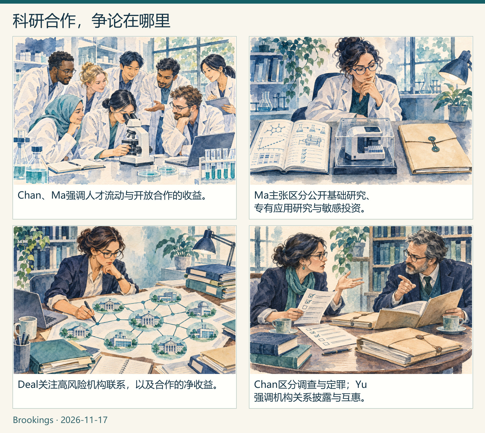
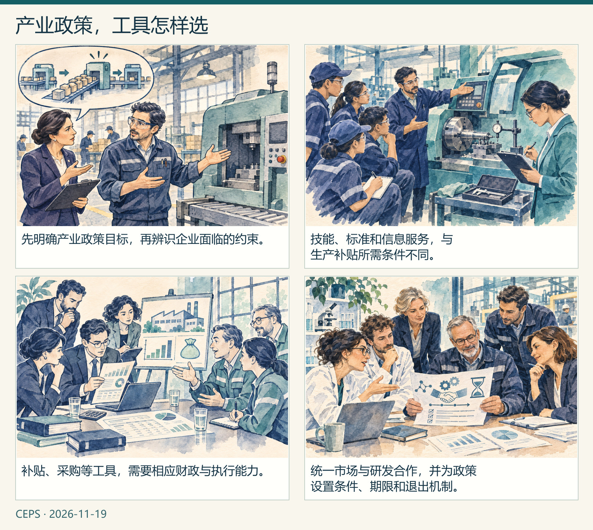
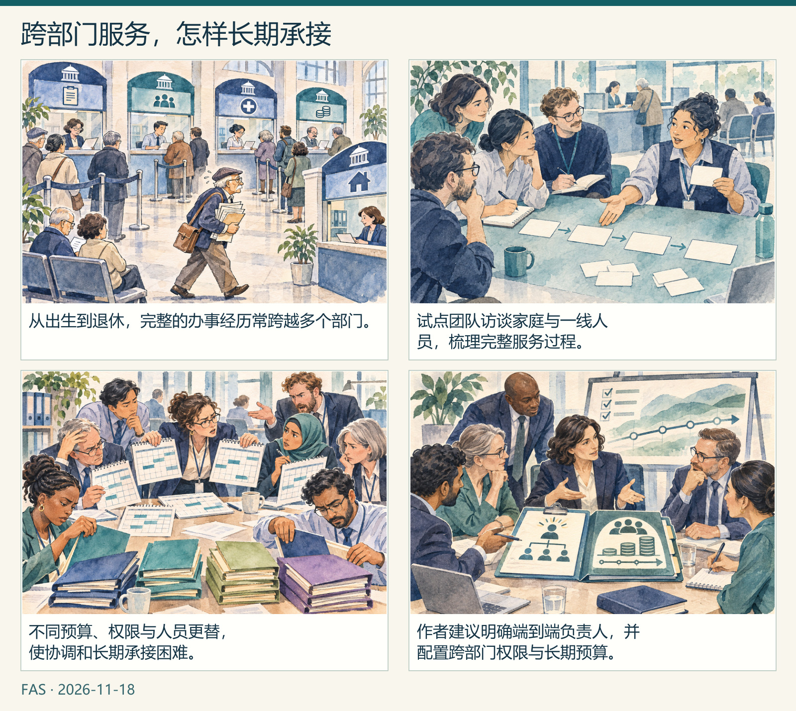
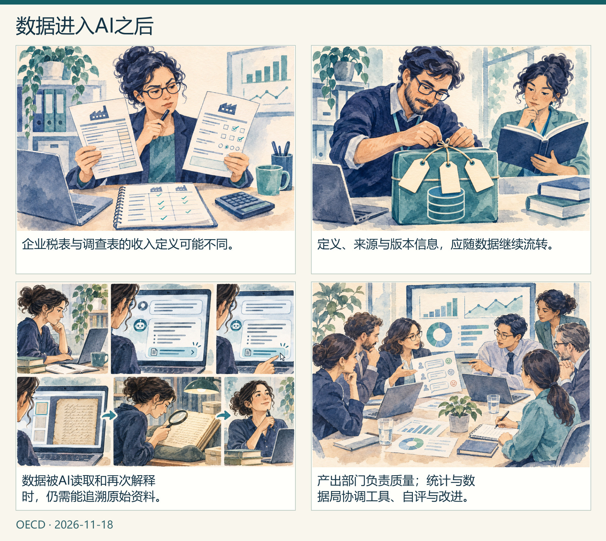

# 国际科技智库周报（2026-11-22）｜资料窗口：2026-11-16 至 2026-11-22

本期收录概况：收录 26 条｜重点 6 条｜本期收录机构 16 家。

<!-- weekly-editorial-sha256: e98d8527858f58123dbe8837e8838a86755daa2703779f2761743e7fbe382862 -->

## 长期合作的承诺、融资评价与数据质量

本期分别讨论大学与企业长期合作、公共股权投资、统计数据质量、跨部门公共服务、中美科研合作及欧洲产业政策。日本讨论稿把企业资金和人员承诺纳入大学认定；EIC问卷具体呈现企业对融资和尽调的评价；OECD将数据再次传播时的定义、来源与版本纳入质量管理。

## 值得细读的发现

### 企业承诺进入大学认定

日本讨论稿要求企业说明资金与人员投入，大学形成部门行动计划，拟约每五年评价并年度跟踪。

[来源原文](https://www.mext.go.jp/content/20261116-mxt_sanchi01-000053277_03.pdf) · [阅读全文](#topic-06)

### 融资作用按回答组别计算

EIC最近一轮融资题有78家企业回答：64.1%认为基金参与不可或缺，16.7%认为有帮助。全问卷有效回答为182份。

[来源原文](https://eic.ec.europa.eu/document/download/7f8fa8d8-7654-411a-bae9-ef0ecc78255e_en?filename=EIC_Fund_beneficiaries_survey_2026.pdf) · [阅读全文](#topic-05)

### 统计定义随数据继续流转

OECD要求数据再次被使用和解释时能够追溯定义、来源与版本；各部门继续对统计产出负责。

[来源原文](https://www.oecd.org/content/dam/oecd/en/publications/reports/2026/11/oecd-statistics-and-data-quality-assurance-framework_e4f27fd1/1d7d2416-en.pdf) · [阅读全文](#topic-04)

[完整阅读导航（6 篇）](#reading-navigation)

## 主题展开

### 主题 01｜[P1] [中美科研合作：收益证据与审查对象之争](https://www.brookings.edu/articles/does-scientific-collaboration-with-china-make-america-stronger-or-more-vulnerable/)

- **来源**：布鲁金斯学会（Brookings）｜2026-11-17

#### 摘要导读

四位作者分别讨论人才收益、具体活动审查、机构关联与互惠条件，对限制合作的依据存在分歧。

#### 中美科研合作：收益证据与审查对象之争

Brookings于11月17日刊出围绕中美科研合作的书面讨论。Kyle Chan、Jacqueline Deal、Yingyi Ma和Miles Yu分别讨论合作收益、安全风险与人员审查。几位作者对风险的判断和政策主张存在明显分歧。

### 开放合作的收益怎样计算

Chan和Ma强调人才吸引及研究交流。Ma主张区分面向公开发表的基础研究、涉及专有技术的应用研究，以及敏感技术企业的投资和所有权；审查应针对具体活动。Chan在回应中指出，技术窃取调查的总数，无法直接说明其中有多少学术研究人员成为嫌疑人或被定罪。

### 限制合作的依据又是什么

Deal认为现有约束覆盖不足，主张加强对高风险机构及其合作关系的限制，并追问合作产生的独特收益能否抵偿知识、网络与合法性转移。Yu强调机构关联披露、敏感合作审查和互惠条件。Ma回应，宽泛限制可能把教育不平等研究与敏感技术研究置于同一禁限框架。

讨论揭示了两项不同的证据要求：一项要把涉嫌窃取、关联披露和公开研究区分开；另一项要求具体衡量合作的净收益及风险对象。

[书面讨论全文](https://www.brookings.edu/articles/does-scientific-collaboration-with-china-make-america-stronger-or-more-vulnerable/)｜两轮问题与回应。

### 主题 02｜[P1] [欧洲产业政策：工具要匹配目标与执行能力](https://www.ceps.eu/ceps-publications/getting-european-industrial-policy-right-some-key-lessons-from-around-the-world/)

- **来源**：欧洲政策研究中心（CEPS）｜2026-11-19

#### 摘要导读

作者将产业工具与市场、财政、行政条件相匹配，主张明确绩效与退出安排，避免把多项目标堆进同一种补贴。

#### 欧洲产业政策：工具要匹配目标与执行能力

Martin Raiser等人在CEPS的新分析中，将产业政策工具与市场规模、财政空间、行政能力相匹配。作者借用世界银行覆盖183个经济体的研究框架，讨论欧洲的制度约束。

### 补贴需要持续监督和退出能力

技能培训、认证及市场信息服务，主要处理信息与协调问题。生产补贴、本地含量要求和战略采购，则需要真实的规模经济或学习效应、足以支持学习期的预算，以及设置绩效条件并停止无效支持的能力。

### 欧洲的规模优势受到分割制约

劳动力、资本及能源市场分割，限制企业扩张；国家层面的支持措施各自设计，又削弱跨国规模。作者主张加强统一市场，并把公共支持更多转向研发和接近技术前沿的领域。

### 不同目标分别接受检验

竞争力、就业调整与供应安全需要不同工具。作者建议为产业支持设定结果指标、审查节点和终止条款；社会政策承担调整中的保障任务。关键投入品的韧性支持应集中于难替代的少数节点，并与贸易伙伴多元化配合。

[CEPS分析全文](https://www.ceps.eu/ceps-publications/getting-european-industrial-policy-right-some-key-lessons-from-around-the-world/)｜PDF物理页3—11。

### 主题 03｜[P1] [跨部门服务试点怎样获得长期承接](https://fas.org/publication/steal-this-to-make-government-work-better/)

- **来源**：美国科学家联合会（FAS）｜2026-11-18

#### 摘要导读

跨部门试点常能找到服务堵点，却缺少持续的权限、预算和承接单位。作者建议先安排负责人及跨年度经费。

#### 跨部门服务试点怎样获得长期承接

美国科学家联合会（FAS）11月18日刊发Loren DeJonge Schulman的回顾：政府怎样围绕人生事件提供服务。她与Amira Boland参与过美国行政管理和预算局（OMB）的相关工作，又在2026年3月召集40多位参与者复盘。其观察对象包括生育、灾后恢复、财务冲击、退休和退役转入平民生活等五类跨部门服务。

### 先跟着办事人走一遍

新生儿家庭可能遇到多家机构、不同表格和资格要求；灾民可能向几个项目反复说明同一损失。小型跨部门团队借调各机构人员，加入设计与研究人员，先访谈申请者和一线工作人员，再绘出从申请到服务的全部步骤。修改网页措辞、衔接助学申请与税务数据、调整医疗补助续期流程，都是文章讨论的具体做法。部分试点找到了常设机构承接。

### 发现共同问题，不等于有人有权解决

Schulman指出，责任和预算沿部门逐级安排，办事人的需求却横跨这些部门。团队为小额跨部门经费反复协调，不同机构对数据使用和人员投入的法律解释也不一致；“家庭”“收入”等资格定义本身还可能不同。有的团队甚至缺少共用日历和协作工具。试点做成后若没有正式承接单位，人员离开就可能使合作中断。

她建议在启动前指定对全过程负责的人，明确其权限、人员与经费，规划试点转入常设服务的路径；国会可考虑多年跨部门服务资金，并允许经费调拨。等待时间、完成率、投诉与用户反馈应成为共同检查对象。文章提出的灾民“只提交一次信息”仍是未完全实现的目标。

[FAS回顾文章](https://fas.org/publication/steal-this-to-make-government-work-better/)｜全文；背景报告《Making Government Work for People》物理页5、30—37。

### 主题 04｜[P1] [OECD将统计质量管理延伸到AI再传播](https://www.oecd.org/en/publications/oecd-statistics-and-data-quality-assurance-framework_1d7d2416-en.html)

- **来源**：经济合作与发展组织（OECD）｜2026-11-18

#### 摘要导读

数据被AI重新解释时，定义、来源与版本必须能够追溯；各部门继续对统计产出负责。

#### OECD将统计质量管理延伸到AI再传播

OECD于11月18日发布新版《统计与数据质量保证框架》。它要处理的变化已经超出统计表自身：数据被搜索引擎和语言模型取走、概括、拼接后，原有定义和来源可能丢失。框架因此把质量管理延伸到数据的再次传播和解释，并要求统计专业人员继续对方法、核验和发布结果负责。

### 数字必须带着定义流转

框架用多源统计解释为什么“拿到更多数据”仍可能得出错误结论。同一家企业在行政登记和企业调查中的收入记录可能冲突；税务记录的应税收入与调查中的总收入也可能采用不同定义。统计团队需要先协调概念，记录清洗、转换与优先选用哪一来源的过程。AI读取时同样需要这些说明，以及稳定标识、版本和机器可读的字段含义。

### 各部门负责产出，中央团队提供工具

实施采用分散负责的安排：OECD各政策部门对自己生产和发布的统计结果负责；统计与数据局在首席统计师指导下协调、制定指引并组织工具建设。年度自评由统计产品负责人填写，用户反馈和外部同行评议补充生产者视角。最终改善计划应写明具体行动、负责人和时间，并由相关部门安排资源。

拟建的协作工具箱将收集质量指标、可复用代码与评估方法。报告举出的指标包括缺失值填补比例、收到数据占预期数据的比例、元数据完整率及准时发布率。数据是否适合AI使用，将体现在准确、清晰、完整等质量目标的持续实现中。

[框架全文](https://www.oecd.org/en/publications/oecd-statistics-and-data-quality-assurance-framework_1d7d2416-en.html)｜物理页6—7、19—23、41—50。

### 主题 05｜[P1] [EIC基金企业如何评价公共股权投资](https://eic.ec.europa.eu/news/eic-fund-companies-highlight-its-role-supporting-fundraising-and-growth-2026-11-17_en)

- **来源**：欧洲创新理事会（EIC）｜2026-11-17

#### 摘要导读

182份有效回答中，不同投资阶段分别作答；最近一轮融资题的78家企业中，64.1%认为EIC参与不可或缺。

#### EIC基金企业如何评价公共股权投资

欧洲创新理事会11月17日公布基金企业调查。调查于2026年3月启动，取得182份有效回答，约占当时752家基金企业总体的24%。企业进入投资流程的阶段不同，各题回答人数也不同。

### 对最近一轮融资的作用

在回答这一问题的78家企业中，64.1%认为EIC参与不可或缺，16.7%认为有帮助，14.1%认为未产生影响，5.1%选择不适用。另一道多选题有78份回答：57家认为提高了投资者对企业的关注与认可，44家认为提高了公共机构及创新网络的认可，34家提及客户和商业伙伴认可。

### 尽职调查的要求与企业此前经历有关

142家企业比较了EIC与其他投资者的尽职调查。约62%认为复杂程度相当，30%认为更全面，8%认为较简。报告指出，许多企业此前主要接触种子轮或天使投资；进入更大规模的股权融资，审查要求本身就会增加。

### 企业希望改善后续投资与决策沟通

企业意见涉及增加后续投资能力、简化行政及报告程序、明确投资决定与时间安排，并改善与其他投资者的对接。补助和股权投资的衔接，也是回答者讨论的具体问题。

[发布页及调查附件](https://eic.ec.europa.eu/news/eic-fund-companies-highlight-its-role-supporting-fundraising-and-growth-2026-11-17_en)｜结果PDF物理页3、5、7—9。

### 主题 06｜[P1] [日本拟以长期企业承诺支持核心大学群](https://www.mext.go.jp/b_menu/shingi/gijyutu/gijyutu31/001/siryo/000019199_00001.htm)

- **来源**：日本文部科学省｜2026-11-16

#### 摘要导读

讨论稿将企业资金与人员承诺、大学部门行动及约五年评价放在同一认定机制中。

#### 日本拟以长期企业承诺支持核心大学群

日本文部科学省与经济产业省11月16日的讨论材料，把大学组织改革和企业长期投入放在同一项拟议制度中。材料引用2024年度调查：约八成大学共同研究项目的单项收入不超过300万日元。两部门希望扩大由企业与大学管理层共同承诺的长期合作。

### 遴选同时看实绩、构想与承诺

拟议的“产业竞争力与研究力核心大学群”制度，要求大学说明已有研究和合作基础、未来发展构想，以及校内改革和企业投入的具体承诺。企业应明确资金与人员投入，大学应把整体战略分解成部门行动计划。认定和问责以单所大学为单位，同时允许通过跨校合作、交叉聘任等方式汇集能力。

### 研究支持要进入大学组织

材料把产业分析、知识产权和研究支持人员列入组织能力建设。大型共同研究需要有人理解企业需求、协调研究团队、处理合作权益，并使这些工作与大学管理层的资源配置衔接。长期合作的设计因此包括人员和治理安排。

### 结果与改革分别检查

讨论稿建议约每五年由专业人士及主管部门判断是否继续认定与支持，并进行年度跟踪。研究成果指标应避免推动短期结果导向；组织改革则需要检查行动是否按计划推进。企业承诺、大学行动和后续评价共同构成拟议支持条件。

[会议材料与附件](https://www.mext.go.jp/b_menu/shingi/gijyutu/gijyutu31/001/siryo/000019199_00001.htm)｜主材料物理页4、9—12。

## 本期简讯

### [博士训练组把AI与科学领域知识结合](https://www.dfg.de/en/service/press/press-releases/2026/press-release-no-46)

德国科学基金会（DFG）｜2026-11-16

DFG决定设立11个博士研究训练组，首期五年经费约7200万欧元，含25%间接费，2027年启动。海德堡的生成式AI科学研究组要求博士生兼具AI与学科知识，研究不完整或有误科学数据的处理；亚琛项目围绕组织植入物，组织细胞、材料、生产工程和伦理协作。

### [EIC加速器选出35家深科技企业](https://eic.ec.europa.eu/news/european-innovation-council-selects-35-deep-tech-companies-its-accelerator-support-2026-11-16_en)

欧洲创新理事会（EIC）｜2026-11-16

453份完整申请中，88家进入面试，最终选出17国35家企业，拟提供合计8400万欧元补助。其中32家还将进入股权投资评估，单家最高1000万欧元。补助协议预计约三个月内落实；股权投资仍需尽调与决定。

### [聚变初创项目通过成熟度阶段评审](https://www.mext.go.jp/b_menu/houdou/mext_01700.html)

日本文部科学省｜2026-11-16

文部科学省公布，三项SBIR聚变相关项目经外部专家书面和答辩审查，确认完成TRL5阶段。MiRESSO铍精炼、Helical Fusion高温超导导体项目的下一阶段资助上限各为20亿日元，LiSTie锂技术为15亿日元，期限至2028年3月底。

### [船岸数字通信试验共享航线建议](https://www.nedo.go.jp/news/press/AA5_101979.html)

日本新能源与产业技术综合开发机构（NEDO）｜2026-11-16

NEDO与IHI等公布11月4—5日在三河湾的两船试验：岸端经VDES数字通信提出航线，船端确认后将信息同步给岸端及另一船，实际操船仍由船员承担。下一步拟验证船舶、岸站和卫星联通，目标在2029财年确立相关技术。

### [移民技能与企业资本投入存在非线性关系](https://www.bis.org/publications/working-paper-1397-immigrants-skills-and-capital-deepening-evidence-chile)

国际清算银行（BIS）｜2026-11-17

BIS工作论文把智利2015—2019年雇员信息与企业税表匹配，利用移民流入差异研究技能与资本投入。作者估计，技术移民占企业全部技术工人的比例增加1个百分点，人均资本提高约1%—2%；这一关系随移民占比上升而减弱。论文以资本与技能互补、同一技能组内部任务分工解释该结果。

### [数据中心电网成本如何分配](https://www.brookings.edu/articles/what-the-new-congress-needs-to-do-now-on-ai-data-centers/)

布鲁金斯学会（Brookings）｜2026-11-17

Mark MacCarthy和David Klaus主张，由新增大负荷用户承担对应电网升级成本，并通过最低付款、预付或担保等合同安排，减少项目撤销后其他用户承担闲置投资的风险。作者指出，现场发电仍可能需要电网备用容量，也会通过能源市场影响电价。

### [镜像生命指南区分分子研究与自复制风险](https://www.rand.org/pubs/perspectives/PEA4696-2.html)

兰德公司（RAND）｜2026-11-17

RAND指南讨论尚未出现的镜像生命及预防治理，区分可能有医疗用途的镜像分子与能够自行维持和繁殖的镜像生物。作者汇集了对后者免疫识别和生态控制风险的担忧，提出提前讨论资助、发表、研究监督及国际协调安排。

### [离网供电仍依赖电力设备供应链](https://www.rand.org/pubs/research_briefs/RBA4707-1.html)

兰德公司（RAND）｜2026-11-17

RAND对数据中心并网、现场和过渡供电所需部件进行供应链评估，结合供应商集中、进口数量与价格波动等指标。离网方案仍需要许多相同发电部件，难以避开设备短缺。作者建议按具体部件风险安排替代、储备、标准化及采购协调。

### [政策研究人员借调纳入前后衔接阶段](https://www.ukri.org/opportunity/sector-transition-ukri-policy-fellowships-2027/)

英国研究与创新署（UKRI）｜2026-11-17

UKRI拟提供56个政策借调岗位，2027年10月启动。18个月分为3个月共同设计、12个月驻点和3个月返校交流；两端投入为0.4全时当量，驻点至少0.6。申请须预留1.5万英镑灵活经费，供入职后共同确定工作用途。

### [关键原材料替代需要比较新的供应依赖](https://joint-research-centre.ec.europa.eu/jrc-news-and-updates/advanced-materials-key-cutting-critical-raw-material-reliance-strategic-sectors-2026-11-18_en)

欧盟联合研究中心（JRC）｜2026-11-18

JRC比较能源、电子、汽车和建筑领域266种创新选项，同时考察性能、寿命、成本、循环利用及环境影响。部分汽车零件可用铝替代镁，但重量与生产能耗可能增加；部分电子应用替代镓也可能转向新的供应依赖。评估因此同时标出替代成熟度与所需产业能力。

### [职业证书资助还需要实施人员与统一指引](https://www.rand.org/pubs/research_reports/RRA4747-1.html)

兰德公司（RAND）｜2026-11-18

RAND评估科罗拉多州Care Forward和Career Advance两项职业教育资助。前者在留存和完成方面呈积极结果，后者结论尚不确定。院校实施涉及领导、教学与助学金人员协作，增加了行政负担。研究建议同时安排实施经费，并在发放前明确资助范围和共同操作指引。

### [AI就业冲击的财政后果取决于再就业与定价](https://www.rand.org/pubs/research_briefs/RBA4392-3.html)

兰德公司（RAND）｜2026-11-18

RAND用“失业者能否找到新工作”和“AI是否按垄断价格销售”构造四种情景。在假设10%就业冲击、被替代者无法再就业的两种情景中，联邦税收相对无冲击基线下降约GDP的1.3和1.6个百分点。作者讨论调整税基和雇佣激励；这些数值是情景模拟结果。

### [为北澳研究合作建立常设承接机构](https://www.aspistrategist.org.au/northern-australia-needs-government-commitment-for-research-partnerships/)

澳大利亚战略政策研究所（ASPI）｜2026-11-19

北澳合作研究中心负责人提出，在现有联邦经费2027年6月结束前成立独立非营利的北澳中心，承接研究网络并扩展投资协调和成果采用服务。现中心自2017年以来支持逾100个项目、涉及272个伙伴。作者建议以联邦经费为基础，联合地方政府、企业及研究伙伴投入；治理应有北部地区和原住民实质参与。

### [共享闲置内存进入超算试点](https://etri.re.kr/kor/bbs/view.etri?b_board_id=ETRI06&b_idx=19857)

韩国电子通信研究院（ETRI）｜2026-11-19

ETRI公布在南加州大学研究计算中心开展弹性内存平台试点，利用高速网络调用其他服务器的闲置内存。一次约1.8TB的基因组任务在本机448GB内存配置下运行，额外内存来自远端。平台已接入SLURM作业管理，后续拟拓展基因、蛋白和气象等科研任务。

### [轻型交通电池碳足迹采用寿命期供能口径](https://joint-research-centre.ec.europa.eu/jrc-news-and-updates/e-bike-batteries-new-guidelines-quantifying-carbon-footprint-2026-11-19_en)

欧盟联合研究中心（JRC）｜2026-11-19

JRC提出电动自行车等轻型交通电池的碳足迹计算指导，以电池寿命期交付每千瓦时电能对应的二氧化碳当量表示。核算覆盖原料、制造、运输和报废，排除使用阶段。回收路线可依据企业与回收商的合同申报，默认回收流程加入锂回收。该指导是后续授权法案的技术基础。

### [机器人基础研究同时考察计算与物理能力](https://www.nsf.gov/funding/opportunities/frr-foundational-research-robotics/nsf27-501/solicitation)

美国国家科学基金会（NSF）｜2026-11-19

NSF新版机器人基础研究项目由计算机信息与工程领域共同组织，支持机械、计算及二者结合的研究，要求对机器人能力有实质贡献。鼓励在真实或模拟物理环境中验证，研究期限通常三至五年。预计支持20—30项、合计约2000万美元，具体取决于经费。

### [ICURe征集衍生企业训练交付机构](https://www.ukri.org/opportunity/icure-exploit-2027-to-2029/)

英国研究与创新署（UKRI）｜2026-11-19

Innovate UK拟以最高700万英镑支持一家机构交付2027—2029财年的ICURe Exploit。服务对象是完成探索并获建议成立衍生企业的团队，提供最长12周训练及研究人员最高2万英镑津贴。运营方须配置导师、诊断团队需求并跟踪阶段结果；700万英镑为整个交付项目预算。

### [MRC概念验证资助要求说明转化与验证路径](https://www.ukri.org/opportunity/mrc-proof-of-concept-stage-one/)

英国研究与创新署（UKRI）｜2026-11-19

原发展路径资助方案改称MRC概念验证，支持疗法、器械、诊断等从原型到早期临床研究的转化。通常按80%全经济成本资助，金额及期限不设统一上限，须逐项论证。涉及AI或模型的申请，要解释数据代表性、现有验证及与替代方法的性能比较，并说明产业伙伴作用。

### [公私联合体制成人工皮肤原型](https://www.cnrs.fr/fr/presse/premiere-mondiale-un-consortium-public-prive-cree-de-la-peau-artificielle-en-laboratoire)

法国国家科学研究中心（CNRS）｜2026-11-20

GENESIS项目在五年合作后，公布可冷冻保存的活体人工皮肤原型。URGO、CNRS、里昂第一大学、CECS、法国血液机构及达索系统参与，获得France 2030支持。后续仍需工业化放大与临床验证，目标是2030年用于首批患者。

### [物理前沿中心须说明中心规模的必要性](https://www.nsf.gov/funding/opportunities/pfc-physics-frontiers-centers/nsf27-502/solicitation)

美国国家科学基金会（NSF）｜2026-11-20

NSF新版物理前沿中心指南强调，申请者须说明为何研究需要中心规模的协作，以及相对既有资助方式增加了什么能力；续期中心也须解释继续支持的必要性。计划支持5—8个中心，合计预计每年1200万—2000万美元、持续六年，取决于可用经费，并将人才培养融入研究。

## 阅读导航

- [主题 01｜中美科研合作：收益证据与审查对象之争](#topic-01) · 布鲁金斯学会（Brookings）
- [主题 02｜欧洲产业政策：工具要匹配目标与执行能力](#topic-02) · 欧洲政策研究中心（CEPS）
- [主题 03｜跨部门服务试点怎样获得长期承接](#topic-03) · 美国科学家联合会（FAS）
- [主题 04｜OECD将统计质量管理延伸到AI再传播](#topic-04) · 经济合作与发展组织（OECD）
- [主题 05｜EIC基金企业如何评价公共股权投资](#topic-05) · 欧洲创新理事会（EIC）
- [主题 06｜日本拟以长期企业承诺支持核心大学群](#topic-06) · 日本文部科学省
