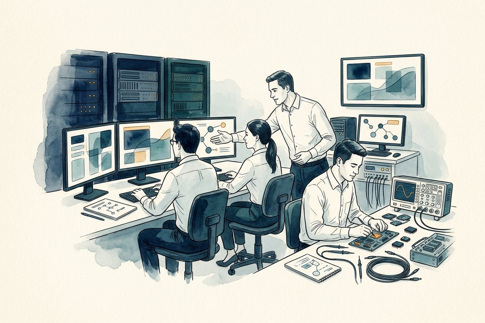
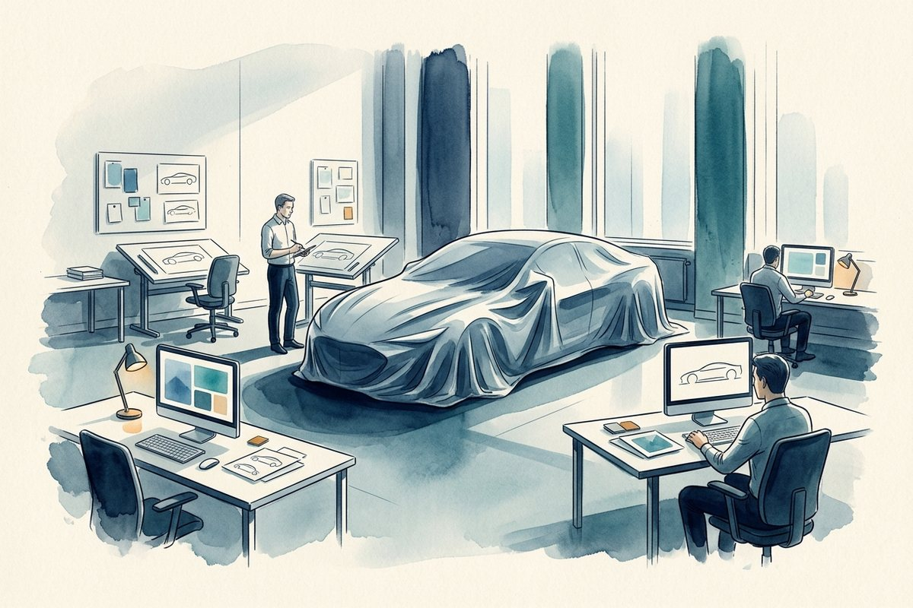
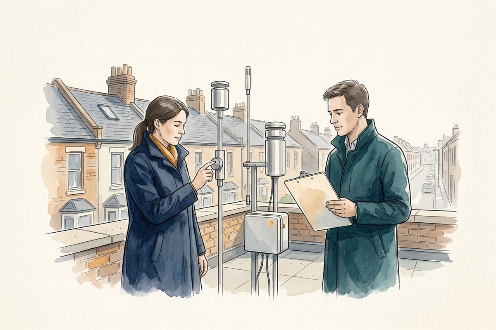
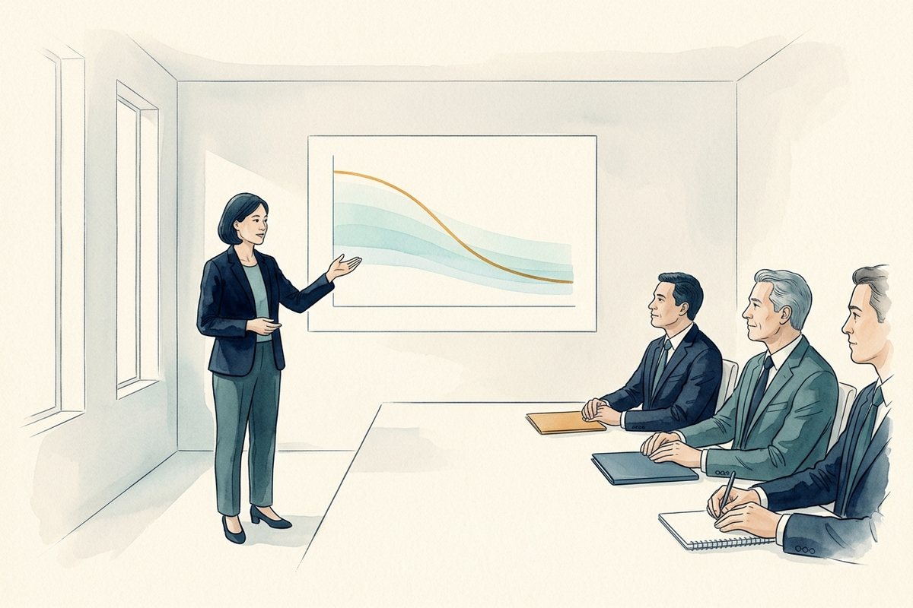
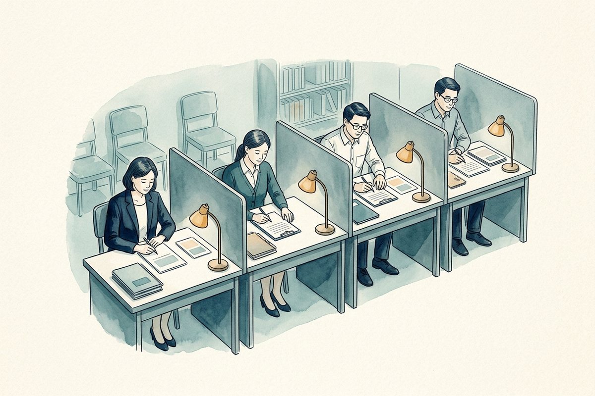

# 国际科技智库周报

2026年11月19日—25日 · 重点解读4篇 · 简讯12则 · 样刊

算力、标准与回报：政府怎样为科研和新市场铺路

美国“创世纪计划”满一年，能源部公布了项目、算力和资金的家底；经合组织数据显示，大企业研发在人工智能带动下提速，政府研发预算却连续两年收缩；欧洲央行为代币化市场提出一套标准参考模型；英国一项评估把一笔长期科研资助的社会回报算到了每1英镑约17英镑。简讯里有两组关于企业支持科研的数字。

## 本周要点

- **美国“创世纪计划”满一年**：297个项目落在369家机构，合作联盟承诺25亿美元算力与工具；国会尚未立法，参议院拨款委员会建议2027财年最多拨款3亿美元。[详见](#genesis)
- **大企业研发与政府研发预算反向而行**：全球60家最大研发投入企业2026年上半年研发支出实际增长13.9%，经合组织国家政府研发预算2025年实际下降2.7%，已低于2020年水平。[详见](#oecd)
- **欧洲央行提出代币化“参考模型”**：用八个标准层对照现有行业标准，所比较的标准中没有一项覆盖全部八层，治理、监管和合规几层覆盖最弱。[详见](#ecb)
- **一项长期科研资助的回报怎么算**：英国自然环境研究理事会2000年以来投入约3亿英镑空气质量研究，评估估算自2010年带来约95亿英镑社会收益，按统一价格口径每1英镑投入约对应17英镑。[详见](#nerc)
- **企业支持科研的两组数字**：新加坡企业基础研究支出2024年下降1.4%；美国高校研发经费增加68亿美元，其中来自企业的只有2900万美元。[详见](#briefs)

## 重点解读

### 美国“创世纪计划”满一年：已经建成什么，钱从哪里来 {#genesis}

美国能源部 · 2026-11-24 · 官方进展通报；另据美国物理联合会对计划负责人的专访（2026-11-20）

一年里建成了什么

<figure><figcaption>橡树岭国家实验室的专用超算Lux用不到11个月建成，首次上榜位列全球第14名。</figcaption></figure><figure><figcaption>297个研究项目分布在369家机构，覆盖电网、材料、核能等33项国家科技挑战。</figcaption></figure><figure><figcaption>合作联盟承诺25亿美元工具与算力；美日宣布五年合计10亿美元合作，各拟出资5亿美元。</figcaption></figure><figure><figcaption>计划尚未写入法律；参议院拨款委员会建议2027财年最多拨款3亿美元。</figcaption></figure>

美国能源部 · 2026-11-24

摘要导读
“创世纪计划”用人工智能和超级计算加速科研，第一年完成了项目遴选、专用超算和统一平台的搭建；第二年的关键是国会能否立法并给出稳定拨款。

“创世纪计划”（Genesis Mission）由2025年11月24日的总统行政令启动，由能源部牵头，用人工智能和超级计算加速科学研究。计划负责人、能源部科学副部长达里奥·吉尔（Darío Gil）把目标表述为：用十年时间，力争让美国每年万亿美元规模的研发体系的生产率和影响力翻一番。11月24日，能源部发布一周年进展通报。

**项目与参与面。** 能源部一周年通报称，计划已在369家机构启动297个研究项目（含一期和二期项目；7月首轮遴选产生278个，10月又有追加）；国家科技挑战从最初的26项扩充到33项，20个联邦机构参与。通报列举了两个二期项目：爱达荷国家实验室牵头、32家单位参与的Prometheus，把人工智能用于核能全生命周期；布鲁克海文国家实验室牵头的GridFM 2.0，目标是在24小时内模拟多达10亿种电网运行情景。吉尔在专访中说，这次征集的响应规模是能源部此前最高纪录的2.5倍。

**算力、平台和人才。** 橡树岭国家实验室的专用超算Lux用不到11个月建成，首次上榜即位列全球高性能计算系统第14名，目前支撑11个计划项目。各国家实验室通过“美国科学云”接入统一平台，平台提供统一身份认证、前沿模型、高性能计算、数百个数据集，以及能自动执行多步科研流程的智能体工具，大学合作方也可使用。2026年6月另启动“量子创世纪”，目标是2028年前做出首个具备科学应用价值、能自动纠错的“容错”量子计算能力；吉尔称将在明年1月初决定由谁承担。人才方面设有四年制博士项目，把科学或工程与计算结合，并保证实习机会；计划提出十年培养10万名科技人员。

**钱的来源。** 由70多家成员组成的“创世纪计划联盟”承诺提供25亿美元的工具与算力资源（能源部称为“超级智能”工具）；吉尔称各联邦机构合计承诺50亿美元支持这一计划。日本是首个国际伙伴：今年6月美日宣布五年合计10亿美元的合作，双方各拟出资5亿美元，以各自后续拨款为前提。国会层面，参议院拨款委员会建议2027财年为计划拨款最多3亿美元（尚未成为正式拨款），吉尔表示所需总投入更大，仍在与拨款委员会商谈。他把第二年的首要任务定为推动两党立法，把计划写入法律。

**争议。** 《科学》杂志报道，能源部从科学办公室传统科研预算中抽取10%用于该计划。吉尔否认这一说法，称计划资助是科学办公室资助的一部分，没有在项目之间挪动资金。

**第二年的方向**：大幅扩充算力；押注美国开源、开放权重（公开模型参数、外界可自行使用和改进）的科学模型；建立对专有和开源模型的定制流程，把人工智能从语言和编程扩展到物理、化学、生物和数学；把显微镜、望远镜等科研仪器接入他所说的“科学互联网”。

原文：[能源部一周年通报](https://www.energy.gov/articles/fact-sheet-energy-department-delivering-president-trumps-genesis-mission) · [美国物理联合会专访](https://www.aip.org/fyi/genesis-mission-chief-takes-stock-one-year-in)

### 大企业研发提速，政府研发预算连续两年下降 {#oecd}

经合组织（OECD） · 2026-11-17（本期补录） · 统计发布

研发的钱往哪里流

<figure><figcaption>60家最大研发投入企业2026年上半年研发实际增长13.9%，软件和电子企业领涨。</figcaption></figure><figure><figcaption>汽车和航空航天企业研发连续两年下降，生命科学企业只增长2%。</figcaption></figure><figure><figcaption>经合组织国家政府研发预算2025年实际下降2.7%，美国下降7.8%。</figcaption></figure><figure><figcaption>研发税收减免占政府研发支持的比重从2000年的6%升至2024年的18%。</figcaption></figure>

经合组织 · 2026-11-17

摘要导读
企业研发增长高度集中在数字行业，政府研发预算则在缩减，而且更多以不指定方向的税收减免形式发放。

经合组织11月17日发布的数据显示，企业研发和政府研发预算朝相反方向变化。企业数据来自经合组织的“企业研发短期追踪”（SwiFTBeRD），它跟踪全球60家最大研发投入企业的季度财报，比正式的企业研发统计更早反映变化；政府数据来自各国官方统计的政府研发预算拨款。

**企业端：增长集中在数字行业。** 这60家企业2026年上半年研发支出扣除通胀后同比增长13.9%，2025年全年为5.6%。软件和计算机服务企业增长23%，信息技术硬件和电子企业增长20%；生命科学企业只增长2%，汽车和航空航天企业的研发支出已连续四个半年度（两年）下降。名义研发支出增幅最大的是英伟达、Meta和三星电子，企业财报把增长归因于开发和部署前沿人工智能模型。经合组织还指出，另有几家快速增长的人工智能企业，研发规模已接近进入这一样本的门槛。

**政府端：预算缩减，定向比例下降。** 经合组织国家政府研发预算2025年实际下降2.7%，2024年已下降3.7%，扣除通胀后已低于2020年水平。美国下降7.8%，日本下降3.7%，德国下降0.9%，欧盟成员国合计下降0.7%（不含欧盟预算资助的研发项目）。

<figure>
<svg viewBox="0 0 360 302" role="img" aria-label="企业研发增长与政府研发预算变化">

<text class="h" x="0" y="16">企业研发：2026年上半年同比增长（实际）</text>
<text class="l" x="132" y="42" text-anchor="end">60家企业合计</text><rect x="140" y="30" width="97" height="16" rx="2" style="fill:#0f6e74"/><text class="v" x="243" y="43">+13.9%</text>
<text class="l" x="132" y="68" text-anchor="end">软件和计算机服务</text><rect x="140" y="56" width="161" height="16" rx="2" style="fill:#0f6e74"/><text class="v" x="307" y="69">+23%</text>
<text class="l" x="132" y="94" text-anchor="end">信息技术硬件和电子</text><rect x="140" y="82" width="140" height="16" rx="2" style="fill:#0f6e74"/><text class="v" x="286" y="95">+20%</text>
<text class="l" x="132" y="120" text-anchor="end">生命科学</text><rect x="140" y="108" width="14" height="16" rx="2" style="fill:#0f6e74"/><text class="v" x="160" y="121">+2%</text>
<text class="h" x="0" y="154">政府研发预算：2025年下降幅度（实际）</text>
<text class="l" x="132" y="180" text-anchor="end">经合组织合计</text><rect x="140" y="168" width="19" height="16" rx="2" style="fill:#b7791f"/><text class="v" x="165" y="181">−2.7%</text>
<text class="l" x="132" y="206" text-anchor="end">美国</text><rect x="140" y="194" width="55" height="16" rx="2" style="fill:#b7791f"/><text class="v" x="201" y="207">−7.8%</text>
<text class="l" x="132" y="232" text-anchor="end">日本</text><rect x="140" y="220" width="26" height="16" rx="2" style="fill:#b7791f"/><text class="v" x="172" y="233">−3.7%</text>
<text class="l" x="132" y="258" text-anchor="end">德国</text><rect x="140" y="246" width="6" height="16" rx="2" style="fill:#b7791f"/><text class="v" x="152" y="259">−0.9%</text>
<text class="l" x="132" y="284" text-anchor="end">欧盟成员国合计</text><rect x="140" y="272" width="5" height="16" rx="2" style="fill:#b7791f"/><text class="v" x="151" y="285">−0.7%</text>
</svg>
<figcaption>数据来源：经合组织2026年11月17日统计发布。企业数据为SwiFTBeRD样本60家企业，政府数据为各国政府研发预算拨款，均扣除通胀。</figcaption>
</figure>

政府研发预算中，有明确用途方向（如卫生、国防、能源）的“定向”部分，在经合组织国家从2024年的68.0%降到2025年的66.4%，欧盟从45.4%降到44.2%。研发税收激励（政府对企业研发的税费减免）不计入上述预算，也通常不指定研究方向；把它计入后，经合组织2024年的定向比例只有55.6%。税收激励占政府研发支持总额的比重已从2000年的6%升至2024年的18%，经合组织认为这是过去二十年定向比例下降的主要原因之一。

原文：[经合组织统计发布全文转载](https://www.hellenicshippingnews.com/digital-firms-drive-surge-in-business-rd-as-government-rd-budgets-across-the-oecd-fall-for-a-second-consecutive-year/)

### 欧洲央行代币化参考模型：先把标准拼成一张图 {#ecb}

欧洲中央银行 · 2026-11-24 · 讨论框架文件，37页

给代币化市场定标准

<figure><figcaption>各家分布式账本平台各用一套规则，代币化资产难以跨平台流转。</figcaption></figure><figure><figcaption>欧洲央行提出参考模型：五项基础能力，三组八个标准层。</figcaption></figure><figure><figcaption>对照ISO 20022等现有标准：没有一项覆盖全部八层，治理、监管和合规几层最弱。</figcaption></figure><figure><figcaption>业界主导的欧洲代币化标准组预计2027年1月启动，欧洲央行等作观察员。</figcaption></figure>

欧洲中央银行 · 2026-11-24

摘要导读
欧洲央行希望在代币化市场铺开之前先统一规则，避免割裂；建议先解决跨平台转让、统一代币标准和共用参考数据三件事。

欧洲央行11月24日发布《欧洲央行代币化参考模型介绍：标准化讨论框架》。代币化是指把证券、存款等金融资产表示为分布式账本上的数字凭证。文件要处理的问题是：分布式账本技术降低了新平台进入金融基础设施的门槛，如果各平台各用一套技术和规则，代币化可能把传统金融市场已有的割裂重新制造一遍，甚至放大。文件的说法是，平台之间应当比服务，而不是比技术和标准；目标是让一家金融机构只接入一个或少数几个账本网络，就能触达绝大多数代币化资产和服务。

**五项基础能力。** 文件先定义了代币化市场应具备的五项能力：互通性（不同系统能以标准方式交换信息、指令和状态）、可转让性（代币能在双方之间合法转移并完成结算）、可移植性（代币连同权利、义务、元数据和身份属性一起跨平台迁移而不失真）、可控性（发行人或权威机构能跨系统保持可见、执行政策和控制）、可组合性（不同功能能组合出新的金融业务）。文件以代币化债券为例说明可移植性：债券换平台后，国际证券识别码、发行人、权利、限制条款、存续期服务记录，以及派息、赎回等发行人事项所涉的义务，都必须原样保留；能在一个平台内转让，并不等于能跨平台迁移。

**八个标准层。** 参考模型把需要协调的领域分为三组八层：交易、互通与同步；资产表示与代币化；数据、元数据与语义；参与者、身份与信任；账本基础设施；政策、法律与监管授权；合规、控制与风险；网络治理。

**现有标准覆盖到哪里。** 文件对照八层评估了ISO 20022、GL1、国际资本市场协会债券数据分类与FINOS通用领域模型、欧清—美国存管信托结算公司—明讯的互通框架、以太坊企业联盟标准和IEEE分布式账本标准。在所比较的这些倡议中，没有一项覆盖全部八层：数据与元数据、资产表示、业务语义、报文和交易处理等层已有较好基础；账本基础设施、法律与监管授权、合规与风险、网络治理几层覆盖较弱，治理模式、监管监督、货币政策衔接和公共部门之间的协调尤其缺乏标准。文件据此认为，欧元体系的Appia计划应侧重协调和推广已有标准，在缺口最大的上层领域推动新标准，而不是另起炉灶。

**先做哪三件事。** 鉴于证券发行、结算和服务领域已出现多个互不连通的平台，文件建议优先讨论：现金与证券代币的跨平台转让（第一步先在同一技术家族内实现，主要是兼容以太坊运行环境的平台）；统一的现金与证券代币技术标准，在以太坊生态现有代币标准基础上推进；所有发行人共用的代币化金融工具参考数据库。文件还提出要调查一个问题：即使技术标准已经具备，欧洲各分布式账本平台的商业利益是否会阻碍互通。

文件强调这一模型不强加给行业，而是供下一步讨论使用。它将作为“欧洲代币化标准组”的工作输入。据欧洲央行此前公告，该标准组由欧盟委员会、欧洲证券和市场管理局与欧洲央行于11月9日授权设立，由业界主导、三家机构作观察员，预计2027年1月启动，目标是2028年初交付首批标准。

原文：[欧洲央行公告](https://www.ecb.europa.eu/press/intro/news/html/ecb.mipnews261124.en.html) · [参考模型全文PDF](https://www.ecb.europa.eu/pub/pdf/other/ecb.introproposalTRM2026.en.pdf)

### 一项长期科研资助的回报怎么算：英国空气质量研究的成本收益评估 {#nerc}

英国研究与创新署自然环境研究理事会（UKRI–NERC） · 2026-11-25 · 委托评估报告，47页

一笔科研资助的回报怎么算

<figure><figcaption>该理事会资助的监测站、模型和长期数据，是英国认识本国空气污染的证据基础。</figcaption></figure><figure><figcaption>2010年至2024年，英国二氧化硫、氮氧化物和细颗粒物排放分别下降80%、54%和34%。</figcaption></figure><figure><figcaption>评估请10位专家匿名估算研究的贡献，再整体下调50%，防止高估。</figcaption></figure><figure><figcaption>研究衍生的光学颗粒计数器已用于70多个国家的空气污染监测。</figcaption></figure>

英国研究与创新署 · 2026-11-25

摘要导读
评估把约1120亿英镑的空气改善收益逐步拆分，估算约95亿英镑可归于这项资助，按统一口径每1英镑投入约对应17英镑。

英国自然环境研究理事会是英国空气质量环境研究的主要资助方。2000年至2024年，它在空气质量研究上投入约3亿英镑（早期年份为回推估算；按报告统一的价格和折现口径约5.7亿英镑），约占其研究总支出的6%。理事会委托经济咨询机构Human Economics与Logika Group做成本收益分析，评估这笔长期投入的社会回报，报告于11月25日发布。

**评估先算空气改善的总收益。** 2010年至2024年，英国二氧化硫、氮氧化物和细颗粒物排放分别下降80%、54%和34%。评估以2007年政府排放预测作为“如果没有新政策”的对照，2024年三项排放分别比对照低70%、31%和38%。按英国环境部的污染损害成本方法，2010年至2025年这些减排带来约1120亿英镑总收益，其中健康收益1073亿英镑（按2025/26年度价格折现计算；2025年排放按2024年水平估算）。

**再一步步扣出研究的份额。** 这是评估中最难也最关键的一步。评估邀请22位熟悉研究如何进入政策的专家，收回10份匿名问卷，请他们分三步估计：减排中有多大比例来自立法和政策，而非技术进步、经济结构变化等；这些政策有多大程度依据了研究成果；这些研究成果有多大程度依赖该理事会的资助。取第10、50、90百分位作为低、中、高估计。由于受访者七成是科学家，可能高估研究的作用，评估又把研究归因的估计统一下调50%（“乐观偏差”调整）。

<figure>
<svg viewBox="0 0 360 300" role="img" aria-label="从总收益到研究贡献的归因步骤">

<rect x="40" y="4" width="280" height="54" rx="6" style="fill:#16325c"/><text class="t" x="180" y="28" text-anchor="middle">1120亿英镑</text><text class="s" x="180" y="47" text-anchor="middle">2010—2025年减排带来的总收益</text>
<text class="a" x="180" y="80" text-anchor="middle">↓ 其中约72%来自立法和政策（49%—83%）</text>
<rect x="40" y="92" width="280" height="54" rx="6" style="fill:#0f6e74"/><text class="t" x="180" y="116" text-anchor="middle">政策驱动的减排</text><text class="s" x="180" y="135" text-anchor="middle">其中约12%归于该理事会资助的研究（4%—20%）</text>
<text class="a" x="180" y="168" text-anchor="middle">↓</text>
<rect x="40" y="178" width="280" height="54" rx="6" style="fill:#b7791f"/><text class="t" x="180" y="202" text-anchor="middle">约95亿英镑</text><text class="s" x="180" y="221" text-anchor="middle">区间22亿—187亿英镑</text>
<text class="a" x="180" y="258" text-anchor="middle">对照2000年以来投入（现值约5.72亿英镑）</text>
<text class="a" x="180" y="280" text-anchor="middle">每1英镑约对应17英镑（区间4—33英镑）</text>
</svg>
<figcaption>评估把总收益依次乘以“政策贡献比例”和“该理事会资助的贡献比例”，得到归于该项资助的收益。资助贡献比例已下调50%。图示为简化表示，比例经过取整，不能据此精确复算最终金额。数据来源：Human Economics与Logika Group为该理事会所作评估，2026年10月定稿。</figcaption>
</figure>

**结果。** 中间估计是：约72%的减排来自立法和政策（区间49%—83%），其中约12%可归于该理事会资助的研究（区间4%—20%），即自2010年以来约95亿英镑社会收益（区间22亿—187亿英镑）。考虑到研究到政策再到效果的时滞，评估拿它与2000年以来的全部投入（统一口径约5.72亿英镑）相比，得出每投入1英镑约产生17英镑社会收益（区间4—33英镑）。评估认为这是偏保守的下限：损害成本法没有计入证据不足的影响，2025年以后仍会持续产生收益。

**研究通过哪些途径起作用。** 报告归纳了三条：资助的研究成为英国认识本国空气质量问题的证据基础，影响监管重点和地方行动；长期数据集、大气模型和分析工具使政策可以被设计、测试和评估；培养的专家进入咨询机构、政府和企业，把新知识用到实处。

**企业收益只作示例，不与上面的数字相加。** 赫特福德大学基于该理事会资助研究开发的光学颗粒计数器，已用于70多个国家的空气污染监测，2015年以来带来5300万英镑收入，支撑30多个岗位；莱斯特大学2016年衍生的EarthSense公司年营业额160万英镑，员工20多人。报告说明，这些是总额而非新增贡献，收入不等于经济价值，也无法精确归因，因此不并入成本收益结果。

报告最后指出，传统污染源减少后，农业氨排放和交通非尾气排放等更难治理的来源比重上升，需要新的证据、方法和监测能力。

原文：[发布页](https://www.ukri.org/publications/assessing-economic-impacts-of-nerc-air-quality-research-funding/) · [评估报告全文PDF](https://www.ukri.org/wp-content/uploads/2026/11/NERC-16112026-Air-quality-economic-evaluation-Oct-26-Final-report.pdf)

## 简讯 {#briefs}

### 企业研发与科研经费

**新加坡2024年全国研发调查：企业基础研究支出下降1.4%**
新加坡科技研究局（A*STAR） · 2026-11-20
2024年新加坡研发总支出150.25亿新元，增长8.5%，占GDP 2.0%。1095家企业的研发支出95.55亿新元，增长6.4%；其中基础研究16.06亿新元，比上年下降1.4%（2014年为5.48亿新元，十年年均增长11.3%），应用研究增长5.0%，试验发展（面向新产品、新工艺的开发）增长10.2%至48.07亿新元。按报告数据计算，基础研究约占企业研发的17%。企业与公共研发支出之比从1.85降至1.75。[原文PDF](https://isomer-user-content.by.gov.sg/441/ddcb2acf-9236-4e95-a7ba-551fd6705997/National_Survey_of_RIE_2024.pdf)

**美国高校研发经费达1244亿美元，企业资助只增加2900万美元**
美国国家科学基金会国家科学与工程统计中心 · 2026-11-24
2025财年美国高校研发支出1244亿美元，增加68亿美元（5.7%）。联邦资金增长4.2%，超过670亿美元，占54%；高校自有资金增加25亿美元（8.2%）；州和地方政府增加8.21亿美元（14%）；非营利组织增加4.34亿美元。企业资助只增加2900万美元（0.5%），占比5.1%。卫生科学与生物及生物医学科学合计约占一半。[原文](https://ncses.nsf.gov/pubs/nsf27310)

**美国政府问责局：小企业创新研究计划两个财年标记1700多项涉外风险**
美国政府问责局 · 2026-11-19
问责局检查了空军、能源部、国立卫生研究院、航空航天局和国家科学基金会五个机构的小企业创新研究与技术转移计划。2024和2025财年，它们对2.8万多份申请做了尽职调查，标记1700多项可能的涉外风险和1.1万多项专利、网络安全等其他风险。各机构用统一披露表和分析工具或反情报审查核实后，决定资助、附条件资助或拒绝；国立卫生研究院拒绝了全部382份被标记申请，其他机构则视情况批准、附条件资助或拒绝。问责局指出各机构记录和追踪这些数据的方式差异很大，有的用自动系统，有的用电子表格。[原文](https://www.gao.gov/products/gao-27-108923)

### 人工智能与科学研究

**AlphaFold2让实验更多流向已知蛋白质**
美国国家经济研究局工作论文36045 · 2026年11月（社会科学研究网11月17日上线）
渥太华大学的Myra Mohnen和多伦多大学的Joshua Gans把530,471种蛋白质与2017—2025年的实验记录关联，比较蛋白质结构预测模型AlphaFold2发布后，模型预测把握度高和低的蛋白质，实验活动各自怎样变化。结果是：预测越可靠，远离已知结构家族的蛋白质获得的“首次结构测定”越少，围绕已有结构蛋白质的后续实验越多，且在已知结构“近亲”密集的区域增加最多。作者的解释是，预测替代了原本用来确定结构的实验，又降低了在已知结构上继续做实验的成本，所以人工智能工具可能更多加深已有知识，而不是把研究推向新区域。[论文页](https://www.nber.org/papers/w36045)

**英国高级研究与发明署在“可编程生理学”领域试行全年滚动资助**
英国高级研究与发明署（ARIA） · 2026-11-24
“可编程生理学”指从系统层面读取、建模和调控人体生理过程。该署在这一领域开放全年滚动申请，单项初始资助最高50万英镑，每年分四轮集中评审，首轮截止2027年2月15日。资助对象是现有项目范围之外的早期大胆设想，例如新的人体测量技术、药物形式，以及更接近人体生理、可大规模并行测试的实验模型。该署称这是改造“机会种子”做法的第一步，将于2027年初公布完整模式。[原文](https://aria.org.uk/opportunity-spaces/programmable-physiology/opportunity-seeds/funding)

### 关键技术与供应链

**存储芯片短缺下，美企是否采购长鑫存储芯片**
美国战略与国际研究中心（CSIS） · 2026-11-19 · 评论
作者Lauryn Williams指出，美光、SK海力士和三星供应绝大部分传统内存（DRAM）和高带宽内存（HBM），大量供应已被预订：美光与大客户签下26份延续到2030年代的长期协议，SK海力士称到2029年（含）的DRAM和HBM均已售罄，高带宽内存最多占用七成产能，新厂从投资到投产最长需四年。部分企业因此考虑采购长鑫存储。文章列出需要权衡的风险：长鑫和长江存储都在五角大楼“中国军事企业”清单上；从2027年12月起，联邦采购及承包商向联邦政府供货不得使用两家及中芯国际的芯片，具体范围另有例外和豁免；长江存储已在实体清单，长鑫尚未列入，但存在被列入的可能。[原文](https://www.csis.org/analysis/between-rock-and-hard-place-evaluating-risks-chinese-memory-chips)

**限制中国光模块进口解决不了美国的依赖**
信息技术与创新基金会（ITIF） · 2026-11-23 · 评论
光模块是在电信号和光信号之间转换的器件，是人工智能数据中心的关键部件。文章称，按数量计中国厂商供应全球近三分之二的光模块，2026年全球人工智能光模块市场预计260亿美元。至少16家企业和初创公司参与了在美国的制造、代工或研发项目，但有估计认为完全替代中国供应商可能需要10年，关键原料金属铟的全球产量也约七成来自中国。作者主张优先限制国防和敏感政府系统；更广泛的民用限制，应以可证明的安全风险和足够规模的替代供应为前提，分阶段实施。[原文](https://itif.org/publications/2026/11/23/optical-transceiver-trade-restrictions-won-t-solve-america-s-china-dependency/)

**美国国会生物技术委员会：跨国药企越来越早买入中国新药**
美国新兴生物技术国家安全委员会 · 2026-11-19 · 分析简报
委员会分析了2023年1月至2026年10月，在美国开展业务、按营收排名前15的药企与42家中国生物技术公司达成的57笔许可交易，发现首付款上升，越来越多交易在临床前阶段就达成；部分合作从授权单个候选药物，扩展到多个药物项目授权和研发平台共同开发。简报援引中国2026年9月发布的医药工业规划，称其列出300多项优先技术和产品，并支持美国财政部拟议的、针对中国生物技术领域的对外投资禁令。[原文PDF](https://www.biotech.senate.gov/wp-content/uploads/2026/11/NSCEB-Innovated-in-China-11.18.26.pdf)

**国际证监会组织：金融业的量子安全准备已经落后**
国际证监会组织（IOSCO） · 2026-11-19 · 最终报告，63页
受调查的监管辖区都没有报告量子计算在金融业实际投入运营，现有活动以研究、概念验证和试点为主。报告认为，足以破解RSA和椭圆曲线等公钥密码的量子计算机，保守估计可能在2030—2035年出现；由于金融系统升级慢、部分数据需要长期保密，“先窃取、后解密”的风险使迁移到抗量子密码已经紧迫。公有区块链的密码升级需要去中心化的参与者协同修改协议规则，迁移更复杂。报告还提醒警惕机构夸大量子技术成熟度的“量子漂洗”。[原文PDF](https://www.iosco.org/library/pubdocs/pdf/IOSCOPD833.pdf)

**欧洲电池回收：宣布的产能远超可回收原料**
德国弗劳恩霍夫系统与创新研究所 · 2026-11-25 · 研究专栏
按2026年10月数据和企业公告汇总，欧洲预处理环节已宣布的产能约38万吨/年，到2030年累计宣布近75万吨/年；这些是最大能力，不代表实际处理量。退役电池和生产废料的年回流量，预计从目前11万—15万吨增至2030年的24万—32万吨，比2024年的预测下调约三分之一，主要因为欧洲电池生产推迟，生产废料减少。精炼环节的已装机能力约为预处理的一半，预处理产出、含待回收电极材料的“黑粉”相当部分运往亚洲、部分运往北美精炼。[原文](https://www.isi.fraunhofer.de/en/blog/themen/batterie-update/batterie-recycling_europa_kapazitaeten_bedarf_update_2026.html)

### 人工智能经济与治理

**欧洲如何留住人工智能的收益**
布鲁盖尔研究所工作论文32/2026 · 2026-11-24
作者来自布鲁盖尔研究所和欧洲投资银行。他们认为，欧洲最大的机会在企业和产业应用，但如果没有自己的算力和多元的模型来源，越来越多的生产率收益会变成付给外部供应商的租金。论文提出五项优先：在各行业大规模复制成熟应用；投资欧洲已有优势的环节；常规应用用多种模型（含开源模型）避免锁定，关键领域保留前沿和自主方案；投资欧盟本土算力、数据中心和主权云（在欧盟境内运营、受欧盟法律管辖的云服务）；在供给、需求和融资上发挥统一市场规模。[原文](https://www.bruegel.org/working-paper/owning-road-not-paying-toll-how-europe-can-keep-returns-ai)

**中国如何看待“放慢人工智能”的呼吁**
卡内基国际和平基金会 · 2026-11-19 · 分析
今年夏天，OpenAI首席执行官Sam Altman、Anthropic高管和1000多名前沿人工智能企业员工公开表示，出于安全考虑可能需要放慢开发速度；9月，Anthropic首席执行官Dario Amodei发文主张“控制前沿节奏”，同时呼吁收紧对华芯片出口管制。Matt Sheehan和Sophie Zhuang梳理了此后的中国反应：外交部和官方媒体的回应集中批评文中针对中国的内容；更广泛的科技和政策圈多为怀疑而非拒绝，质疑提出者的动机或方案的可行性。清华大学人工智能国际治理研究院副院长肖茜列出了任何国际协议都要先回答的问题，例如暂停只针对训练还是也包括部署、由谁核查。作者的结论是：在美国政府本身也反对放慢的情况下，中国加入某种放慢安排目前不现实；这场讨论已改变美国前沿实验室内部的看法，是否会在中国产生类似影响仍有待观察。[原文](https://carnegieendowment.org/research/2026/11/what-does-china-think-about-an-ai-slowdown)
